# Interruptible Real-Time Agent: Samsung PRISM GenAI Hackathon 2026-27, Theme 05

## Current implementation status

**Phase 1 complete: deterministic runtime foundation** ([details](docs/PHASE1_IMPLEMENTATION.md)).
**Phase 2 complete: asynchronous runtime** ([report](docs/PHASE2_RUNTIME.md)): concurrent planner and perception workers, advisory cancellation, timeouts, failure events, live and manual timers, thread-safe submission; the kernel is still the only state writer.
**Phase 3 complete: protocol adapter + black-box evaluation baseline** ([report](docs/PHASE3_PROTOCOL_ADAPTER.md)): the local protocol **PRISM-LOCAL/0** (ours, *not* Samsung's), ingress/egress adapters, a lockstep stdio agent, a black-box harness with a mock tool world, 34 scenarios, and internal PRISM-style metrics. Baseline: 34/34 scenarios pass, mean internal score 98.6 ([report](evaluation/reports/impl_a/report.md)).
**Phase 4 complete: fast understanding + response-relevant turn classification** ([report](docs/PHASE4_FAST_UNDERSTANDING.md)): a deterministic, bounded recogniser (`agent/understand_rules.py`) classifies every utterance (REQUEST, CORRECTION, GOAL_SWITCH, ANSWER, STATUS_QUERY, BACKCHANNEL) and extracts schema-valid slot changes from the tool manifest, with no scenario tables. Truthful status answers and acknowledgements. Internal black-box result: 47/47 scenarios pass (before: 41/47), interruption → cancel 0.00 s. Held-out corpus, first run: 97.8% classification, 4.4% unsafe (fixed; see report).

**Phase 5 complete: real planner / deep reasoning** ([report](docs/PHASE5_PLANNER.md), [model evidence](docs/PHASE5_MODEL_EVALUATION.md)):
- A model planner proposes goals, slot values and task graphs through grammar-constrained JSON. A validation layer (one repair) sits between it and the kernel, which stays the only authority.
- Backends: scripted, local Ollama, OpenAI-compatible (unconfigured), and replay.
- The kernel now also refuses a state-changing action that the user never asked for, never said the values of, or that was built from tool-result content (D13). Late planner answers merge by field and never override newer ones (D14).
- Three local models were A/B-tested on the same 55 scenarios. qwen2.5:7b plans best (40/55 with latency factored out) but is too slow for an 8 s budget on this machine. No model caused an unsafe side effect in ≈ 570 requests.
- Next: multimodal perception ([plan](docs/PHASE2_PLAN.md)).

- **What works:** a single-writer session kernel with supersession, cancellation, result admission, the state-changing operation ledger, a full journal and byte-identical replay. It runs against a local deterministic scenario simulator with scripted tools, planner and perception.
- **Tests:** 323 pass on Python 3.12 and 3.10, and all 23 architectural invariants are checked on every step, in the simulator and the async runtime.
- **Not yet:** ASR/vision backends, a planner fast enough for CPU-only hosts, live wall-clock harness mode, Docker. The official Samsung wire protocol is unavailable; only `agent/adapter/` will change when it arrives.

```sh
uv venv --python 3.12 .venv && uv pip install -e ".[dev]"
python -m pytest                 # full suite
python -m agent.scenario B       # timeline: correction mid-search, stale result rejected
python -m evaluation.run all --agent impl_a   # black-box evaluation (INTERNAL PRISM-style metrics)
python -m tests.understanding_corpus        # fast-understanding corpus (internal measurement)
python -m scripts.bench_understanding       # recogniser latency
python -m agent.adapter.stdio --planner ollama:qwen2.5:7b   # live model planner (needs `ollama serve`)
python -m scripts.ab_planners --backends scripted,ollama:qwen2.5:3b   # A/B planner backends (INTERNAL)
```

## Architecture



The agent is an event processor. It is not a turn-taking chatbot. Everything the evaluation harness sends arrives in one ordered inbox, including text chunks, audio, image frames, interrupt signals, tool manifests, and tool results that may arrive late. A single **session kernel** processes one event per step. Each step takes milliseconds and never waits on a model or a tool, and the kernel is the only component that changes session state. Planning, speech-to-text, image understanding and timers run concurrently as workers that only send results back as new events. Slow work therefore never blocks the conversation, and it can never race with a state update.

Interruptions are handled by comparing the work we *want* with the work that is *in flight*. Every tool call is identified by its tool and argument values. When the user corrects a value ("actually, to Mumbai"), the kernel recomputes which calls are wanted in the same step. It marks the affected calls **superseded** and sends the harness an advisory cancel. Unrelated work keeps running. Harness tools may finish anyway, so every result is recorded as fact but is only *used* if its call is still wanted, which means a late or stale result can never reach an answer or a state snapshot. Tools that change state (booking, ticket creation) pass through a commit barrier and a strict ledger that allows at most one unresolved attempt per operation and never a second create. The speech the agent produces is derived from state, so it never claims something is done before a successful result exists.

The harness wire format is isolated in one adapter module. Every event and decision is journaled, so any run can be replayed exactly, offline, to explain why each call was made and why each stale result was ignored.

| Document | Contents |
|---|---|
| [`docs/ARCHITECTURE_REVIEW.md`](docs/ARCHITECTURE_REVIEW.md) | Hostile review and the **final approved architecture** (authoritative) |
| [`docs/ARCHITECTURE.md`](docs/ARCHITECTURE.md) | Requirements analysis and design rationale (non-normative); v0.1 kept in `docs/archive/` |
| [`docs/PHASE1_IMPLEMENTATION.md`](docs/PHASE1_IMPLEMENTATION.md) | Phase 1: modules, interfaces, journal/replay, invariant coverage, limitations |
| [`docs/PHASE0_PREFLIGHT.md`](docs/PHASE0_PREFLIGHT.md) | Environment and harness preflight, interface contracts, invariant-to-test map, build order |
| [`docs/diagrams/`](docs/diagrams/README.md) | Diagram set (Mermaid sources, SVG, PNG), conventions, and resolved consistency issues |
