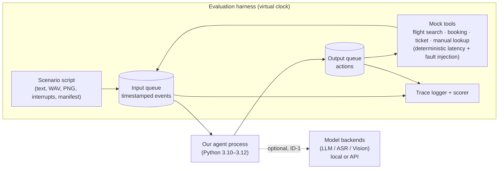

# Theme 05 — Interruptible Real-Time Agent: Architecture Rationale

| | |
|---|---|
| Project | Samsung PRISM Generative AI Hackathon 2026-27, Theme 05 "Interruptible Real-Time Agents" |
| Document role | **Rationale and context — non-normative.** The normative architecture is the section *FINAL ARCHITECTURE — APPROVED FOR IMPLEMENTATION* in [`ARCHITECTURE_REVIEW.md`](ARCHITECTURE_REVIEW.md), with its Terms and FINAL ARCHITECTURAL INVARIANTS. This document states no behavioural rule of its own; if anything here reads differently, the review wins. |
| Version | 1.0 (2026-09-29), after the hostile review and the consistency/decision phase |
| History | v0.1 is preserved verbatim in [`archive/ARCHITECTURE_v0.1.md`](archive/ARCHITECTURE_v0.1.md). Section numbers cited as "v0.1 §n" in the review refer to that file. |
| Diagrams | [`diagrams/`](diagrams/README.md) |
| Authoritative sources | `Theme 5_Guide.pdf` (v1.0.0), `Samsung PRISM_Y2026_GenAI_Hackathon_3rd_Edition.V2(2).pdf` |

---

## 0. Source analysis and repository audit

### 0.1 What the problem actually asks for (distilled from the Theme 05 guide)

| # | Requirement | Source (Guide §) | Architectural consequence |
|---|---|---|---|
| R1 | Agent communicates over **two asynchronous queues**: timestamped events in, actions out | §3 | The agent is an event processor, not a request/response chatbot. There is no "turn" API. |
| R2 | Inputs: text chunks + end-of-turn markers, WAV clips, PNG frames, interruption signals, **async tool results**, **tool manifests** | §3.1 | Tools are executed **by the harness**. We emit calls and receive results as events, so tool latency is never on our thread. |
| R3 | Outputs: spoken fillers, non-blocking tool calls with **explicit `call_id`**, cancellations, clarifications, final responses with **State Snapshots (intent + slots)** | §3.1 | The agent owns call identity. Snapshots are a first-class output, not a by-product of text generation. |
| R4 | Fast path in "a few hundred ms"; slow path for tools, multimodal, reasoning; coordination layer for non-blocking execution, cancellation, snapshots, idempotency | §1 | We need three separable concerns. The coordination layer is the heart of the system. |
| R5 | Floor management: meaningful responses quickly, **no false completion claims, no excessive fillers** | §3.2.1 | Speech must be derived from verified state, and fillers must be rate-limited. |
| R6 | Interruption recovery: cancel superseded in-flight calls **within a few ms grace period**, update snapshots, re-plan cleanly | §3.2.2 | Cancellation decisions cannot wait on an LLM. Part of understanding must be deterministic and in-process. |
| R7 | Session-scoped slots across turns; **localized slot corrections** | §3.2.3 | A correction must touch only the slot that changed and the work that depends on it. |
| R8 | Dynamic tool definitions from manifests (read-only vs state-modifying); **strictly no duplicate state-changing calls** | §3.2.4 | We need a manifest-driven registry and a mutation ledger, with no hard-coded tools. |
| R9 | Process audio and frames **behind conversational acknowledgements**; clarify ambiguous perception | §3.2.5 | Perception is asynchronous and produces evidence with confidence. |
| R10 | Well-formed JSON payloads with valid snapshots and identifiers | §3.2.6 | Every output passes schema validation before it leaves the agent. |
| R11 | Virtual-clock harness, deterministic replay, fault injection (latency, failure) for flight search, booking, ticket creation, frame-grounded manual lookup | §4 | Our own time source must be injectable, and our behaviour must be replayable. |
| R12 | 9 public / ~60 hidden scenarios, mix 50% text / 30% audio / 20% visual; interruptions, chained calls, retries, clarifications, **unseen tools**, **adversarial timing** | §4 | Tool handling must be generic. Timing robustness must come from structure, not tuning. |
| R13 | Score = Task Completion 40 + Interruption Recovery 35 + Latency 15 + Safety & Protocol 10, × quality multiplier 0.8–1.2 (naturalness, truthfulness, relevance); multimodal ×1.5 in hidden set | §5 | 75% of the score is correctness under interruption. Latency is 15% and measures only the **first substantive spoken action**. |
| R14 | Python 3.10–3.12, 120 s wall-clock cap per scenario, 300 s setup/warm-up hook, session-scoped memory only | §6 | We run as a single-process Python agent, load models during warm-up, and never cache across sessions. |
| R15 | Out of scope: wake word, voice synthesis tuning, UI design | §6 | We build no TTS and no UI product. A trace viewer is allowed as an engineering tool. |
| R16 | Focus areas: async event-loop orchestration, speculative execution, latency hiding, multimodal intent grounding | §6 | These are what the judges are primed to look for. |

Broader PRISM judging (main deck p.11): Working prototype 30%, Technical depth & feasibility 25%, Innovation 20%, Theme relevance 15%, Presentation & docs 10%. The final jury asks: *does it work, is it sound, would a user want it, can it become a worklet?* Submission needs a GitHub repo with README, Docker, a 5-minute video, a deck, and the release tag `PRISM_GENAI_HACKATHON_Y2026`.

### 0.2 Repository audit (as of 2026-09-29)

| Finding | Detail | Consequence |
|---|---|---|
| **No source code** | Only `fwdsamsungprismgenaihackathon3_0registrationli/` with PDFs, a pptx template and a docx | The design is greenfield. There is nothing to reuse or redesign. |
| **Not a git repository** | No `.git` | Submission requires a GitHub repo and a release tag. This must be fixed in Phase 0. |
| **Evaluation kit absent** | Guide §4: "released post the registrations" | The exact wire protocol, event field names, cancel semantics and clock semantics are all unknown. See §6 (UNK list). |
| Irrelevant material | `theme1_guidelines.pdf`, `Theme 2_...pdf`, `Theme 3 - Evaluation Criteria.pdf` (an Android APK rubric for Theme 3), `Theme 4 Guide_RAG.pdf` | Ignore these. Do not mix their criteria into ours. |
| **Inconsistency in main deck** | The Theme 05 slide lists "Corpus provided" and "begin retrieving before the utterance ends", which is copied from Theme 04 | The Guide v1.0.0 is authoritative. We will not build a RAG corpus pipeline; manual lookup is a harness-provided tool (Guide §4). |
| **Schedule risk** | The deck lists submission closing on 25 Sep 2026, and today is 29 Sep 2026 (dates are marked "tentative") | Confirm the live deadline with the organisers immediately (`prism@samsung.com`). This could make everything below moot. |
| Deliverable templates | `CollegeName_TeamName_Submission.pptx` (12 slides incl. architecture diagram slide), `LangAI3.0_AI_Disclosure.docx` | The AI-disclosure form requires feature-level provenance, so keep a log of AI-assisted work from day one. |

---

## 1. Executive summary

The agent is an event processor. Everything the harness sends arrives in one ordered **inbox**: text chunks, end-of-turn markers, audio clips, image frames, interrupt signals, tool manifests, and tool results, which may arrive late. A single **session kernel** processes one event per step. The step is synchronous, bounded to milliseconds, and never waits on a model or tool. The kernel is the only code that mutates session state. The planner, perception (speech-to-text and image understanding, in a separate worker process) and timers run concurrently, and they only return results as new inbox events.

Correctness under interruption rests on three separations:

- **What work vs which execution.** Every tool call has a *content key* (tool + canonical argument values) and a unique *call_id*. The active goal's task graph yields a *desired key set* from the current slot values. A call is DESIRED only while its key is in that set. When a correction changes a slot, the affected calls are **superseded** in the same step, and the harness receives an **advisory cancel**. Unrelated calls keep running.
- **Our decision vs the world's truth.** A call's *relevance* (DESIRED or SUPERSEDED) is our logical decision. Its *outcome* (PENDING, OK, FAILED_CLEAN or UNKNOWN) is what the harness reported. Every result is recorded, but only results of DESIRED calls are ever used, so a late or stale result can never reach an answer or a snapshot.
- **The semantic side effect vs its attempts.** A state-changing tool call belongs to an *operation* (goal, tool, instance tag). An operation allows at most one unresolved attempt and never a second create after success. Dispatch requires a commit barrier: turn closed, no interruption hold, slots confirmed.

The planner proposes and the kernel disposes: identifiers, cancellations, the operation ledger and snapshots are deterministic kernel functions. Speech is derived from state, so the agent never claims completion without a successful result. Every inbox event and every decision is journaled, so a run can be replayed offline and reproduce the same decisions.

---

## 2. Design principles

| # | Principle | Why (grounding) |
|---|---|---|
| P1 | **One writer, many workers.** Only the kernel mutates session state. Concurrency lives in effects, not in state. | R6, R7. Almost every interruption bug is a race on shared state. Removing shared mutable state removes the bug class. |
| P2 | **Correctness by validation, promptness by cancellation.** Late or stale results are rejected on arrival no matter what cancellation did. | R6, R13 (35% interruption). Cancellation can always lose a race with completion, but validation cannot. |
| P3 | **LLM proposes, kernel disposes.** Identifiers, snapshots, idempotency and cancellation are deterministic kernel functions. | R3, R8, R10. Safety & Protocol (10%) must not depend on sampling. |
| P4 | **Supersede locally.** A correction supersedes only the calls whose content key used the corrected value. | R7 ("localized slot corrections"), and the Theme 05 slide: "most systems … throw everything away and start over". |
| P5 | **Speak facts, not hopes.** Every utterance is grounded in a state transition that has already happened. | R5 (no false completion claims), quality multiplier (truthfulness). |
| P6 | **Mutations are committed deliberately.** No speculative, duplicate or blind-retried state-changing call, ever. | R8, R13 ("zero duplicate state-changing calls"). |
| P7 | **Time is an input.** No sleeps and no wall-clock reads in logic. Timers are events. | R11 (virtual clock), and replayability. |
| P8 | **The harness protocol is a detail.** Exactly one module knows its wire format. | The eval kit is not yet available (UNK). Hidden scenarios may add fields. |
| P9 | **Level-triggered, not edge-triggered.** The kernel reconciles *desired* state against *actual* state instead of reacting to individual edges. | R12 (adversarial timing). A duplicate, missing or reordered event cannot desynchronise a level-triggered reconciler. |
| P10 | **Build the least system that proves the claims.** No broker, database, vector store, multi-agent framework or microservices. | Hackathon scope, 120 s scenarios, and single-session memory. Complexity that the 9 public and ~60 hidden scenarios cannot exercise is pure risk. |

---

## 3. System context



**Explicitly outside the agent core:** tool execution (the harness does it), speech synthesis, wake word, UI, cross-session memory, retrieval corpora, and scoring.

---

## 4. High-level architecture



Reading guide and the full diagram set: [`diagrams/README.md`](diagrams/README.md).

### 4.1 Subsystem boundaries

| Subsystem | Owns | Must NOT do |
|---|---|---|
| **Protocol Adapter** | Wire format ↔ internal `Event`/`Action`; field mapping; ingest timestamps; loading media refs | Make decisions, hold state (beyond a dedupe window), or call models |
| **Session Kernel** | All session state; ordering; all decisions (supersede, cancel, dispatch, speak, clarify, snapshot); fast understanding (T0) | Any I/O, model call, sleep or wall-clock read. It must not block for more than a few ms. |
| **Reasoner (planner; optional fast mode)** | Mapping language + evidence + state summary → structured *proposal* (intent, slot updates, desired plan, response content) | Emitting actions, choosing `call_id`s, writing state, or deciding idempotency |
| **Perception worker process (ASR, Vision)** | Mapping raw media → typed *evidence* with confidence and provenance | Deciding slot values or talking to the user |
| **Timer service** | Turning "wake me at harness-time *t*" into a `TimerFired` event | Holding logic |
| **Tool Registry** | Parsing and validating manifests; argument validation and canonicalisation; side-effect class | Executing tools (the harness does) |
| **Trace journal** | Append-only record sufficient for deterministic replay and "why" queries | Being read by decision logic |

The boundaries follow the problem's own decomposition:

- **Perception** maps to ASR and Vision.
- **Reasoning** maps to the Reasoner.
- **Execution** maps to tool calls out through the Adapter.
- **Coordination** maps to the Kernel.
- **State** maps to SessionState.
- **Output** maps to the Adapter egress after the Guards.

---

## 5. Architectural alternatives considered

The problem is a concurrency and state-consistency problem (Guide §1), so the alternatives below differ in **where state lives and who serialises changes to it**. They are not deployment topologies.

| Approach | Description | Interruption correctness | State consistency | Latency | Determinism / testability | Hidden-set robustness | Build cost | Verdict |
|---|---|---|---|---|---|---|---|---|
| **A. Sequential agent loop + task cancellation** (ReAct-style, `task.cancel()` on interrupt) | One coroutine: listen → LLM → tool → LLM … | Poor. Cancel-and-restart discards valid work, and state is mutated mid-await, so races are likely | Weak | LLM on critical path | Low: behaviour depends on await interleavings | Weak on adversarial timing | Low | Rejected. It is the "half-duplex with a kill switch" the theme critiques. |
| **B. Multi-agent pipeline** (perception agent, planner agent, executor agent, speaker agent, each with own memory) | Actors message each other | Medium. Cancellation needs distributed agreement | Weak. Slots are replicated across agents and can drift | Good | Low to medium | Medium | High | Rejected. It adds consensus problems we would then have to solve. |
| **C. Blackboard** (shared state, knowledge sources fire opportunistically) | Classic AI architecture | Medium | Weak without locking, and locking re-creates A's races | Good | Low | Medium | Medium | Rejected. Its opportunism is the opposite of explainable traces. |
| **D. Reactive dataflow** (Rx-style streams; `switchMap` for supersession) | Streams of chunks → intents → calls | Coarse. `switchMap` cancels the *whole* upstream on any new input, which throws everything away | Implicit and scattered across operators | Good | Medium (virtual schedulers exist) | Medium | Medium | Rejected as the core. Its supersession granularity is wrong for localized corrections. |
| **E. End-to-end full-duplex speech model** (native duplex audio LLM) | One model does everything | Opaque | None explicit, so snapshots must be scraped | Excellent for speech | None | Weak on tools, IDs and schemas | High (GPU, weights) | Rejected. It fails Protocol and Snapshot requirements and is non-deterministic. |
| **F. Event-sourced single-writer kernel + effect executors + declarative plan reconciliation** (chosen) | Pure decide step over an ordered event log; effects asynchronous; content-keyed calls with last-writer-wins slot registers | **Strong.** Localized supersession plus admission control | **Strong.** One writer, versioned | Fast path ms; slow work never on the critical path | **Replayable bit-for-bit** | Strong. Level-triggered reconciliation tolerates reordering and duplicates | Medium | **Selected.** |

F borrows the right idea from each alternative:

- From **A**, the LLM-driven planning loop, demoted to a proposal source.
- From **D**, supersession, made fine-grained through content keys.
- From database systems, validation at the point of use (admission control) and last-writer-wins registers.
- From build systems and Kubernetes controllers, content-addressed nodes and level-triggered reconciliation.
- From statecharts, explicit floor and call lifecycles.

---

## 6. Unknowns the adapter isolates (from the evaluation kit)

| ID | Unknown | Default assumption until known |
|---|---|---|
| UNK-1 | Exact event and action JSON schemas | Adapter maps §7 and §14.1 to them |
| UNK-2 | Clock semantics: does agent compute time advance virtual time? How is latency measured? | The kernel reads time only from event timestamps; the timer worker supports both clock sources (review §7.4, gate G3). Measure in Phase 0. |
| UNK-3 | Does the harness acknowledge cancellations? Does a cancelled mock tool still return? | Handle both (review §10.2) |
| UNK-4 | Can we pass an idempotency key? | Send it if a field exists. The ledger guarantees safety regardless. |
| UNK-5 | Snapshot slot naming and schema | Tool parameter names |
| UNK-6 | Is every turn terminated with EOT? | EOT-silence timer fallback |
| UNK-7 | Is there a yield/stop-speaking action? Is speech duration simulated? | Emit YIELD if supported, else just stop further speech |
| UNK-8 | Network/GPU availability in the hidden evaluation environment | Decides ID-1…ID-4 (local vs API models) |
| UNK-9 | Does `Interrupt` precede, accompany or replace content? | Handle all three (Phase 0 is content-free) |

---

## 7. Performance model

### 7.1 Where latency is scored

Only two latencies are scored directly:

- **L1:** first substantive spoken action after user input or interruption (15%).
- **L2:** cancellation promptness after the input that supersedes a call (inside the 35%).

Everything else only has to fit in 120 s.

### 7.2 Critical paths

| Path | Steps | Budget | Notes |
|---|---|---|---|
| L2 cancel (text) | ingest → step → fast understanding (T0) → supersede → advisory cancel → egress | **< 5 ms** | No model involved. This is why T0 exists. |
| L1 text, established goal | end of turn → step → dispatch read-only call + templated acknowledgement → egress | < 10 ms | Later turns of a goal whose tool is already known |
| L1 text, first turn or new goal | end of turn → planner → step → speak | planner latency (~0.5–3 s); a fast planner mode only if measured necessary | Fast understanding cannot select a tool for an unseen manifest (review CF-16) |
| L1 audio | clip → ASR → fast understanding → speak | ASR + above | **ASR is the bottleneck.** Warm the model in setup; pick for latency. Audio cancel timing is gate G6. |
| L1 visual | frame → purpose ack (same step if intent known) | < 10 ms | Vision runs behind the ack |
| Planner | 0.5–3 s | never on L2 | On L1 only for a first turn / new goal; gates state-changing slot confirmation and final wording |

### 7.3 Blocking points and mitigations

- **Event-loop starvation from CPU-bound inference.** Heavy inference runs in a separate worker process or remote endpoint, never a thread in the kernel's process (review CF-12). A loop-lag test fails if lag exceeds 20 ms.
- **Kernel step cost.** decide/apply split with no state copying; large tool results are held by reference.
- **Serial reasoner requests.** At most one in flight per purpose. A newer input cancels the older one, so no queue builds up behind stale work.

### 7.4 Latency hiding and avoided work

- **Pre-end-of-turn work:** optional planner calls on partial transcripts, only after measurement. Speculative tool calls are removed (review §5).
- **Warm-up hook (300 s):** load and warm ASR, vision and LLM clients; compile T0 lexicons; open HTTP keep-alive. **No scenario data is cached** (R14).
- **Deterministic continuation** avoids a planner call per chained hop (§12.3).
- **Model-call triage.** No reasoner call for backchannels, duplicate chunks, or results that advance a fully-bound plan.
- **Prompt structure.** The static prefix (instructions + manifest) sits first, so provider-side prompt caching can apply within a session.
- **Parallel DAG nodes** are issued in the same step.

---

## 8. Extensibility strategy

| New thing | Where it plugs in | Core change? |
|---|---|---|
| Tool / tool schema | Manifest → Registry; T0 recognisers regenerate; the planner sees the manifest | None |
| Modality | New ingress event kind + a perception effect emitting `EvidenceReady` claims | One dispatch-table entry |
| Scenario | Data, not code | None |
| Interruption pattern | T0 lexicon/recogniser additions; interruption policy constants | None (policy module) |
| Reasoning strategy / model | Reasoner port backend | None |
| Execution policy (retry, barrier, filler, interruption) | Policy functions and constants | None |
| Protocol revision | Adapter only | None |

The rule we follow: a new *kind of input* costs one table entry, and a new *instance* (tool, scenario) costs zero code.

---

## 9. Security and reliability considerations

- **Untrusted inputs.** User speech, frames (text in images), tool results and manifests are untrusted. The model only *proposes*. Tool calls must name registry tools with schema-valid arguments. State-changing calls need user-originated provenance (review F6). Tool-result text and frame text are passed to the model as quoted data, never as instructions.
- **Session isolation.** One kernel instance per session. No module-level mutable state beyond warmed model handles. The warm-up hook loads weights only.
- **Resource bounds.** There are caps on concurrent calls, retries and reasoner concurrency, plus the deadline governor for the 120 s cap and timeouts on every effect.
- **Secrets.** Model API keys, if any (ID-1), come only from the environment and are never logged. The trace redacts headers.
- **Failure containment.** Effect errors become events, and a kernel exception rolls back the step. Protocol validity is maintained even when intelligence degrades.

---

## 10. Risks and mitigations

| Risk | Likelihood | Impact | Mitigation |
|---|---|---|---|
| **Deadline already passed** (deck: 25 Sep) | Unknown | Fatal | Confirm the timeline with the organisers **today** |
| Eval kit protocol differs from assumptions | High | Medium | AD-11: adapter-only change. Phase 0 is protocol lock. |
| Virtual clock counts our compute time differently than assumed (UNK-2) | Medium | High (latency score) | Measure on public suite in Phase 0. The Clock port supports both semantics. |
| No network in hidden env → API LLM unusable (UNK-8) | Medium | High | Reasoner port; local model option evaluated in Phase 0; rule backend fallback |
| T0 heuristics misattribute a correction (origin vs destination) | Medium | Medium | Abstain on ambiguity; admission control guarantees correctness; the planner's later proposal overrides by last-writer-wins |
| Scorer penalises speculative/cancelled calls | Medium | Low–Med | Speculative tool calls removed; re-enable only with public-suite evidence |
| Snapshot slot naming mismatch (UNK-5) | Medium | High (Task Completion) | Pin from kit; mapping table in adapter |
| Model latency spikes | High | Medium | Fast understanding carries L1 for established goals and all cancellations; planner never on the cancel path; timeouts + fallback |
| Over-engineering eats the schedule | Medium | High | Phased roadmap with a scoring-harness run gating each phase; P10 |
| Templated speech lowers quality multiplier | Medium | Low–Med | Grounded LLM realisation for answers; templates only for acks |

---

## 11. Recommended repository / module structure

```
Prism/                              # becomes the git repo
├── README.md                       # setup, run, reproduce scores
├── Dockerfile
├── pyproject.toml
├── docs/
│   ├── ARCHITECTURE.md             # this document (rationale)
│   ├── ARCHITECTURE_REVIEW.md      # normative final architecture
│   ├── diagrams/                   # Mermaid sources + SVG/PNG
│   ├── archive/                    # v0.1 history
│   └── source/                     # PRISM PDFs (moved from the download folder)
├── agent/
│   ├── entry.py                    # harness hooks: setup/warm-up, run_session
│   ├── adapter.py                  # ONLY harness-aware module (AD-11)
│   ├── kernel/
│   │   ├── model.py                # Event, Action, SessionState, Slot, CallRecord, Plan dataclasses
│   │   ├── step.py                 # the reducer + dispatch table
│   │   ├── supersede.py            # supersession + result admission
│   │   ├── reconcile.py            # plan DAG diff
│   │   ├── policies.py             # floor/speech, retry, barrier, interruption, deadline — constants here
│   │   ├── guards.py               # operation lock, commit barrier, provenance, truthfulness
│   │   └── t0.py                   # schema-derived recognisers, correction/backchannel lexicons
│   ├── tools.py                    # ToolSpec, validate, canonicalise, content key, operation id
│   ├── effects/
│   │   ├── reasoner.py             # port + backends (LLM, scripted) + proposal schema
│   │   └── perception_worker.py    # separate process: ASR + vision
│   ├── runtime.py                  # event loop, inbox, effect executor, Clock port, timers
│   └── trace.py                    # journal writer + replay loader
├── tools/
│   └── timeline.py                 # trace → swimlane HTML (demo/debug)
└── tests/
    ├── test_kernel.py              # handlers + invariants (property-based)
    ├── test_races.py               # schedule fuzzing, seeded
    ├── test_tools.py
    └── replays/                    # golden traces of public scenarios
```
We start with the fewest files that respect the boundaries, and split a file only when it grows past comfortable review size.

---

## 12. Demonstrability (what the jury sees)

Every demo is a normal scenario run followed by the journal's timeline. None of them is a special demo mode.

1. **Change your mind mid-search** ([diagram 03](diagrams/03_interruption_recovery.svg)). The old search is superseded in the same step as "to Mumbai"; its late result is recorded but never used.
2. **Correction races a booking** ([diagram 05b](diagrams/05b_booking_race.svg)). The operation lock prevents a second booking, and the agent reports the race truthfully.
3. **Rapid self-repairs** (review attack #6). Three corrections inside one open turn produce exactly one ticket, because nothing is dispatched while the turn is open.
4. **"Look at this"** ([diagram 06](diagrams/06_multimodal_pipeline.svg)). An instant acknowledgement, perception runs behind it, and conflicting evidence becomes a specific question.
5. **Fault injection live.** Latency and timeouts produce grounded progress narration, read-only retries, and the UNKNOWN-outcome handling for state-changing tools.
6. **Deterministic replay** ([diagram 07](diagrams/07_trace_replay.svg)). A recorded run replayed offline, with models disconnected, reproduces identical decisions.

## 13. Where the detailed design lives

| Topic | Normative location in `ARCHITECTURE_REVIEW.md` | v0.1 history |
|---|---|---|
| Terms (content key, relevance, outcome, operation, …) | FINAL ARCHITECTURE → Terms | — |
| Kernel, concurrency boundary | §6, F1–F2 | v0.1 §6.2 |
| Event model, staleness fences, time | §7, F2 | v0.1 §7 |
| State model, slots, snapshots, evidence | §8, F3 | v0.1 §8 |
| Understanding tiers, fast-path rights, interruption policy | §9, F4–F5, §16 D3–D5 | v0.1 §6.4, §9, §10 |
| Tool execution, operation ledger, reconciliation | §10, F6, §16 D1–D2, D6–D7 | v0.1 §11, §12 |
| Speech, snapshots, deadline | F7 | v0.1 §9.4–9.5 |
| Protocol boundary | §12, F8 | v0.1 §6.1, §14 |
| Trace and replay | §11, F9 | v0.1 §16 |
| Invariants and tests | FINAL ARCHITECTURAL INVARIANTS, §18 of v0.1 for test layers | v0.1 §18 |
| Roadmap | F10 | v0.1 §24 |
