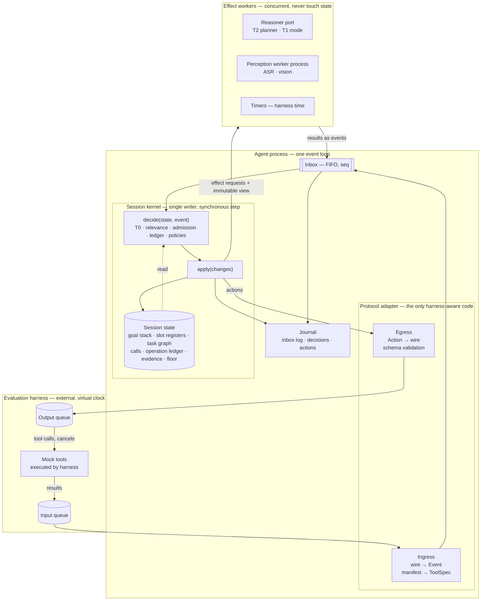
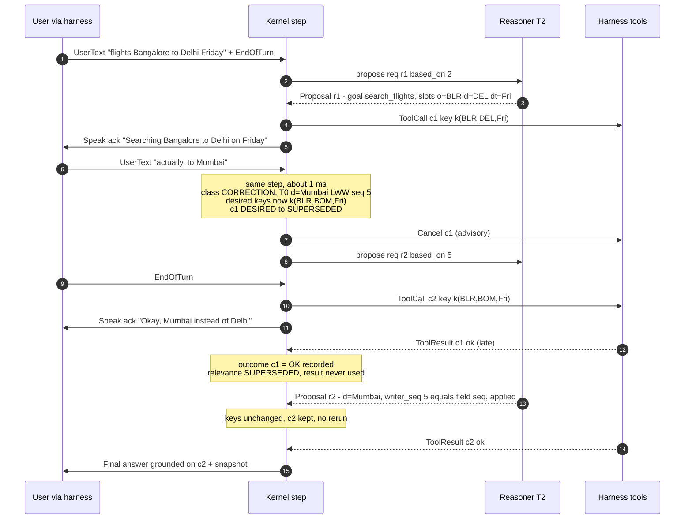
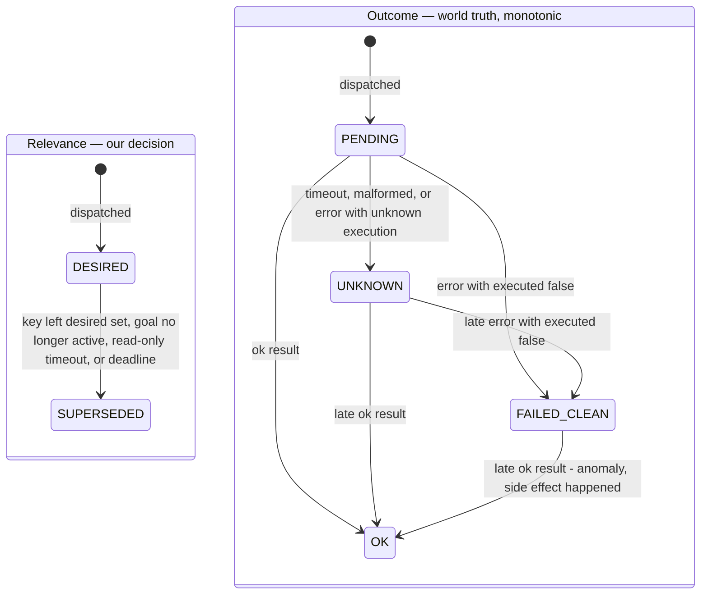
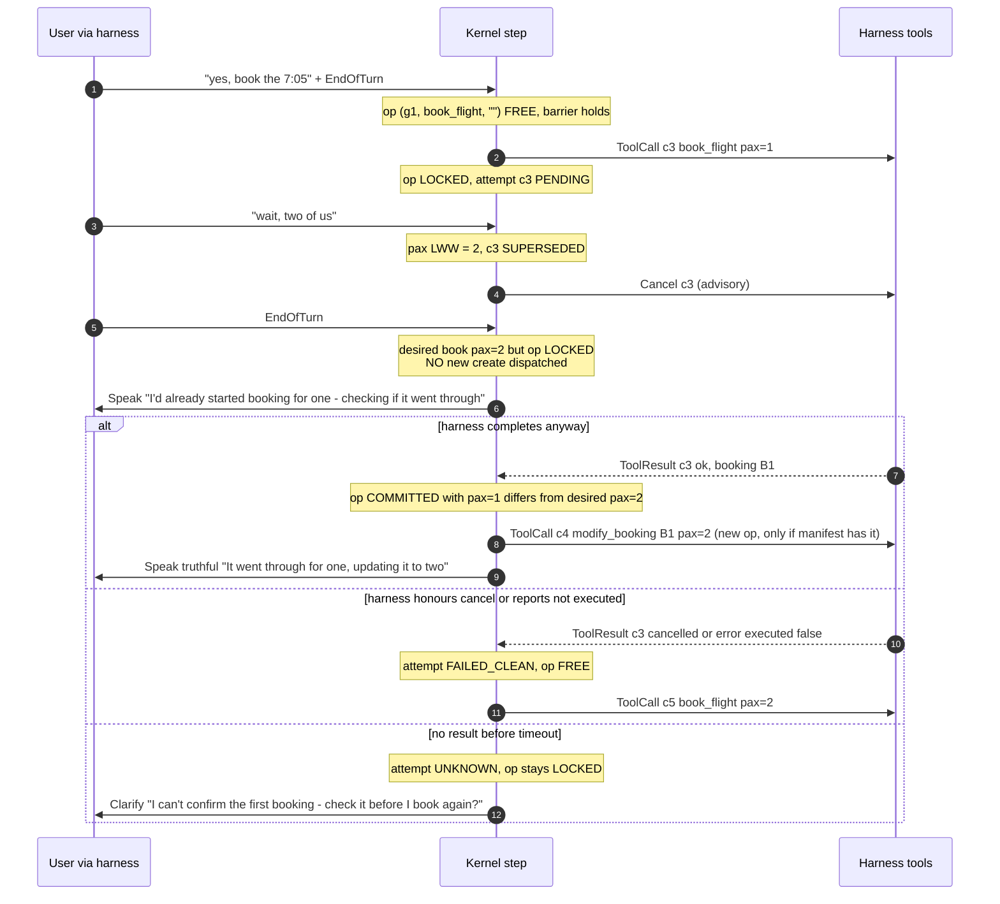
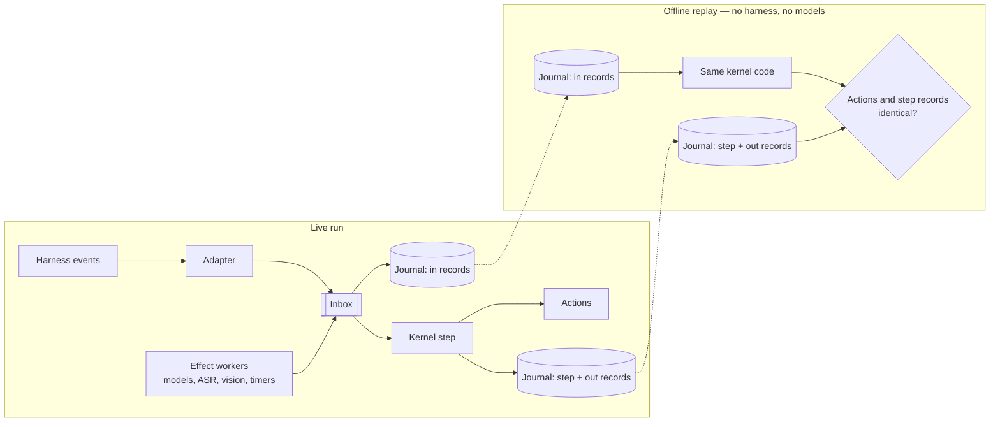

# Theme 05 — Hostile Architecture Review

| | |
|---|---|
| Reviews | `docs/ARCHITECTURE.md` v0.1 (2026-09-29) |
| Diagrams | [`docs/diagrams/`](diagrams/README.md): final diagram set drawn from this review |
| Consistency phase | 2026-09-29: remaining contradictions resolved in §16 (D1–D7); final Terms and FINAL ARCHITECTURAL INVARIANTS added; approval checklist at the end |
| Review date | 2026-09-29 |
| Source of truth | `Theme 5_Guide.pdf` v1.0.0 (§3.2 objectives, §4 evaluation kit, §5 scoring, §6 constraints); PRISM deck p.11 judging criteria |
| Outcome | **v0.1 is not approved as written.** It has two critical safety flaws, one requirement it fails by construction, and several over-built components. §15 contains the revised architecture that survives review, and it supersedes v0.1 wherever the two conflict. |

Reviewer stance: every mechanism in v0.1 is assumed guilty until a scoring criterion or a concrete failure scenario justifies it.

In the tables below, **RO** means read-only tool and **SM** means state-modifying tool.

---

## 1. Architecture Review Summary

**What survives.** The core bet is correct: a single serialising owner of session state per session, with all slow work pushed into asynchronous effects that report back as events. No alternative examined (lock-based shared state, per-subsystem actors, reactive streams) removes the race class this problem is built around (Guide §1: "a concurrency and state-consistency challenge"). The same holds for:

- LLM-proposes / kernel-disposes;
- validating results when they arrive (admission control);
- a manifest-driven registry;
- replay from a journal.

**What breaks.**

1. **The idempotency ledger allows double booking** (CF-1). It keys side effects by *arguments*. Two different argument sets for the same user intent get two different keys, so a corrected booking can be dispatched while the original one is still in flight. The ledger "passes" and the harness sees two state-changing calls. This directly violates "zero duplicate state-changing calls" (Guide §5, Safety & Protocol).
2. **Read-set invalidation has a hole** (CF-2). It only tracks arguments that the planner bound as `$slot` references. Any literal argument the LLM writes (`"destination": "DEL"`) has an empty read-set. That call survives the correction and its result is admitted. This is exactly the "stale work survives" failure that Interruption Recovery (35%) scores.
3. **The "wait 100–400 ms for T1" interruption policy fails the requirement by construction** (CF-3). The Guide asks for cancellation "within few ms grace period" (§3.2.2), and no model call fits in a few ms. The policy also still relies on a model's judgement for cancellation.
4. **"Interruption" was defined too broadly** (CF-4). v0.1 treats any user content while work is pending as an interruption. A user answering our own clarification question, or asking "how long will this take?", would have triggered cancellation logic.
5. **Stale-proposal rejection is all-or-nothing and can starve** (CF-5). Any newer input (even "uh-huh") discards a whole planner proposal, so a user who keeps talking can prevent the planner from ever landing.
6. **Timers are undefined under a virtual clock** (CF-9). v0.1 never says how our timers fire if harness time only advances via events.

**What is over-built.** The following add code and failure surface without a matching scoring benefit, and are removed or cut back (§5):

- the copy-on-write state;
- the egress-error feedback loop;
- a second in-kernel schema validation;
- per-slot version arithmetic;
- speculative tool calls;
- NLP entity-checking of generated text;
- hold-time result buffering;
- the read-only cancel-grace state.

**Net result.** The revised architecture (§6–§11, consolidated in §15) is *smaller* than v0.1 and safer:

- Validity is decided by **content keys + a relevance/outcome split**, not per-slot version maths.
- Side-effect safety is decided by **operation instances**, not argument hashes.
- The interruption policy **never waits on a model to cancel**.

---

## 2. Critical flaws discovered

| ID | Severity | Flaw | Where in v0.1 (`archive/ARCHITECTURE_v0.1.md`) | Concrete failure | Scoring impact |
|---|---|---|---|---|---|
| **CF-1** | **Critical** | Side-effect identity = `hash(tool, canonical_args)`. A corrected mutation gets a new key, and nothing blocks it while the old attempt is unresolved. | §11.1, §11.4, §10.5 "free to book with new args (new key k6)" | `book(pax=1)` in flight → "two of us" → cancel sent, no ack → EOT → `book(pax=2)` passes ledger (different key) → old booking's result arrives ok → **two bookings**. | Safety & Protocol 10% (zero duplicates); Task Completion 40% |
| **CF-2** | **Critical** | Read-sets only cover args the LLM expressed as `$slot` refs. Literal args escape invalidation. | §6.5 "where possible", §10.3 | T2 emits `search(dest="DEL")` as a literal; user corrects to Mumbai; T0 bumps `dest`; `c1.read_set` has no `dest` → not cancelled → its result is admitted and spoken. | Interruption Recovery 35% |
| **CF-3** | High | When T0 abstains, cancellation waits for T1 (100–400 ms) | §10.2 | Guide: "within few ms grace period". This fails deterministically on every unattributable interruption, and on **every audio interruption** (ASR comes before T0). | Interruption Recovery |
| **CF-4** | High | Interruption = any user content while work is pending or agent speaking | §7.4 | The agent asks "which date?" while an unrelated read-only call runs; the user answers "the cheaper one". T0 abstains → treated as unresolved interruption → wrong cancellation (or a hold on valid work). A status question during a slow call would do the same. | Task Completion; latency (reruns) |
| **CF-5** | High | Proposal fence discards the whole proposal if `based_on_seq < last_user_input_seq`, and backchannels count as input | §7.5, INV-10 | Continuous user speech with chunks every 300 ms and T2 at ~1 s → every proposal is superseded → no plan, no mutation, no snapshot until the user stops. An "uh-huh" during agent speech discards a correct proposal. | Task Completion; latency |
| CF-6 | Medium | Unlabeled tools default to state-modifying, combined with a strict ledger | §6.3, AD-15 | Hidden "unseen tool" manifest omits the side-effect flag on `lookup_order`. It is treated as SM, so re-lookup after a correction is blocked by exclusion (with CF-1's fix applied) or is never speculated. | Task Completion on unseen tools |
| CF-7 | Medium | One session-wide slot table shared by all intents | §8.2 | A flight intent's `date` is inherited by a later ticket intent's `date` (different meaning); snapshot slot sets become polluted across goals. | Snapshot accuracy (Task Completion) |
| CF-8 | Medium | "Bit-for-bit replay" has unguarded non-determinism sources | §1, §16, §18 | Python `hash()` randomisation (PYTHONHASHSEED) changes set iteration order and content-key values; `Clock.now()` read inside decisions; effect outputs stored as *digests*, not values; media re-processed on replay. | Testability; jury credibility |
| **CF-9** | High (unknown) | Timer semantics under a virtual clock unspecified | §6.2, AD-10 | If harness time advances only via events, a `call_timeout` at harness-time *t+5* never fires when the harness is silent. If virtual time runs faster than wall time, wall-clock timers fire late. | Retries, timeouts, deadline governor |
| CF-10 | Low–Med | Validity by slot *version* causes needless reruns on value reverts (ABA) | §10.3 | Fri(v1) search completes → "Saturday" (v2) → "no, Friday" (v3): the Friday result is valid data but its read-set says v1 ≠ v3 → re-run. | Latency, extra calls. **Resolved (D1): the re-run is accepted deliberately.** |
| CF-11 | Medium | Snapshot emitted only from CONFIRMED slots, and confirmation depends on T2 | §8.4 | Planner outage → no confirmed slots → FINAL snapshot empty/stale, although T0 had the right values. | Task Completion (snapshot accuracy) |
| CF-12 | Medium–High | CPU inference "in an executor thread" | §6.6, §17.3 | Pure-Python pre/post-processing holds the GIL, which stalls the kernel loop. If the harness queues are in-process `asyncio` queues (plausible from "two asynchronous queues"), we also stall the *harness*. | Latency; cancel promptness |
| CF-13 | Medium | Hold "buffers results and admits after re-understanding" | §10.2 | Hidden queue with undefined release semantics. If T2 fails, buffered results are never released. Nobody can say from the trace when a result became visible. | Task Completion; traceability |
| CF-14 | Medium | Every mutation requires T2-CONFIRMED slots | §11.4 | Model outage or slow model → no mutation ever → scenario fails, although the user stated everything unambiguously. | Task Completion |
| CF-15 | Medium | Outcome transitions are not monotonic facts. A late `ok` after an earlier error/timeout isn't modelled. | §11.2 | `create_ticket` times out (UNKNOWN) → retry blocked → late `ok` for the original arrives → v0.1 has no transition UNKNOWN→COMMITTED in the call state machine, only in prose. | Safety; truthfulness |
| CF-16 | Medium (honesty) | Trace A claims L1 ≈ 1 ms on the *first* turn by having T0 pick `search_flights` | §25 Trace A | T0 cannot select a tool for an unseen manifest on turn one. First-turn L1 is bounded by T1/T2 unless a lexical match is unambiguous. The document overstated latency. | Credibility in Q&A |

---

## 3. Assumptions that are currently unsafe

| # | Assumption in v0.1 | Why unsafe | Treatment |
|---|---|---|---|
| U1 | The harness honours `CancelCall` (tool stops) | Guide says "cancellations" are an *output*. Nothing says mock tools stop or acknowledge. | **Assume cancel is advisory.** Design for "tool completes anyway" (§10). |
| U2 | Cancel acknowledgement exists | Not in Guide | Never required for safety. It is only an accelerator if present. |
| U3 | Idempotency key can be passed to tools | Not in Guide | Agent-side exclusion is the guarantee (§10). The key is only sent if the wire schema has the field. |
| U4 | Harness latency clock = our clock; our compute time is measured in harness time | Unspecified ("virtual clock") | UNK-2. Measure with a stub agent in Phase 0. Timers get dual semantics (§7.4). |
| U5 | Agent owns `call_id` format | Guide: "explicit `call_id`" suggests agent-generated, but the format is unknown | Adapter maps; the kernel's ids are opaque strings |
| U6 | Harness events carry unique ids | Unspecified | Dedupe by id only if present. Never dedupe by content (a user can repeat "yes"). |
| U7 | `Interrupt` means real barge-in, not VAD noise | Unspecified | A content-free `Interrupt` never cancels tools (§9). |
| U8 | Transcript and audio of the same utterance never both arrive | Unspecified | Harness transcript is authoritative when both exist (§8.5) |
| U9 | Network / GPU available in hidden env | Unspecified; Docker submission | Reasoner port + scripted fallback; decided in Phase 0 (UNK-8) |
| U10 | Agent runs in a separate process from harness | "two asynchronous queues" may mean in-process asyncio | Heavy inference goes in a **separate process or remote endpoint**, never a thread in the loop's process (CF-12) |
| U11 | Snapshot slot names = tool parameter names | Unspecified | Adapter mapping table; confirm with kit (UNK-5) |
| U12 | Speech actions are instantaneous text | Harness may simulate speech duration for barge-in | Floor flag `agent_speaking` is set/cleared from harness signals if provided, else by our own emission |
| U13 | Scenario ends when we emit FINAL | Unknown; the scenario may continue after FINAL (new request) | The kernel never shuts down on FINAL; `SessionEnd` or the cap ends it |
| U14 | A slow T2 is acceptable because only "first substantive speech" is scored | The 120 s wall cap is wall-clock; chains of 3+ planner calls with retries can approach it | Planner calls only when needed (deterministic continuation); deadline governor |

---

## 4. Components that should be redesigned

| Component (v0.1) | Problem | Redesign |
|---|---|---|
| Mutation ledger keyed by args | CF-1 | **Operation-instance ledger:** one logical side effect per `(goal, tool, instance_tag)`; attempts inside it; strict exclusion (§10.3) |
| Per-call slot-version read-sets | CF-2, CF-10, complexity | **Content-key validity:** every tool argument must be bound to a slot or to a node output; the kernel resolves args; a call stays DESIRED only while its content key ∈ current desired key set (§8.3) |
| Call state machine (single axis) | Mixes our decision with the world's truth (CF-15) | **Two axes:** `relevance ∈ {DESIRED, SUPERSEDED}` (our logical decision) × `outcome ∈ {PENDING, OK, FAILED_CLEAN, UNKNOWN}` (world's truth, monotonic) (§10.1) |
| Interruption policy (wait for T1) | CF-3, CF-4 | **Decide at arrival, never wait on a model** (§9) |
| Whole-proposal staleness fence | CF-5 | **Per-field last-writer-wins by input seq:** stale proposals are partially applied, never wholesale-discarded; backchannels are not writers (§7.3) |
| Session-wide slot table | CF-7 | **Goal-scoped slot registers** with explicit carry-over by the planner (§8.2) |
| Commit barrier requiring T2 | CF-14 | Mutation requires *confirmed* slots, where "confirmed" = confirmed by T2 **or** user-stated in a closed turn with unambiguous T0 attribution **or** explicitly confirmed by the user. On planner failure → one deterministic confirmation question. (§10.4) |
| Snapshot = CONFIRMED only | CF-11 | Snapshot = current best value per slot (confirmed > proposed); FINAL always emits it (§8.4) |
| Timer service | CF-9 | Timers keyed to **harness time**, driven by whichever clock UNK-2 establishes; the kernel reads "now" only from the event being processed (§7.4) |
| Perception executors in threads | CF-12 | Separate worker process (or remote endpoint) per heavy model; results return as events (§6) |
| Unlabeled tool = SM | CF-6 | Classify from manifest field → else name/description verb lexicon (`get/search/list/find/lookup/check/status` → RO) → else SM. The classification and its reason are traced. (§10.5) |
| Trace with digests | CF-8, sufficiency | Journal stores **full inbox events** (incl. effect outputs), plan revisions with desired-key sets, and rule-tagged decisions; replay feeds the inbox log (§11) |

---

## 5. Components that should be removed (over-engineering check)

| Component in v0.1 | Class | Rationale |
|---|---|---|
| Single-writer session kernel | **ESSENTIAL** | Only structure that removes the state-race class. It is cheap in Python asyncio. |
| Ordered inbox with `seq` | **ESSENTIAL** | Total order for decisions and replay |
| Protocol adapter (ingress/egress/manifest/results) | **ESSENTIAL** | Unknown wire protocol (U1–U13) |
| Tool registry + arg validation + canonicalisation | **ESSENTIAL** | Unseen tools; Safety & Protocol |
| Result admission control | **ESSENTIAL** | Correctness when cancellation loses the race (U1) |
| Operation-instance ledger | **ESSENTIAL** | CF-1 |
| Task graph + desired-key reconciliation | **ESSENTIAL** (small) | Supersession, keeping still-desired calls, and chained calls. Graphs are ≤ ~5 nodes; no graph engine. |
| T0 deterministic tier | **ESSENTIAL** (narrow) | Only way to cancel within ms on text. Scope is restricted (§9.2). |
| T2 planner (LLM) | **ESSENTIAL** | Unseen tools, argument extraction, final wording |
| T1 fast understanding | **USEFUL** | Needed only for first-turn L1 when T2 is slow. It is a *mode* of the reasoner port (small prompt / small model), not a component. Built after measuring T2 latency. |
| Scripted reasoner backend | **ESSENTIAL for tests**, OPTIONAL in production | Tests need deterministic proposals; production fallback is the confirmation-question path |
| Goal stack (intent frames, suspend/resume) | **USEFUL** | Guide objective "changes in goals without losing session context". Implemented as a list. |
| Floor handling | **USEFUL**, simplified | Three flags (`user_turn_open`, `agent_speaking`, `hold`); the statechart diagram is documentation, not code |
| Filler budget + progress narration | **USEFUL** | "no excessive fillers" (Guide §3.2.1). Two constants. |
| Truthfulness guard | **ESSENTIAL**, simplified | Act-type gating only (no `confirm`/`answer` without an OK outcome) |
| NLP entity-check of LLM-realised text | **REMOVE** | Fragile, slow, hard to test. Replace with: LLM realises answers only from a provided fact list; confirmations use templates. |
| Copy-on-write state per step | **REMOVE** | Replace with a **decide → apply** split. `decide` reads state and returns a change list + actions; `apply` performs plain assignments. The exception boundary is `decide`. |
| Second (in-kernel) schema validation of actions | **REMOVE** | Actions are built by typed constructors. One schema validation at egress against the kit schema. |
| `EgressError` feedback event | **REMOVE** | A rejected FINAL is a bug to catch in tests, not a runtime path. The adapter logs and emits a minimal template fallback itself. |
| Read-only cancel-grace timer & `CANCELLED` state | **REMOVE** | Logical cancellation is immediate and final for read-only calls; waiting for acks adds states without changing decisions |
| Hold-time result buffering | **REMOVE** | CF-13. Results are always admitted by the normal rule; `hold` only blocks mutation dispatch and FINAL. |
| Speculative (pre-EOT) tool calls | **REMOVE for now** (OPTIONAL later) | Unmeasured benefit, and possible scorer penalty for cancelled calls. Re-enable only with public-suite evidence. |
| Pre-EOT T1 on partial transcripts | **OPTIONAL** | Latency hiding; adds cancellation churn. After measurement. |
| Evidence fusion "policy engine" | **USEFUL**, simplified | A fixed rule table (§8.5) |
| Compensation (modify/cancel tools) automation | **OPTIONAL** | Default is to ask the user. Auto-compensate only if the manifest has an explicit modify/cancel tool and the kit's scenarios show it expected. |
| Deadline governor | **ESSENTIAL** | The 120 s cap is fatal otherwise. It is a single timer. |
| Trace journal + inbox-log replay | **ESSENTIAL** | Trace-based evaluation; debugging races |
| Timeline viewer | **OPTIONAL** | Demo artefact; a static HTML render of the journal |
| Seeded schedule-permutation tests | **ESSENTIAL** | The only way to reproduce the adversarial timing class |
| Property-based random event generation | **USEFUL** | After seeded permutation tests exist |
| Message broker / DB / vector store / agent framework / microservices | **REMOVE** (never added) | No requirement they serve: one session, 120 s, harness-provided tools |

---

## 6. Revised architecture

### 6.1 Concurrency boundary (review item A)

**Verdict: one serialising kernel per session is the correct boundary.** Alternatives fail as follows:

- **Per-goal kernels:** goals share slots and the floor, so the kernels would need coordination.
- **Locks on shared state:** this re-creates await-point races, and makes replay depend on scheduling.
- **Actors per subsystem:** state gets replicated across actors.

| Must be serialised (inside one `step`) | May run concurrently (effects / I/O) |
|---|---|
| Every read and write of session state | T1/T2 model calls |
| `call_id` / `action_id` allocation | ASR, vision (separate process) |
| Relevance decisions (supersede / keep / dispatch) | Waiting on harness tools (they run in the harness) |
| Outcome recording and ledger transitions | Journal writes (append-only, fire-and-forget) |
| Ordering of emitted actions (a cancel precedes the replacement call) | Media decoding / file loads in the adapter |
| Timer arming / disarming | Prompt/context assembly for the reasoner (from an immutable view passed at request time) |

**Hazards and answers:**

- **Throughput.** ≤ a few hundred events per 120 s scenario. A 1–5 ms step gives more than 100× headroom.
- **Reentrancy.** `step` is synchronous. It never awaits and never calls back into itself. Effects are *started after apply*, and their completions are enqueued, never invoked inline.
- **Ordering.** FIFO by arrival `seq`. The harness's delivery order is preserved for equal timestamps.
- **Starvation.** It is impossible while steps are bounded. The only unbounded risks are T0 regexes (use literal lexicons and simple tokenisation; no backtracking patterns) and context assembly (moved into the effect).
- **Long-running handlers.** They are forbidden by construction. A step-duration histogram is emitted in the trace, and a test fails if p99 > 5 ms.
- **Rapid interruptions.** Each chunk is one step. Supersession and outcome recording are idempotent, so N interruptions produce at most one cancel per call.
- **Process isolation (CF-12).** Heavy models run in a worker *process* (or remote), so the kernel's loop and a possibly in-process harness never stall on the GIL.

### 6.2 Revised component diagram



Solid arrows are data or control flow within a step, or asynchronous messages. Every arrow that crosses the kernel boundary is asynchronous.

---

## 7. Revised event model

### 7.1 Envelope (unchanged fields kept, two added)

```
Event { eid, seq, kind, t (harness time of the event, authoritative "now" for this step),
        t_recv, turn_id, cause[], corr{call_id, req_id, plan_rev, timer_id, frame_eid},
        payload,
        content_bearing: bool,      # NEW: false for backchannels/hesitations/empty/duplicate EOT
        writer_seq: int | None }    # NEW: for effect results = based_on_seq of the request
```

### 7.2 Kinds (normalised by the adapter)

| Normalised kind | Produced from | Notes |
|---|---|---|
| `Manifest` | tool manifest | Adapter converts the wire format → `ToolSpec` list. The registry never parses wire JSON. |
| `UserText` | text chunk (harness) **or** `Transcript` (ASR effect) | One path for both modalities. Carries `source: harness|asr`, confidence. |
| `EndOfTurn` | explicit marker, or EOT-silence timer | Timer-generated EOT is flagged `inferred=true` |
| `Media` | WAV / PNG arrival | Triggers the perception effect; marks user activity |
| `Evidence` | vision effect | Claims keyed to the frame, not to a goal |
| `Interrupt` | harness barge-in signal | Content-free by definition |
| `ToolResult` | harness | `outcome_hint ∈ ok|error(executed?:bool|unknown)|cancelled_ack|malformed` |
| `Proposal` / `ProposalFailed` | reasoner effect | `writer_seq = based_on_seq` |
| `Timer` | timer worker | purposes: `tool_timeout`, `progress`, `eot_silence`, `deadline` |
| `SessionStart` / `SessionEnd` | harness | |

### 7.3 Staleness fences (revised)

| Fence | Rule | Replaces |
|---|---|---|
| **Per-field LWW** | Every slot register and the goal's intent field store `writer_seq`. An update from any source applies iff `update.writer_seq ≥ field.writer_seq`. Harness input writes with its own `seq`; proposals write with `based_on_seq`. **Only content-bearing inputs advance `last_content_seq`.** | Whole-proposal discard (CF-5) |
| **Structure fence** | A proposal's *goal/intent change* and *task graph* apply only if no content-bearing input arrived after `based_on_seq` that changed the intent (T0 goal-switch marker). Otherwise the structure is dropped and its slot updates are still considered field-by-field. | — |
| **Relevance fence** | A tool result may be *used* only if its call is `DESIRED` | Slot-version fence (CF-2, CF-10) |
| **Outcome recording** | A tool result is *always recorded* as world truth (monotonic outcome), whether used or not | New (CF-15) |
| **Frame association** | Evidence is keyed by frame; applied to a goal only if the frame is the latest frame attached to that goal's turns (§8.5) | Intent-epoch fence for evidence |

**Anti-starvation property.** A proposal is never discarded wholesale because of later input. At worst its fields lose to newer writers. So continuous speech cannot livelock planning.

### 7.4 Time

- The kernel's notion of "now" is **only** `event.t` of the event being processed. There are no clock reads in `decide`. This is what makes replay exact.
- Timers are armed in harness time. The timer worker fires them using the clock that UNK-2 establishes:
  - **(a)** If the harness exposes a virtual clock or ticks, subscribe to it.
  - **(b)** Else use wall time mapped at the last event.

  Both choices are hidden behind the timer worker. **This is a Phase 0 blocking unknown** (G3).

---

## 8. Revised state model

### 8.1 Canonical state

```
SessionState {
  rev: int                                   # ++ per step that changes anything (the "state revision")
  last_content_seq: int
  floor: { user_turn_open, agent_speaking, hold }
  turns: [Turn{turn_id, texts[], media[], closed, inferred_eot, kind: REQUEST|ANSWER|INTERRUPTION|STATUS_QUERY|BACKCHANNEL}]
  goals: [Goal]                              # goal stack; exactly one ACTIVE (or none)
  calls: {call_id: Call}
  ops: {op_id: Operation}                    # side-effect ledger (§10.3)
  evidence: {frame_eid: Evidence}
  pending: [Pending{kind: CLARIFY|CONFIRM, goal, slots[], asked_seq}]
  reasoner: {req_id: {purpose, based_on_seq}}
  registry: ToolRegistry (versioned)
}

Goal {
  goal_id, status: ACTIVE|SUSPENDED|COMPLETED|ABANDONED,
  intent: Register<str>,
  slots: {name: Register<value>},             # goal-scoped (CF-7)
  graph: TaskGraph, plan_rev: int
}

Register<T> { value, writer_seq, source: T0|T1|T2|USER_CONFIRMED|EVIDENCE|CARRIED,
              confirmed: bool, confidence, history: [(value, writer_seq, source)] }
```

### 8.2 Consistency rules

1. **Single writer, LWW per field.** Contradictory corrections resolve by `seq`: "Fri → Sat → Fri" ends at Fri, and `history` records all three for the trace.
2. **Confirmed values** (required for state-changing dispatch) come from any of:
   - T2 with `writer_seq` current;
   - user confirmation;
   - an unambiguous T0 attribution in a *closed* turn with no correction marker after it;
   - evidence with confidence ≥ θ and no conflicting user value.

   A later write with a different value un-confirms the field.
3. **Goal switch** pushes the current goal to `SUSPENDED` and creates a new goal. Carry-over of slots happens only through planner proposals (source `CARRIED`), never implicitly.
4. **Committed side effects are facts**, stored in `ops`. They are never deleted or rewritten by corrections (§10.3).
5. **Derived state is not stored.** Desired keys, snapshots and "what to say" are recomputed from state in each step. Nothing derived can go stale.

### 8.3 Is slot versioning sufficient? (review item B)

It is **not sufficient**, and the version arithmetic is not needed at all. The identity that decides validity is the **content key** (*what* work a call does). `call_id` remains the *execution* identity (*which* dispatch). Both are defined in the final Terms.

- Every tool argument is bound to a **slot** (`$slot`), a **node output** (`$node.path`), or a **manifest constant**. A literal from the LLM is converted at proposal admission: if its value equals a current slot value, it is rebound to that slot; otherwise the literal is written *into* a slot of the same parameter name (so it becomes a tracked writer). No unbound argument can exist, which closes CF-2.
- `desired_keys(goal)` = the content keys of all graph nodes whose bindings resolve against *current* registers and the outputs of DESIRED upstream calls with outcome OK.
- A call is `DESIRED` iff `key ∈ desired_keys` of an `ACTIVE` goal. Otherwise it is `SUPERSEDED`.

How this handles the stress cases:

| Stress case | Behaviour |
|---|---|
| Multiple slots change in one step | Keys are recomputed once per step. Every call whose key changed is superseded in that step. |
| Dependencies between slots / derived state | Downstream nodes bind to upstream outputs. If the upstream call is superseded, its output is unusable, so the downstream bindings don't resolve and the downstream key disappears → superseded transitively. No explicit dependency walk is needed. |
| Correction affecting one branch | Only keys on that branch change. Parallel branches keep their keys and calls (localized). |
| Value revert (ABA, CF-10) | **Resolved by D1:** a call, once SUPERSEDED, is never used again, whether it completed before or after supersession. The reverted key has no DESIRED call, so a new call is dispatched when the turn closes. Reverts inside one open turn cost nothing, because nothing is dispatched while the turn is open (D5). |
| Stale model result | Per-field LWW (§7.3) |
| Stale multimodal result | Frame association (§8.5) |

`rev` (the state revision) and `plan_rev` (the revision of a goal's desired key set) survive as **trace identifiers**, not as validity mechanisms (final Terms).

### 8.4 Snapshots

`snapshot(goal) = {intent: goal.intent.value, slots: {k: r.value for r in goal.slots if r.value is not None}}`

This is the best current value, whether confirmed or proposed (CF-11). Emission points:

- every FINAL;
- after an interruption changes intent or slots, at the step that closes the interrupting turn;
- on explicit status query if the kit expects it.

The snapshot is a pure function of state and is validated at egress.

### 8.5 Multimodal evidence (review item I)

| Rule | Detail |
|---|---|
| Keyed by frame | `Evidence{frame_eid, turn_id, claims{key: (value, conf)}}`. Claims are **image facts**, independent of the goal that asked. |
| Association | A frame attaches to the turn it arrived in (or the next turn if no turn is open) and so to that turn's goal |
| Consumption | When a goal needs slot `k` and an attached frame has a claim for `k`, write the register (source `EVIDENCE`, `writer_seq` = frame's seq) via LWW |
| Multiple frames | Newer frame's claims win per key (higher seq) unless its confidence < θ_low and the older's ≥ θ |
| Text before image | Goal known → the vision request includes the goal's open slot names as hints |
| Image before text | Generic extraction (description + visible text + key/value claims); no re-query unless a required slot is still missing after text arrives |
| Audio vs transcript | Harness transcript is authoritative. ASR is used only for audio without a transcript. If both exist and disagree on a slot value → treat as conflict (clarify before mutation). |
| Goal changes while vision runs | Evidence is still recorded under its frame. It is applied only to goals the frame is attached to. The new goal uses it only if the planner explicitly carries the frame over. |
| Old visual processing finishes late | Same as above. It never changes the active goal's slots unless attached; no speech about it. |
| Evidence vs user statement conflict | User value wins for read-only work. **Mutations blocked** until a clarification resolves it. |

---

## 9. Revised interruption model (review items D, H)

### 9.1 What counts as an interruption (fixes CF-4)

A closed or ongoing user turn is classified by T0 at each chunk:

| Class | Detection (deterministic) | Effect on in-flight work |
|---|---|---|
| `BACKCHANNEL` | Lexicon ("uh-huh", "okay", "mm", "um") with no other content | None; not a writer; does not advance `last_content_seq` |
| `ANSWER` | A `pending` clarification exists and the turn contains a value of the asked slot's type, or no correction/goal-switch marker | None pre-emptively; handled as a normal slot write |
| `STATUS_QUERY` | Question markers ("how long", "what's happening", "are you still") with no values | None; answer from state |
| `CORRECTION` | Correction marker ("no", "actually", "wait", "instead", "make it", "change … to", "not X") **or** T0 resolves a value for an already-filled slot to a different value | See §9.2 |
| `GOAL_SWITCH` | Goal-switch markers ("forget that", "never mind", "cancel that", "instead can you") | See §9.2 |
| `REQUEST` | Anything else | None pre-emptively; T2 decides |

An explicit harness `Interrupt` with no content only does two things: it **yields the floor** (stops speech) and sets `hold`. It never cancels tools (U7). `hold` clears as defined in D4.

### 9.2 Strategy comparison for unattributable content

| Strategy | Cancel latency | Wrong cancels | Stale work survives? | Reruns | Verdict |
|---|---|---|---|---|---|
| S0 wait for T1 (v0.1) | 100–400 ms+ | Few | No (admission) | Few | **Rejected.** It fails the "few ms" grace by construction. |
| S1 cancel all in-flight read-only calls on any interruption | ~1 ms | Many (status questions, answers) | No | Many | Rejected. It throws valid work away and penalises the "one parameter changed, other op valid" case. |
| S2 localized only; never cancel when T0 abstains | ~1 ms when resolved; T2 latency otherwise | None | No (admission) | None | Too slow on abstain |
| **S3 (chosen)** localized when T0 resolves; **goal-scoped cancel of read-only calls** when a correction/goal-switch marker is present but attribution fails; nothing otherwise | ~1 ms whenever a marker or value is present | Only calls of the active goal, and only when the user explicitly signalled a change | No (admission) | Bounded to marked corrections | **Chosen** |

Evidence for S3 from the Guide:

- **"Promptly cancel superseded in-flight tool calls (within few ms grace period)"** (§3.2.2). A few ms rules out any model in the cancellation path, so the decision must come from deterministic signals available at arrival. Correction and goal-switch markers are exactly the signal that something was superseded.
- **"absence of stale re-runs"** (§5). S3 never re-issues a superseded key, because superseded keys are gone from the desired set.
- **"Accessibility: resolving speech hesitations and conversational self-repairs"** (§2). This is why backchannels and hesitations must not trigger cancellation.

### 9.3 Audio interruptions

For audio, the invalidating content is inside the WAV, and T0 needs ASR first. Two options:

- **(a) Default:** decide at `Transcript` arrival using S3. Cancel latency ≈ ASR latency.
- **(b) Option:** on an audio clip that arrives while the agent speaks or a read-only call of the active goal is in flight, cancel those read-only calls immediately (S1 scoped to the goal), and let reconciliation re-issue what is still desired.

(a) is chosen unless Phase 0 shows that the scorer measures grace from clip arrival. **This is a measured decision, not a guess** (G6).

### 9.4 Lifecycle (revised)



Note on first-turn latency (CF-16). On the first turn, the first *substantive* action waits for tool selection (T1/T2). T0 only issues read-only calls for goals whose tool is already established. The document no longer claims ~1 ms L1 on turn one.

### 9.5 What the fast path may decide

| Allowed (same step, deterministic) | Forbidden |
|---|---|
| Classify the turn (§9.1) | Change the active goal. It may only *flag* a goal switch. |
| Write slot registers as `T0` proposed values (unambiguous only) | Confirm a slot, except rule 8.2-2's closed-turn case |
| Supersede calls whose keys change, read-only and state-changing alike, and emit the advisory cancel per D3 | Dispatch a **state-changing** call except through the operation lock and commit barrier (D3) |
| Goal-scoped read-only cancel on marked-but-unattributed corrections | Emit FINAL, or `confirm`/`answer` speech |
| Dispatch read-only calls for an *established* goal whose keys resolved, once no user turn is open (D5) | Select a tool for a goal no model has established |
| Yield floor, set hold, arm timers | Wait on any effect |
| Ack speech restating what it recognised ("Okay, Mumbai instead of Delhi") | State anything not in the registers |

**Three tiers?** The separation that matters is **deterministic in-step (T0) vs model effects**. T1 is not a separate architectural tier; it is the reasoner port in a cheap mode, justified only by measured first-turn latency (§5).

---

## 10. Revised tool execution model (review items C, F)

### 10.1 Two orthogonal axes per call



- **Physical cancellation** is an *action* (`Cancel{call_id}`) sent to the harness. It is advisory, never a state.
- **Logical cancellation** is relevance becoming `SUPERSEDED`. It is immediate, final and local.
- **Supersession** is the cause of logical cancellation: a key change, a goal switch, or the deadline.
- **Stale-result rejection:** results of `SUPERSEDED` calls are never used for speech, bindings or snapshots. The only permitted reference is reconciliation of a COMMITTED operation (D6).
- **Side-effect completion:** outcome `OK` on a state-modifying call is recorded no matter what the relevance is.
- **State reconciliation:** the kernel compares the desired graph with `ops` facts to decide what to do next (§10.4).

### 10.2 The three race cases, exactly

| Case | Read-only call | State-modifying call |
|---|---|---|
| **C1** started → interruption → still executing → cancel sent → completes anyway | At the interruption step: `SUPERSEDED` + advisory cancel. Result: outcome OK recorded; never used. | At the interruption step: `SUPERSEDED` + advisory cancel (if `cancellable != false`); the operation stays **locked**. Result OK → op `COMMITTED` → reconcile (§10.4): truthful speech, then modify/cancel tool if allowed, else ask. |
| **C2** started → completes → interruption → cancel attempted | Result already applied. At the interruption step its key leaves the desired set: relevance `SUPERSEDED`, **no cancel emitted** (outcome already known). New key dispatched. | Op already `COMMITTED`. **No cancel emitted.** Reconcile as above. If our cancel crosses a result still in transit (harness already sent it), the cancel is harmless and the result is handled as in C1. |
| **C3** started → interruption → cancel → new plan starts → old result arrives later | New call c2 is independent. c1's late result: outcome recorded, never used, no effect on c2. | **The new create is not dispatched while the old attempt is PENDING/UNKNOWN** (operation lock, §10.3). The new plan waits: (a) the old result arrives OK → reconcile; (b) FAILED_CLEAN or cancel-ack → lock released → new attempt with new args; (c) timeout → UNKNOWN → verify with a read-only status tool if the manifest has one, else ask the user. This is the fix for CF-1. |

### 10.3 Operation-instance ledger (fixes CF-1)

**Identity of a side effect:**

- `op_id = (goal_id, tool, instance_tag)`. The planner supplies `instance_tag` only when the user explicitly wants multiple instances ("book one for me and one for my colleague"); the default tag is `""`.
- The **semantic operation** is the unit of exclusion. Arguments are an attribute of each *attempt*.

```
Operation { op_id, attempts: [Attempt{call_id, args_key, outcome}], state }
state = FREE        — no attempts, or all attempts FAILED_CLEAN
      | LOCKED      — some attempt PENDING or UNKNOWN
      | COMMITTED   — some attempt OK (terminal for "create"; only modify/cancel ops may follow)
```

Rules the agent enforces from its side (the safest protocol available without trusting the tool):

1. **Dispatch** a state-modifying call only if its op is `FREE` and the commit barrier holds (no open turn, `hold` false, all read slots confirmed, no pending clarification on those slots).
2. **Syntactically different arguments for the same semantic action** don't matter, because exclusion is by `op_id`, not by arguments. Canonical `args_key` is used only to send the *same* idempotency key on a legitimate retry.
3. **Retry** only when every prior attempt is `FAILED_CLEAN` (explicitly not executed). Same args → same idempotency key (if the wire supports it).
4. **Lost result / cannot tell whether it happened:** op `LOCKED` via `UNKNOWN`. Never re-dispatch the create. Verify with a read-only lookup tool if the manifest offers one, else tell the user truthfully ("I'm not certain the booking went through") and ask.
5. **Already completed externally** (user says "I already booked it", or the tool returns a conflict/already-exists error): record the op `COMMITTED` (source: external) and never create.
6. **Interrupt immediately after dispatch:** `SUPERSEDED` + advisory cancel; op stays `LOCKED` until the outcome resolves. Speech: "I'd already started the booking — checking whether it went through."
7. **Tool not idempotent:** irrelevant to our guarantee. We never send a second create for an op unless every prior attempt is known not to have executed.
8. **Anomaly** `FAILED_CLEAN → OK` (harness says not executed, then ok): record `COMMITTED`, flag in the trace, reconcile. Our dispatch was still defensible.

### 10.4 Reconciliation (level-triggered, per step)

For the active goal:

1. Compute `desired_keys`.
2. **Read-only:** once no user turn is open (D5), dispatch every desired key that has no `DESIRED` call, regardless of SUPERSEDED calls with the same key (D2). A DESIRED call with outcome OK keeps serving its key (D1). Calls whose keys are not desired are superseded, with an advisory cancel if their outcome is not yet known (D7).
3. **State-modifying:** for each desired SM node, look up its op:
   - `FREE` + barrier → dispatch;
   - `LOCKED` → wait (progress narration if long);
   - `COMMITTED` with matching args → done;
   - `COMMITTED` with different args → **compensation decision**: a modify/cancel tool exists and is allowed → a *new op* on that tool; else CLARIFY.
4. **Commit barrier fallback (CF-14).** If T2 fails and a mutation's slots are all proposed but unconfirmed, ask one templated confirmation question naming the values. A "yes" confirms them.

This is idempotent. Re-running it after a duplicate or reordered event emits nothing new.

### 10.5 Tool classification and timeouts

- **Classification:** manifest field → verb lexicon on name/description (read-only verbs: get, search, list, find, lookup, check, status, fetch, query) → default SM. The reason is recorded (CF-6).
- **Timeouts:** manifest hint or policy default, in harness time.
  - Read-only: timeout → supersede + advisory cancel + retry with a new `call_id` in the same step (max 2; D2, D7).
  - State-modifying: timeout → outcome `UNKNOWN` (never retried blindly).
- **Malformed result:** read-only → treat as error, retry once. SM → `UNKNOWN`.
- **Conflicting outputs:**
  - between attempts of the same key: only the `DESIRED` attempt's result is used;
  - between different desired tools: the planner reconciles semantically, and the kernel does not pick winners;
  - duplicate result for the same call_id: first recorded outcome wins except for the monotonic transitions in §10.1.

### 10.6 Revised booking race (CF-1 fix, visualised)



---

## 11. Revised trace / replay model (review item J)

### 11.1 Is v0.1's journal sufficient?

Not quite. It can't reconstruct *plan revision → dispatch* causality, because desired-key sets aren't journaled. It can't replay, because effect outputs are stored as digests. And it relies on clock reads inside decisions.

### 11.2 Journal records (JSONL)

| Record | Content | Answers |
|---|---|---|
| `header` | code version (git sha), policy constants, `PYTHONHASHSEED`, registry digest | "Which build and settings?" |
| `in` | the **full normalised event** as delivered to the inbox (incl. effect outputs in full; media by path + hash) | Replay input |
| `step` | `seq`, `rev_before→rev_after`, `turn_class`, **rules fired** (named, e.g. `T0.correction`, `LWW.apply`, `REL.supersede`, `OP.lock_block`, `ADM.record_outcome`, `BARRIER.block`), register writes (old→new, writer_seq, source), relevance changes with **the desired-key set at this plan_rev**, outcome changes, op state changes | "Why was c1 ignored?" → `REL.supersede c1: k(BLR,DEL,Fri) ∉ desired@plan_rev 3 (d: DEL→Mumbai by seq 5)` |
| `out` | action with `action_id`, `caused_by=[seq]`, `rule`, and for tool calls: node id, key, bound args with their register `writer_seq`s | "Why this exact call at this time?" → issued at step seq 6 by `REC.dispatch` because key k(BLR,BOM,Fri) ∈ desired@4 and no DESIRED call held it |
| `fx` | effect start/end: req_id, based_on_seq, duration, cancelled | Latency attribution |
| `metric` | per-turn L1 (first substantive speech), L2 (invalidating input → cancel), step-duration p99, #supersessions, #reuses, #fillers | Scorecard |

### 11.3 Replay



- **Replay = feed the recorded `in` sequence (which already contains every effect result at its original position) into a fresh kernel.** No model, harness or timer runs, because their outputs are already inbox events.
- **Determinism requirements (CF-8):**
  - no reads of wall time in `decide` (use `event.t`);
  - no iteration over sets (use insertion-ordered dicts or sorted lists);
  - content keys via a stable hash (e.g. SHA-256 of canonical JSON), never `hash()`;
  - no randomness;
  - the policy constants from the header.
- **Test use:**
  - golden replays of public scenarios;
  - **seeded schedule permutation**: take a journal, permute the order of effect/tool-result events within configurable windows, replay, and assert the FINAL ARCHITECTURAL INVARIANTS. A failing seed is a reproducible bug.
- **Answering "why":** a small CLI `why <call_id|action_id>` walks `out.caused_by → step.rules → in` records.

---

## 12. Protocol boundary (review item K)

| Layer | Owns | Knows the wire? |
|---|---|---|
| **Harness input adapter** | Event field names; timestamps & clock; EOT representation (flag vs event); interrupt semantics (U7); media encoding (path/base64) → file ref; duplicate ids (U6); transcript-vs-audio pairing (U8) | Yes |
| **Harness output adapter** | Action encoding; `call_id` format (U5); speech act → wire type (filler vs response); FINAL + snapshot schema and slot naming (U11); optional fields (`caused_by`, idempotency key U3); egress schema validation | Yes |
| **Tool adapter** (functions in the adapter module, not a service) | Manifest JSON → `ToolSpec`; side-effect flag name; result → `outcome_hint` (ok / error+executed / cancel-ack U2 / malformed) | Yes |
| **Internal core** (kernel, registry, reasoner, perception, journal) | Normalised `Event`, `Action`, `ToolSpec`, `outcome_hint` only | **No** |

Rule: when the kit arrives, the adapter module and its tests change, and nothing else does. A test enforces that no core module imports adapter wire types.

---

## 13. Hidden-test attack matrix

Notation: RO = read-only tool, SM = state-modifying tool, c# = call ids, t in harness seconds.

| # | Attack | Timeline | v0.1 behaviour | Failure point in v0.1 | Revised behaviour |
|---|---|---|---|---|---|
| 1 | Interrupt 1 ms before RO completion | c1 search(DEL) @0.5; "to Mumbai" @2.000; c1 ok @2.001 | Cancel c1; late result discarded | None (if the arg was a `$slot`); fails via CF-2 if literal | Supersede c1 @2.000, cancel; c1 OK recorded, unused; c2 dispatched at EOT |
| 2 | Interrupt 1 ms *after* RO completion (result delivered first) | c1 ok @2.000; "to Mumbai" @2.001 | c1 applied, then marked stale; rerun with new args | OK | c1 superseded, **no cancel emitted** (C2); c2 at EOT |
| 3 | Interrupt 1 ms before SM completion | c3 book(pax1) @4.0; "two of us" @4.300; c3 ok @4.301 | Cancel; COMPLETED_AFTER_CANCEL; reconcile | OK *unless* EOT arrives first with no result → **double booking** (CF-1) | Op LOCKED blocks the pax=2 create until c3 resolves; then reconcile (§10.6) |
| 4 | Correction immediately after SM completion | c3 ok @4.30; "two of us" @4.31 | Reconcile | OK | Op COMMITTED; compensation op or clarify; never a second create |
| 5 | SM dispatched, result lost forever | c3 @4.0, nothing | Timeout → UNKNOWN; block re-issue of *same key* | New args (after correction) bypass it (CF-1) | Op LOCKED/UNKNOWN; verify via RO lookup or ask; no create |
| 6 | Three self-repairs in one open turn | "priority high" / "no, medium" / "um actually high" / EOT | Barrier holds SM; one create | OK | Same; "um" is a backchannel token inside a CORRECTION turn, no writer effect |
| 7 | Three corrections each followed by EOT while RO in flight | dest DEL→BOM→GOI→BOM, each with EOT, 300 ms apart | Cancel/issue churn; version ABA forces reruns | Extra calls (CF-10) | Each correction supersedes (advisory cancel while the outcome is unknown). When BOM returns, a new call is dispatched at turn close even if BOM's first call is still PENDING (D2). No superseded result is ever reused, completed or not (D1). |
| 8 | Stale result after several replans | c1, c2 superseded; c3 active; results arrive c2, c1, c3 | Discarded by call state | OK | Outcomes recorded; only c3 used |
| 9 | Duplicate input event (same eid) | chunk "Mumbai" delivered twice | Adapter dedupe | OK if ids exist | Same; without ids, LWW rewrite of the same value = no key change = no effect |
| 10 | Duplicate tool result (same call_id, different content) | c1 ok{A} then ok{B} | Second dropped | OK | First recorded outcome wins; content conflict flagged in trace |
| 11 | Delayed cancellation (harness processes cancel after completion) | cancel c3 @4.30; harness completes c3 @4.35 | COMPLETED_AFTER_CANCEL | OK | Same (C1) |
| 12 | RO timeout then late result | c1 timeout @5.0 → c2 retry; c1 ok @5.4; c2 ok @6.0 | c1 discarded | OK | c1 superseded at timeout (advisory cancel); c2 dispatched in the same step (D2); c1's late OK recorded, unused; c2 used |
| 13 | SM timeout then late OK | c3 timeout @6.0 → UNKNOWN; c3 ok @7.2 | Prose only, no transition | CF-15 | UNKNOWN→OK → COMMITTED; truthful update ("it did go through") |
| 14 | SM explicit not-executed error, retry, then late OK of first | c1 err{executed:false}; c2 retry ok; c1 ok late | Unmodelled | Double side effect unaccounted | Anomaly FAILED_CLEAN→OK recorded; op has two OK attempts → truthful report + compensation/clarify; trace shows harness contradiction |
| 15 | Slot correction and conflicting frame evidence in the same ms | "actually Saturday" @3.000; Evidence{date: Fri} from earlier frame @3.000 | Fusion → clarify | OK | LWW by seq; user value (newer seq) wins for RO; SM blocked until clarify, since evidence conflicts with user value |
| 16 | Goal switch while vision runs; vision finishes later | Frame @0.2 (troubleshoot); "forget it, book a flight" @1.0; Evidence @1.8 | Epoch fence; evidence kept | OK | Evidence recorded under frame → attached to suspended goal only; no speech, no slot writes to the flight goal |
| 17 | Image arrives after the text that refers to it | "what does this error mean" @0.2 EOT; Frame @0.9 | Turn closed; frame starts effect | Frame's association ambiguous | Frame arriving within the EOT-window of a turn that references visual deixis ("this", "the photo") attaches to that turn; otherwise to the next turn |
| 18 | Two frames, the second clearer | Frame1 @0.2 (code 4C .52); Frame2 @1.0 (4E .91) | Unspecified | Ambiguity | Per-key newest-frame wins (4E .91); if the user already said "4C" → conflict → clarify |
| 19 | Audio clip and transcript disagree | Transcript "Mumbai"; ASR of the same clip "Mumbra" | Unspecified | Unspecified | Harness transcript authoritative; disagreement on a slot value → conflict flag, clarify before SM |
| 20 | Malformed tool result | c1 ok{} missing required fields | FAILED(malformed) | OK | RO: error → retry once; SM: UNKNOWN (never retried) |
| 21 | Malformed manifest | one tool with invalid JSON Schema; another without side-effect flag | Quarantine; unlabeled = SM | CF-6 blocks legit re-lookups | Quarantine; classify by verb lexicon, default SM, reason traced |
| 22 | Result for unknown call_id / EOT before any chunk | stray ToolResult c99; EOT with empty turn | Dropped / ignored | OK | Same, traced as `ADM.unknown_call` / `TURN.empty` |
| 23 | Partial transcript, no EOT ever | "book it for Fri—" then silence | EOT-silence timer | Timer semantics undefined under virtual clock (CF-9) | Inferred EOT via harness-time timer; turn closed `inferred=true`; SM requires committed slots (T2 or confirmation), so no blind booking |
| 24 | One parameter changes while another long op stays valid | c1 search(dest) + c2 weather(origin) parallel; "actually to Mumbai" | Localized via read-sets | OK if both `$slot`-bound | Only c1's key changes → c1 superseded; c2 untouched and used |
| 25 | Status question during slow call | c1 in flight 6 s; user "how long will this take?" | Treated as interruption; T0 abstains → hold + wait (CF-4) | Possible wrong cancel / held results | `STATUS_QUERY` → no cancel; answer from state ("still searching Friday fares") |
| 26 | Answer to our clarification while unrelated RO runs | Clarify "which date?"; c2 lookup running; user "the earliest one" | Interruption path | CF-4 | `ANSWER` → normal write; nothing cancelled |
| 27 | Content-free barge-in (cough) during agent speech | Interrupt @2.0, no text | Hold; no content | Hold release timing unclear | Yield floor; `hold` set; the end-of-turn silence timer armed at the interrupt clears it if no content follows (D4); no cancel |
| 28 | Continuous talker (planner starvation) | chunks every 250 ms for 6 s; T2 1 s | Every proposal discarded (CF-5) | No plan until silence | Per-field LWW applies proposal fields not overwritten since `based_on` |
| 29 | Planner outage for the whole scenario | all T2 requests fail | Fallback vague | SM never commits (CF-14) | Deterministic single-tool derivation where unambiguous; one confirmation question for SM; truthful failure otherwise |
| 30 | Approaching 120 s cap with SM LOCKED | t=110 s, c3 pending | Governor emits FINAL | OK | FINAL states "booking still being confirmed" (truthful), snapshot of current registers |

---

## 14. Architecture-to-evaluation mapping

Scoring categories (Guide §5): **TC** Task Completion 40%, **IR** Interruption Recovery 35%, **RL** Response Latency 15%, **SP** Safety & Protocol 10%. **QM** is the quality multiplier.

| Mechanism | Problem addressed | Category | Expected benefit (justified) | Potential downside | Test demonstrating it |
|---|---|---|---|---|---|
| Single-writer kernel, synchronous step | Races on shared state | IR, TC | Removes interleaving-dependent outcomes; a precondition for every other guarantee | All decisions serialised (≤ 5 ms each; measured) | Step-duration p99 test; seeded permutation replay |
| T0 turn classification + deterministic attribution | Cancel within ms; don't cancel on status/answers | IR, RL | Cancel latency = step latency for marked/resolved corrections | Heuristic misses → cancel delayed to T2 (still correct via relevance) | Attack #1, #24, #25, #26; L2 metric |
| Content-key relevance + reconciliation | Stale work survival; localized supersession; keeping unaffected work | IR, TC | A key that is not desired is never dispatched, and a superseded call's result is never used ("absence of stale re-runs") | Requires every arg bound (rebinding logic) | Attack #7, #8, #24; INV-06–09, INV-12 |
| Outcome axis (monotonic facts) | Late results, cancel-vs-complete races | IR, SP | Truthful state regardless of arrival order | Anomaly handling for contradictory harness outcomes | Attack #11–#14 |
| Operation-instance ledger | Duplicate side effects under correction | SP, TC | Makes "zero duplicate state-changing calls" an invariant enforced by construction | May block legitimate second instances until the planner tags them | Attack #3–#5; INV-13, INV-16 under permutation |
| Commit barrier (+ confirmation fallback) | Mutating while the user is still correcting | SP, IR | No SM dispatch during an open turn | Mutation latency (unscored) | Attack #6, #29 |
| Per-field LWW proposals | Stale model output; planner starvation | TC, IR | Stale proposals can't overwrite newer user input; planning always lands | Partial application may yield an incomplete plan → re-request | Attack #28 |
| Goal-scoped registers + goal stack | Goal switches without losing context; snapshot hygiene | TC | Snapshot contains only the active goal's slots | Cross-goal carry-over relies on the planner | Goal-switch scenario; snapshot equality test |
| Snapshot as a pure function, emitted on FINAL and after interruption | Snapshot accuracy / validity | TC, SP, IR | Snapshot never disagrees with state | Snapshot may show proposed (unconfirmed) values | INV-21; INV-22 |
| Speech from state + act gating + filler budget | False completion claims; filler spam; first substantive action | QM, RL | No "done" before an OK outcome; bounded fillers | Templated phrasing may lower naturalness | INV-20; filler count metric |
| Frame-keyed evidence + LWW + conflict → clarify | Ambiguous/late multimodal evidence | TC (×1.5 multimodal), SP | Wrong perceptions never silently drive mutations | Extra clarification turns | Attack #15–#19 |
| Perception in a separate process | Loop stall (GIL / in-process harness) | RL, IR | Kernel keeps ms-scale steps during inference | IPC complexity | Loop-lag test under concurrent inference |
| Protocol adapter isolation | Unknown wire format | SP | Kit changes are localised | One more mapping layer | Import-boundary test; egress schema tests |
| Deadline governor | 120 s cap | TC | A FINAL + snapshot always exists | May finalize with an incomplete task (truthfully) | Attack #30 |
| Journal + inbox-log replay | Trace-based evaluation; race debugging; jury questions | all (indirect) | Every decision explainable; bugs reproducible | Journal size | Golden replay equality; `why` CLI output |

We claim no score gain for T1, speculation or compensation automation until measured.

---

## 15. Final Architecture Approval Gate

| # | Decision | Status after review | Blocking? |
|---|---|---|---|
| **G0** | Confirm the submission deadline is still open (deck: 25 Sep; today 29 Sep) | Open | **Blocks all work** |
| G1 | Single-writer kernel per session; decide/apply step; no awaits in step; heavy models in a separate process | Approve | — |
| G2 | Relevance × Outcome call model; physical cancel is advisory; results always recorded, used only if DESIRED | Approve | — |
| G3 | Timer/clock semantics (UNK-2) measured with a stub agent before the kernel's timer code is written | Open | Blocks Phase 2 timers |
| G4 | Content-key relevance with mandatory argument binding (no unbound literals); per-slot version arithmetic dropped | Approve | — |
| G5 | Operation-instance ledger with strict exclusion (FREE / LOCKED / COMMITTED) | Approve | — |
| G6 | Interruption policy S3; audio option (a) vs (b) decided by public-suite measurement | Approve S3; audio open | Measured in Phase 3 |
| G7 | Per-field LWW for proposals and evidence; backchannels are not writers | Approve | — |
| G8 | Goal-scoped slot registers; carry-over only via planner | Approve; confirm snapshot naming (UNK-5) from kit | UNK-5 |
| G9 | Removed components (§5) stay removed unless public-suite data justifies them | Approve | — |
| G10 | Journal stores full inbox events; replay = inbox-log feed; determinism rules (§11.3) enforced by tests | Approve | — |
| G11 | Model hosting (local vs API) decided after UNK-8 | Open | Blocks Phase 3 |
| G12 | FINAL ARCHITECTURAL INVARIANTS and seeded permutation tests are the definition of done | Approve | — |

The consistency phase (§16) refined G2, G4, G5 and G12 without changing their approval. The final state of every item is in the *Final approval check* at the end.

---

## 16. Final consistency decisions

These decisions resolve every contradiction that remained after §1–§15 and the diagram pass. Each one is reasoned from the Theme 05 scoring (Guide §5) and from the behaviour of a harness we do not control.

### D1 — Reusing a result after a value is changed back

**Contradiction.** §8.3 (the CF-10 fix) reused a completed result when its key became desired again, while F6 allowed reuse only for calls that were never superseded.

**Timeline**

| Revision | Event | Calls |
|---|---|---|
| r7 | destination = DEL; `search(DEL)` = c1 completes OK | c1 DESIRED, OK |
| r8 | "actually Mumbai" → destination = Mumbai | c1 → SUPERSEDED (no cancel: outcome already known); c2 `search(BOM)` dispatched at turn close |
| r9 | "no, Delhi after all" → destination = DEL | c2 → SUPERSEDED (+ cancel if still PENDING); key k(DEL) desired again |

| Criterion | A · reuse c1 | B · re-run (new call c3) | C · reuse if "fresh" |
|---|---|---|---|
| Correctness | Data may be outdated: a state-changing operation may have committed between r7 and r9, and harness data may be time-dependent | Always current | Depends on a freshness notion the manifests don't provide |
| Stale information in the trace | The final answer is grounded on a call that was superseded earlier. A trace scorer cannot tell this apart from using a stale result, which is exactly what Interruption Recovery penalises. | The answer is grounded on a call dispatched after the last correction | Same risk as A whenever reuse happens |
| Task completion | Same | Same | Same |
| Latency | Saves one read-only round trip. Only *first substantive speech* is scored, and that is the acknowledgement at turn close, so it is unaffected. | +1 read-only call duration before the answer (not the scored latency) | In between |
| Hidden tests | Fragile under "stale result after several replans" | Robust | Fragile, heuristic |
| Determinism | Deterministic | Deterministic | Deterministic, but policy-heavy |
| Complexity | Two kinds of supersession (before/after completion) | One rule: SUPERSEDED is terminal | Highest |

**Decision: B.** A call, once SUPERSEDED, is never used again, whether it completed before or after supersession. The cost is an extra read-only call in cross-turn reverts only: reverts inside one open turn dispatch nothing (D5).

**Invariant (INV-07, INV-09):** relevance never moves from SUPERSEDED to DESIRED, and a result is used only if its call is DESIRED at the moment of use.

### D2 — New call while a superseded twin is still running

**Contradiction.** INV-R3 made a new call wait for a PENDING superseded call with the same key. Attack #7 dispatched it immediately. The review's own read-only timeout retry (§10.5) is always this case, because the retry has the same key as the timed-out call, so INV-R3 would deadlock every retry.

**Timeline:**
- t0: c1 starts.
- t1: the user changes the value.
- t2: c1 is superseded in the same step.
- t3: an advisory cancel is emitted for c1.
- t4: the new work is dispatchable.
- t5: c1 may still complete.
- t6: the new call completes.

| Case | Waiting (A) buys | Waiting costs |
|---|---|---|
| Different key (ordinary correction) | Nothing. INV-R3 never applied here. | — |
| Same key, read-only (revert, timeout retry) | Nothing: by D1, c1's result can never be used | Latency up to c1's full duration or timeout; deadlock if c1 never returns; the retry-on-timeout rule is impossible |
| Same or different key, state-changing | Duplicate-side-effect protection | Necessary: c1 may still take effect (U1) |

**Duplicate work.** Dispatching immediately (B) can briefly run two identical *read-only* executions in the harness. That has no side effect, and c1 has already received its single advisory cancel. For state-changing tools, protection must not depend on key equality at all: the **operation lock** already blocks a new create while *any* attempt of the operation is PENDING or UNKNOWN, whatever its arguments.

**Decision: C — split by side-effect class.** INV-R3 is deleted.

**Rule:**
- **Read-only:** in any step in which no user turn is open, every desired read-only key of the active goal that has no DESIRED call is dispatched in that step, regardless of SUPERSEDED calls with the same key.
- **State-changing:** a create attempt is dispatched only if its operation is FREE (all prior attempts FAILED_CLEAN) and the commit barrier holds.

### D3 — What the fast path may do with state-changing calls

**Contradiction.** The §9.5 "forbidden" column said "dispatch or cancel a state-modifying call", while §10.2, §10.6 and F5 supersede and cancel in the interruption step.

| Activity | Who decides | When | For state-changing calls |
|---|---|---|---|
| Detect that a call is superseded | Kernel, deterministically (desired key recomputation) | The step that changes the desired key set | **Always, no model involved** |
| Logically invalidate (supersede) | Kernel | Same step | **Always** |
| Emit the cancel action | Kernel | Same step | **Yes**, if the outcome is not yet known and `ToolSpec.cancellable` is not `false` |
| Physically cancel execution | Harness | Unknown | Never assumed (U1) |
| Prevent a new state-changing call | Operation lock + commit barrier | Every step | **Always**; independent of cancel success |
| Reconcile a side effect that completed despite cancel | Kernel reconciliation on the next step | After the outcome arrives | Compensation only as a new operation through the same gates, or clarify (D6) |

**Why emit the cancel.** The Guide scores "prompt cancellation of invalidated calls" (§5). A booking with the wrong passenger count is an invalidated call, so withholding the cancel loses those points and leaves an unwanted side effect running that the harness might have stopped. Emitting it is safe, because it changes nothing in our state. The operation stays LOCKED until an outcome is known, so an ignored cancel cannot lead to a duplicate. When the manifest declares a tool non-cancellable, we don't send an unsupported action; the call is still superseded and the operation still locked.

**Policy.**
- Supersession, and cancel emission for **read-only and state-changing** calls, are deterministic kernel decisions made in the same step as the event that changes the desired key set. No model output participates.
- No step, fast or otherwise, dispatches a state-changing call except through the operation lock and the commit barrier.
- "Fast path" is not a safety boundary. The gates are.

### D4 — `hold` must always clear

**Contradiction.** `hold` "clears when the interrupting turn closes", but a content-free `Interrupt` sets `hold` without opening a turn. So `hold`, and with it state-changing dispatch and FINAL, could stay blocked for the rest of the scenario. Attack #27 assumed it clears.

**Decision:**
- `hold` is set by an `Interrupt` signal or by a turn classified CORRECTION or GOAL_SWITCH.
- It is cleared by the step that closes that turn, whether by an explicit or an inferred end of turn.
- An `Interrupt` with no open turn arms the end-of-turn silence timer. If no content arrives before it fires, that timer event clears `hold`.
- The deadline governor clears `hold` before emitting the final FINAL.

### D5 — When tool calls are dispatched

**Gap.** Removing speculation (§5) implied, but never stated, that dispatch waits for the end of turn.

**Decision:** no tool call of any kind is dispatched while a user turn is open, but supersession and cancel are still immediate.

**Rationale:**
- It makes self-repair flurries (attack #6) cost zero calls and zero cancels.
- It removes most revert churn (D1).
- It doesn't affect the scored latency, since the acknowledgement is spoken at turn close together with the dispatch.
- The deck's "begin retrieving before the utterance ends" is copied from Theme 04 (audit §0.2 of `ARCHITECTURE.md`) and is not a Theme 05 requirement.

### D6 — Superseded results vs reconciliation of committed side effects

**Contradiction.** Compensation (`modify_booking(B1)`) needs B1 from a *superseded* attempt, but stale results are never used.

**Decision.** The prohibition covers *forward use*: task-graph bindings, grounding of `confirm`/`answer` about the requested task, and snapshot values. The operation ledger's record of a COMMITTED attempt may be referenced **only** by reconciliation: compensation arguments on a *different* operation, and truthful narration ("it went through for one"). That is reporting a side effect that happened, not trusting stale data.

### D7 — Cancel emission when a timeout and supersession coincide

**Gap.** "Cancel only while PENDING" conflicts with a read-only timeout that sets the outcome to UNKNOWN in the same step as supersession.

**Decision.** A cancel is emitted for a call in the step it becomes SUPERSEDED if its outcome is **not known**, meaning PENDING or UNKNOWN (and, for state-changing calls, `cancellable` is not `false`). There is never more than one cancel per call. There is never a cancel once the outcome is OK or FAILED_CLEAN.

### D8 — Terminology

- **"confirmed" vs "committed."** "Committed" was used both for slot values and for operations. Slots are now **confirmed**, and **COMMITTED** is reserved for operations. The commit barrier keeps its name because it guards committing a side effect.
- **Content key vs `call_id`.** The *content key* identifies *what* work a call does. `call_id` is the **execution identity** (*which* dispatch).
- **`plan_rev`.** It is the revision of a goal's *desired key set* and graph, so it increments on slot changes that change keys. This matches diagrams 04 and 07.
- **"Supersede".** "Logical invalidation" and "logical cancellation" are synonyms of *supersede*. The documents use "supersede". "Cancel" always means the advisory action sent to the harness.

### D9 — Provenance guard restored

v0.1 required user-originated provenance for state-changing calls (anti-injection). F6 dropped it without a review decision. It is a security measure and is restored (F6, INV-15).

### D10 — Document roles

- `ARCHITECTURE.md` is now a non-normative rationale document with no behavioural rules.
- v0.1 is archived verbatim in `archive/ARCHITECTURE_v0.1.md`.
- This section and the final architecture below are the only normative statements of behaviour.

### D11 — A goal switch withholds the flagged goal's re-dispatch (Phase 4, implementation evidence)

**Evidence.** With real fast understanding, "never mind, what's the weather in Pune" is classified GOAL_SWITCH in its own step. The unattributed-marker rule (F5) supersedes the active goal's read-only calls, but the goal stays ACTIVE until the planner answers. INV-12 then forced an identical re-dispatch at turn close: a stale re-run of abandoned work.

**Decision.**
- A GOAL_SWITCH records `switch_pending = <active goal>` (rule `SWITCH.pending`).
- Reconciliation does not dispatch for that goal while the flag is set.
- The flag clears on the next structurally valid planner proposal (`SWITCH.answered`). That proposal either creates the new goal (the old one is suspended) or keeps the old one, which then re-dispatches normally.
- INV-12 is exempt for the flagged goal. Nothing else changes; no model is awaited for the supersede or cancel.

### D12 — An unfilled fast-path retraction is reverted (Phase 4, implementation evidence)

**Evidence.** The recogniser may attribute a correction to a slot without being able to canonicalise the value (for example, "actually, to Mumbai" for an IATA-pattern slot). It then writes a **retraction**: the register is set to `None` (source T0), so the stale call leaves the desired set in the same step.

If the planner, having seen that utterance, proposes no value for the slot, the register would stay empty and the task would stall.

**Decision.** After applying a planner proposal whose `based_on_seq` is at least the retraction's `writer_seq`, and which did not write the slot, the kernel restores the previous non-`None` value from the register's history (source PLANNER, confirmed; rule `T0.retraction_reverted`). The planner is authoritative on attribution; the fast path must never leave a hole that nobody fills.

**Term added.** A **retraction** is a T0 register write of `None` that marks a slot as "being changed, value not yet known".

### D13 — State-changing operations need user authorisation, and tool-derived literals are tainted (Phase 5, implementation evidence)

**Evidence.**
- INV-15 was implemented as "the goal has a user origin".
- A model planner can add a state-changing task to a goal the user created for something else. For example, the user says "find flights", a tool result says "book XX-999", and the planner adds a booking. The goal still has a user origin, so the old check passed.
- The same gap let a literal copied from a tool result reach a state-changing argument.

**Decision.** This implements INV-15 as written ("no chain originates only from tool-result or evidence content"). It adds no new behaviour class.
- **Authorisation.** A state-changing task may dispatch only if a user utterance of its goal names the operation: the tool's verb or a listed synonym (`agent/proposal.py`), or the user explicitly confirmed it.
  - Otherwise the barrier blocks it (`BARRIER.block unauthorised`), and the kernel asks: "Do you want me to … with {args}?".
  - A "yes" resolves the question and records the authorisation of those **exact arguments** (`AUTH.confirmed`).
- **Grounding.** Every value the planner chose for a state-changing call (a PLANNER-sourced slot or a constant) must be something the user said in this goal: the same token, a word prefix ("Fri" for "Friday"), or a number as digits or a word.
  - Otherwise the barrier blocks it (`ungrounded:<param>`) and asks for confirmation of the exact arguments, exactly as above.
  - Evidence: on "book flight 6E-701", both qwen2.5 models invented `passengers=1` instead of asking (docs/PHASE5_MODEL_EVALUATION.md).
- **Taint.** A string value that appears as a whole token in tool results or evidence but was never said by the user may reach a state-changing argument only through a `$node` binding, which resolves to a DESIRED result (INV-09). It may never arrive as a literal or slot value.
  - A tainted write is refused (`PROP.tainted`) and turned into a question.
  - A state-changing task that is both unauthorised and tainted is the shape of an injection. It is dropped together with the slot writes only it would read (`PROP.injection_dropped`), without asking the user about it.
- **Checks.** Both rules are checked on every step by the invariant checker (INV-15/D13).

### D14 — Planner answers are ordered, and side effects wait for newer planning (Phase 5, implementation evidence)

**Evidence.** Two cases showed up once real, slow planners answered out of order:
- **Structure.** An older proposal arriving after a newer one could overwrite the newer graph, or suspend a goal that the newer proposal had created.
- **Side effects.** A booking could dispatch from a plan that the user had already corrected. For example, the user says "book … for one person" and then "make it two" while the first plan is in flight. The first plan arrives, the turn is closed, and the booking went out for one person.

**Decision.** Field-level merging (F4) is unchanged: slot fields always apply by last-writer-wins against `based_on_seq`.
- **Intent.** A proposal changes the intent only if `based_on_seq` ≥ the goal-switch seq AND ≥ the active goal's `origin_seq`. Otherwise the whole proposal is stale (`PROP.structure_stale`).
- **Graph.** A proposal replaces the graph only if `based_on_seq` ≥ the graph's own `graph_seq` (`PROP.graph_stale` otherwise). An older plan never overwrites a newer one, but it still fills in a graph that no newer proposal has set.
- **Side effects.** While a planner request for a task-changing turn is open (`may_change`), no state-changing call is dispatched (`BARRIER.block replanning`). Read-only work continues. This is checked on every step (INV-14/D14).
- **Liveness.** The request always ends, through a proposal, a failure (worker timeout) or the deadline governor.

### D15 — Status-only turns do not call the planner (Phase 5)

A turn whose classes are only STATUS_QUERY/BACKCHANNEL is answered from state (Phase 4 response policy), so it does not request the planner (`PLANNER.skip`). This saves a model call per status question and cannot cancel an in-flight plan. Other turns are unchanged: every content turn still requests the planner at turn close.

In addition, a proposal that fails `agent/proposal.check` (unknown tool or parameter, forward or circular dependency, duplicate state-changing task, bad shape) changes nothing (`PROP.invalid`). When the newest task-changing request fails, the agent says so instead of going silent.

---

# FINAL ARCHITECTURE — APPROVED FOR IMPLEMENTATION

*This section is the single normative statement of the architecture. It contains only resolved policies. Sections §1–§16 explain how it was reached. [`ARCHITECTURE.md`](ARCHITECTURE.md) gives the rationale, and [`diagrams/`](diagrams/README.md) draws it.*

### Terms (defined once; used exactly this way everywhere)

| Term | Definition |
|---|---|
| **seq** | Inbox sequence number, assigned on arrival. The single total order of all decisions. |
| **Step** | Processing of one inbox event: `decide(state, event)` → changes + actions + effect requests, then `apply(changes)`. |
| **State revision (`rev`)** | Counter incremented by every step that applies at least one change. A journal identifier only; never used to decide validity. |
| **Goal** | An intent with its own slot registers and task graph. Exactly one goal is ACTIVE (or none); others are SUSPENDED, COMPLETED or ABANDONED. |
| **Slot register** | A goal-scoped value with `writer_seq`, source, `confirmed` flag and history. Written by last-writer-wins on `writer_seq`. |
| **Confirmed (slot)** | A register value eligible for state-changing dispatch (rule in F3). Not to be confused with COMMITTED. |
| **Content key** | `k(...)` = SHA-256 of the canonical JSON of (tool name, canonical resolved arguments). Identifies *what work* a call performs. |
| **Desired key set** | The content keys of all task-graph nodes of the ACTIVE goal whose arguments resolve against current registers and the outputs of DESIRED calls with outcome OK. |
| **Plan revision (`plan_rev`)** | Per-goal counter incremented whenever that goal's desired key set or graph structure changes. A journal identifier only. |
| **Call / execution identity** | One dispatched execution, identified by `call_id`, unique per session and never reused. Many calls may share one content key over time. |
| **Relevance** | `DESIRED` or `SUPERSEDED`, set at dispatch to DESIRED. SUPERSEDED is terminal. |
| **Supersede** | The transition DESIRED → SUPERSEDED, caused by: the call's key left the desired key set; its goal is no longer ACTIVE; a read-only timeout; or the deadline governor. "Logical invalidation" and "logical cancellation" mean the same thing. |
| **Cancel** | The advisory `Cancel{call_id}` action sent to the harness. It requests physical cancellation, never changes state, and is never assumed to succeed. |
| **Outcome** | World truth reported by the harness: `PENDING` → `OK` \| `FAILED_CLEAN` (explicitly not executed) \| `UNKNOWN` (timeout, malformed, or execution unknown). Further allowed moves: `UNKNOWN` → `OK` \| `FAILED_CLEAN`; `FAILED_CLEAN` → `OK` (anomaly, journaled). `OK` is terminal. An outcome is **known** when it is OK or FAILED_CLEAN. |
| **Stale result** | Any result of a SUPERSEDED call. Recorded, never used. |
| **Use (of a result)** | As a task-graph argument binding, as grounding for `confirm`/`answer` speech, or as the source of a snapshot value. |
| **Operation** | The identity of a side effect of a state-changing tool: `(goal_id, tool, instance_tag)`, where `instance_tag` defaults to `""`. Its calls are **attempts**. **State (derived):** COMMITTED if any attempt is OK; else LOCKED if any attempt is PENDING or UNKNOWN; else FREE. |
| **Idempotency key** | SHA-256 of (operation, canonical arguments). Retries with identical arguments carry the same key. |
| **Commit barrier** | The preconditions for any state-changing dispatch (F6). |
| **hold** | Flag that blocks state-changing dispatch and FINAL during an interruption (F5). |
| **Fast understanding (T0)** | Deterministic, in-step turn classification and value recognition derived from the tool schemas. |

*Older wording in §1–§15:* "state-modifying", "SM" and "mutation" mean **state-changing**. "T2" means the **planner** and "T1" its optional fast mode. "Logical cancellation" means **supersede**. "Committed register" (pre-D8) means **confirmed** slot.

### F1. System shape

- One Python process, one event loop, **one session kernel per session**.
- The harness executes tools. We emit calls and cancels as actions, and results come back as inbox events.
- Heavy models run in a **separate worker process** or a remote endpoint. The planner, perception and timers are **effects**: they receive an immutable view and return results only as inbox events.
- **No** broker, database, vector store, agent framework or microservices.

### F2. Kernel

- **Inbox:** FIFO; `seq` is the only total order.
- **Step:** synchronous, never awaits, and reads "now" only from `event.t`. Step p99 < 5 ms is a tested requirement.
- **Exception in `decide`:** state is untouched, the event is journaled as poison, and a templated fallback is emitted (never a state-changing call).
- **Serialised inside a step:** all state reads and writes, id allocation, relevance, outcomes, operations, action ordering and timer arming.
- **Action order within a step:** all `Cancel` actions precede all tool calls.

### F3. State

- **Goals:** a goal stack. Each goal has an intent register, goal-scoped slot registers, a task graph and `plan_rev`. A goal switch suspends the current goal. Slots carry over only via planner proposals.
- **Registers:** last-writer-wins on `writer_seq`. Only content-bearing inputs and proposals write; a backchannel never writes.
- **Confirmation.** A value is **confirmed** when it comes from any of:
  - a planner proposal whose `based_on_seq` ≥ the register's `writer_seq`;
  - an explicit user confirmation;
  - an unambiguous T0 attribution in a closed turn with no later correction marker;
  - evidence with confidence ≥ θ that doesn't conflict with a user-stated value.

  A later write with a different value un-confirms it.
- **Calls** carry relevance, outcome, `call_id`, content key, goal and node.
- **Operations** are as defined in Terms.
- **Evidence** is keyed by frame, attached to the turn it arrived in, and so to that turn's goal. Newest frame wins per claim key.
- **Derived, never stored:** desired key sets, snapshots and speech content.

### F4. Understanding

- **T0 (in step):**
  - turn classification: BACKCHANNEL, ANSWER, STATUS_QUERY, CORRECTION, GOAL_SWITCH, REQUEST;
  - schema-derived value recognisers;
  - unambiguous slot attribution, otherwise abstain.
- **Planner (effect)** proposes intent, slot writes, a task graph and response content. Every argument is bound to a slot, an upstream node output or a constant. A literal is rebound to a slot of equal value, or else written into the slot of the same parameter name.
  - A fast planner mode is added only if first-turn latency measurements require it.
  - A scripted planner backend serves the tests.
- **Proposal admission:**
  - fields apply by last-writer-wins against `based_on_seq`;
  - graph structure applies only if no newer content-bearing input changed the intent;
  - everything is validated against the registry schemas.
  - *(Phase 5)* the proposal's structure is checked first (D15 note); ordering follows D14; state-changing tasks need user authorisation and untainted values (D13).
- **The model never** chooses ids, emits actions, writes snapshots, decides supersession, or decides idempotency.

### F5. Interruption

- **Supersession policy S3.** Evaluated in the step of each user-input event:
  - A resolved CORRECTION writes registers, and the calls whose keys leave the desired key set are superseded.
  - A CORRECTION or GOAL_SWITCH marker without attribution supersedes the active goal's calls whose outcome is not known and whose tools are **read-only**.
  - *(Phase 4)* "Without attribution" means that the fast path attributed the marker to no slot. An attributed correction whose value is not schema-valid writes a retraction (D12) instead, so only the calls that depend on that slot are superseded. A GOAL_SWITCH also sets `switch_pending` (D11).
  - BACKCHANNEL, ANSWER, STATUS_QUERY and plain REQUEST supersede nothing pre-emptively.
- **Cancel emission** follows D7 for read-only and state-changing calls alike (D3).
- **No supersession or cancel ever waits on a model.**
- **`hold`** is set and cleared exactly as D4 states. It blocks state-changing dispatch and FINAL only.
- **Audio.** Supersession is decided when the transcript arrives. Pre-emptive supersession on clip arrival (option (b) of §9.3) is a measured policy switch (gate G6), not a structural change.

### F6. Tool execution

- **Registry.**
  - The adapter normalises the manifest into `ToolSpec`s.
  - Invalid tools are quarantined.
  - Side-effect class comes from the manifest field, else a verb lexicon on name and description, else state-changing. The reason is journaled.
  - `cancellable` comes from the manifest, or is null.
- **Dispatch timing.** No tool call is dispatched while a user turn is open (D5).
- **Read-only reconciliation, in each step with no user turn open:**
  - every desired read-only key of the ACTIVE goal with no DESIRED call is dispatched, whatever SUPERSEDED calls share the key (D2);
  - every call whose key is not desired, or whose goal is not ACTIVE, is superseded (D7 decides the cancel).
- **State-changing dispatch** (create attempt or compensation) requires all of:
  - the operation is FREE;
  - no user turn is open;
  - `hold` is false;
  - every slot read by its arguments is confirmed;
  - no pending clarification touches those slots;
  - the node's goal was established by user-originated content (**provenance**: tool-result and frame text never originate a state-changing node, D9).
- **Retries.**
  - Read-only: at most 2 retries on error or timeout. The retry is a new call, dispatched in the same step (D2).
  - State-changing: retry only when all prior attempts are FAILED_CLEAN, with the same idempotency key when arguments are identical.
- **Admission of every result, in order:**
  1. Record the outcome by the monotonic transitions.
  2. For a state-changing call, the operation state follows.
  3. The result is used only if the call is DESIRED.
  4. A result for an unknown `call_id` changes nothing except the journal.
- **Reconciliation of a COMMITTED operation whose committed arguments differ from the desired ones.** The only permitted actions are:
  - a compensation call on a **different** operation (modify or cancel tool), when the manifest offers one and policy allows it;
  - otherwise a CLARIFY.

  The ledger record may be referenced only for this, and for truthful narration (D6). There is never a second create.
- **UNKNOWN outcome on a state-changing attempt.** The operation stays LOCKED. We verify with a read-only status tool if the manifest has one, else ask the user.

### F7. Speech and outputs

- Speech is derived from state deltas. Acts are `ack | narration | clarify | confirm | answer | filler`.
- **Grounding:** `confirm`/`answer` must be grounded on a DESIRED call with outcome OK, or on a COMMITTED operation (narration of a committed side effect is allowed per D6).
- **Budgets:** at most one contentless filler per turn, only after `τ_filler` with nothing substantive to say. Progress narration is rate-limited and names concrete parameters.
- Nothing is spoken while a user turn is open.
- **Snapshot:** `snapshot(goal)` = the active goal's intent plus the best current register values (confirmed or proposed). It is emitted with every FINAL, and in the step that closes an interrupting turn that changed intent or slots.
- **Deadline governor:** it supersedes the remaining read-only calls, clears `hold`, and emits a truthful FINAL before the 120 s cap.

### F8. Protocol boundary

- The adapter module is the only code that knows the wire. It handles:
  - **ingress:** events, the end-of-turn form, interrupt semantics, media references, and dedupe by id only;
  - **egress:** action encoding, `call_id` format, snapshot naming, optional fields (idempotency key, `caused_by`), and schema validation;
  - **tool mapping:** manifest → `ToolSpec`; result → outcome hint.
- A test forbids core imports of wire types.

### F9. Trace and replay

- **The JSONL journal contains:**
  - a header: git sha, policy constants, hash seed, registry digest;
  - **full inbox events**, including every effect output;
  - `step` records: rules fired, register writes, relevance, outcome and operation transitions, and the desired key set per `plan_rev`;
  - `out` records: `caused_by`, rule, content key, and argument provenance (the `writer_seq` of each bound slot);
  - metrics: L1, L2, step p99, fillers, supersessions.
- **Replay** feeds the recorded inbox events, in `seq` order, into the same kernel with no harness, models or timers.

---

## FINAL ARCHITECTURAL INVARIANTS

Each invariant is checked after every step in unit tests, journal replays and seeded permutation tests. The *check* column is the test oracle.

| ID | Invariant | Check |
|---|---|---|
| **INV-01** Single writer | State changes only in `apply`. `decide` returns the same output for the same (state, event) and leaves state unchanged. | Run `decide` twice on a deep copy; outputs equal and state deep-equal to before. No kernel module imports clock, randomness, or wire types. |
| **INV-02** Time | The kernel's notion of "now" within a step is `event.t` of that step's event. | Replay with a different wall clock and fake timers; identical `step`/`out` records. |
| **INV-03** Ordering | Within a step, every `Cancel` action precedes every tool-call action. Actions across steps are emitted in `seq` order. | Scan `out` records per step. |
| **INV-04** Execution identity | `call_id` and `action_id` are unique within a session and never reused, including for retries. | Set-size check over the journal. |
| **INV-05** Content key | The content key is SHA-256 of canonical JSON of (tool, canonical args). Equal inputs give equal keys across processes and `PYTHONHASHSEED` values. | Hash the same inputs under several seeds and processes. |
| **INV-06** Relevance consistency | After every step, each DESIRED call belongs to the ACTIVE goal and its key is in that goal's desired key set. At most one DESIRED call exists per (goal, key). | Recompute desired keys from state; compare. |
| **INV-07** Supersession is terminal | No call ever moves from SUPERSEDED to DESIRED. | Scan relevance transitions in `step` records. |
| **INV-08** Prompt supersession | If the step for event *e* removes key *k* from the desired key set, every DESIRED call with key *k* is SUPERSEDED in that same step. | Compare desired sets before/after each step against relevance transitions of the same step. |
| **INV-09** Stale-result rejection | A result is used (binding, `confirm`/`answer` grounding, snapshot value source) only if its call is DESIRED at the moment of use. The only reference to a SUPERSEDED call's result is reconciliation of its COMMITTED operation. | Every use in `step` records names a call; assert its relevance at that step. |
| **INV-10** Outcome recording | Every result for a known `call_id` is recorded and moves the outcome only along the defined transitions, regardless of relevance. A result for an unknown `call_id` changes no state. | Transition table check; unknown-id fuzz. |
| **INV-11** Cancel semantics | A `Cancel` for call *c* is emitted iff *c* becomes SUPERSEDED in this step while its outcome is not known, and (*c* is read-only or `cancellable` ≠ false). There is at most one cancel per call. No cancel is ever emitted for a call with a known outcome. No cancel changes any state except the journal. | Scan `out` vs relevance/outcome transitions. |
| **INV-12** Read-only dispatch | After every step in which no user turn is open, every desired read-only key of the ACTIVE goal has exactly one DESIRED call, regardless of SUPERSEDED calls with the same key. No tool call is dispatched in a step during which a user turn is open. Exception (D11): the ACTIVE goal flagged by `switch_pending` is exempt until the planner answers. | Recompute; scan dispatches against turn state. |
| **INV-13** One unresolved attempt, never a second create | When a create attempt of an operation is dispatched, every earlier attempt of that operation has outcome FAILED_CLEAN. | Per operation, check attempt outcomes at each dispatch step. |
| **INV-14** Commit barrier | Every state-changing dispatch happens in a step where: no user turn is open, `hold` is false, every slot its arguments read is confirmed, no pending clarification touches those slots, and its operation is FREE. | Assert predicates at every state-changing dispatch. |
| **INV-15** Provenance | Every state-changing dispatch's goal traces through `caused_by` to at least one user-content event (text, transcript). No chain originates only from tool-result or evidence content. | Walk `caused_by` chains in the journal. |
| **INV-16** Reconciliation | A COMMITTED operation whose committed arguments differ from the desired arguments leads only to a dispatch on a different operation or to a CLARIFY. A tool call with that operation's key is never re-dispatched. | Scan steps after each COMMITTED transition. |
| **INV-17** Idempotency key | Attempts of the same operation with identical canonical arguments carry identical idempotency keys. Different arguments or operations carry different keys. | Property test over generated attempts. |
| **INV-18** Last writer wins | A write to a register applies iff its `writer_seq` ≥ the register's `writer_seq`. BACKCHANNEL turns produce no writes. | Generated interleavings of proposals and inputs. |
| **INV-19** hold liveness | Whenever `hold` is set, a pending end of turn, end-of-turn silence timer or deadline timer exists that will clear it. `hold` is never set when a session ends. | State check after every step; end-of-session check. |
| **INV-20** Truthful speech | Every `confirm`/`answer` speech act is grounded on a DESIRED call with outcome OK or on a COMMITTED operation. No speech occurs while a user turn is open. | Scan `out` records with grounding. |
| **INV-21** Snapshot correctness | Every FINAL carries `snapshot(ACTIVE goal)` computed from the post-apply state of the same step. It contains only that goal's registers, and passes the snapshot schema. A FINAL is emitted before the scenario deadline. | Recompute the snapshot from the journaled state; schema-validate; deadline test. |
| **INV-22** Protocol validity | Every emitted action passes egress schema validation. | Validator on every `out` record. |
| **INV-23** Deterministic replay | Feeding a journal's inbox events, in `seq` order, into a fresh kernel with the header's constants reproduces identical `step` and `out` records under any `PYTHONHASHSEED`. | Golden replays; permutation replays compare invariants. |

### F10. Build order

| Phase | Work | Exit criterion |
|---|---|---|
| 0 | Resolve G0; git + GitHub; eval kit; stub agent through the adapter; measure clock semantics, cancel behaviour and snapshot naming (UNK-1…9) | Stub passes protocol validation on all public scenarios |
| 1 | Adapter, inbox, kernel decide/apply, registry, journal + replay, scripted planner | INV-01–05, INV-22, INV-23 green |
| 2 | Registers, task graph + keys, relevance/outcome, operations, barrier, provenance, hold, timers | INV-06–19 green under ≥ 10k permutation seeds |
| 3 | T0, planner, speech policy, deadline governor | Text public scenarios pass; INV-20–21 green; L1/L2 recorded |
| 4 | Perception worker process, frame evidence, audio path | Audio and visual public scenarios pass |
| 5 | Attack matrix §13 as tests; policy tuning (G6 audio option, fillers, timeouts) | All attack tests pass |
| 6 | Timeline viewer (optional), demo, README/Docker, deck, AI disclosure, release tag | Clean-machine Docker run reproduces scores |

**Team split (four people):**
- **(1)** adapter + runtime + journal/replay;
- **(2)** kernel state, relevance/outcome, operations, reconciliation;
- **(3)** T0 + planner proposal schema;
- **(4)** perception worker + attack-matrix tests + demo.

Invariants are owned jointly by (2) and (4).

---

## Final approval check

| Item | Result | Reason |
|---|---|---|
| ARCH-01 No contradictory state semantics | **PASS** | One definition each for register, confirmed, goal, `rev` and `plan_rev` (Terms). "Committed" is now reserved for operations (D8). Diagram 04 and 07 revision numbers match the `plan_rev` definition. |
| ARCH-02 No contradictory cancellation semantics | **PASS** | Supersede vs cancel are separated (Terms). The emission condition is single (D7/INV-11). §9.5, §10.2, §10.6 and F5 now agree (D3). Diagrams 01, 03, 05 and 05b follow INV-11. |
| ARCH-03 No contradictory idempotency semantics | **PASS** | Operation identity, the derived operation state and the idempotency key are defined once. D2 splits read-only from state-changing without touching the operation lock. INV-13/16/17 cover it. |
| ARCH-04 No contradictory execution identity semantics | **PASS** | Content key = what; `call_id` = which (D8). Reuse after a revert is resolved (D1). INV-R3 is removed in favour of D2/INV-12. |
| ARCH-05 No contradictory fast-path responsibilities | **PASS** | D3 makes the gates, not the path, the safety boundary. The §9.5 table was corrected. No supersession or cancel depends on a model (F5). |
| ARCH-06 No obsolete behaviour in diagrams | **PASS** | All sources were re-scanned for v0.1 mechanisms. The one wording conflict ("slots committed", diagram 05) was changed to "slots confirmed" and the diagram re-rendered. Diagram 04's validity rule now names "DESIRED upstream calls". v0.1 diagrams exist only in the archive. |
| ARCH-07 No unresolved assumptions that affect correctness | **PASS** | The remaining unknowns (UNK-1…9: wire format, clock source, cancel acknowledgement, snapshot naming, network/GPU) change adapter mapping, timer source or policy constants, not correctness. Every rule above holds whether the harness honours cancels or not (U1), and the kernel's decisions depend only on `seq` and event time. Gate items G0 (deadline), G3 (clock source), G6 (audio option) and G11 (model hosting) are Phase 0 facts or measurements, not open design questions. |
| ARCH-08 Every critical invariant is testable | **PASS** | INV-01–23 each state a machine-checkable oracle over the journal or state. None requires a model or the harness. |
| ARCH-09 Implementable by a four-person team | **PASS** | The consistency phase removed a rule (INV-R3) and added no component. The kernel stays one synchronous function over small state. The build order stages invariants per phase. |
| ARCH-10 Aligned with Theme 05 evaluation | **PASS** | Interruption Recovery: same-step supersession + cancel (INV-08/11), no stale use (INV-09). Safety & Protocol: INV-13/14/22. Task Completion: snapshot (INV-21), no stalls (INV-12/19). Latency: first speech at turn close, cancel without a model. Truthfulness: INV-20. |

All ten items pass.

**FINAL ARCHITECTURE — LOCKED FOR IMPLEMENTATION**
