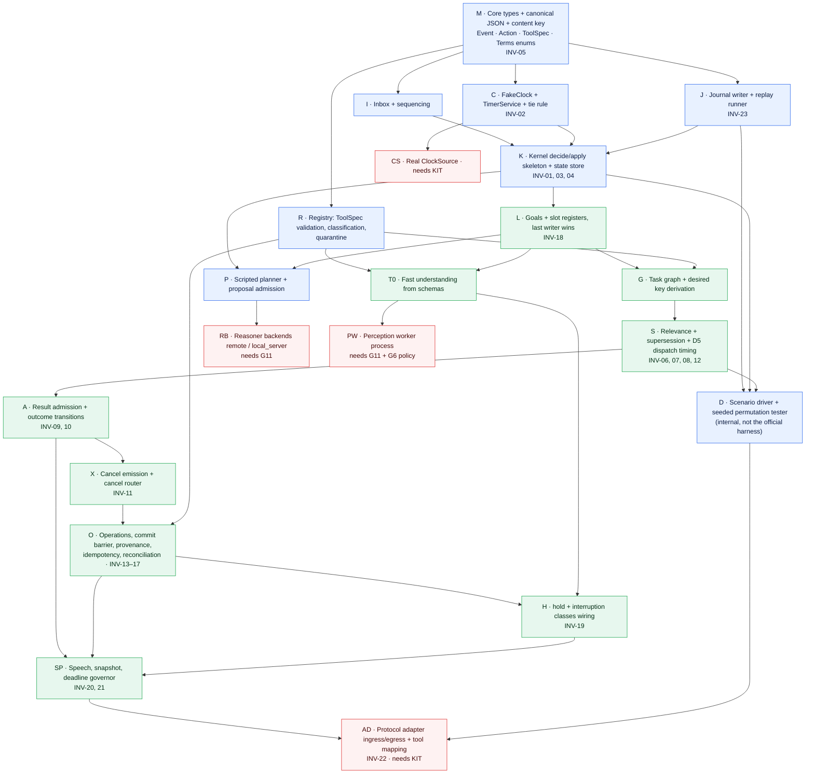

# Phase 0 — Implementation Preflight and Harness Validation

| | |
|---|---|
| Date | 2026-09-29 |
| Authoritative architecture | [`ARCHITECTURE_REVIEW.md`](ARCHITECTURE_REVIEW.md) → *FINAL ARCHITECTURE — LOCKED FOR IMPLEMENTATION* (Terms, F1–F10, INV-01…23) |
| Scope | Resolve implementation-level unknowns, fix interface contracts, map invariants to tests, derive build order. **No application code; architecture unchanged.** |
| Outcome | No factual incompatibility with the evaluation environment was found, because the evaluation kit is **not available**. Every harness-dependent fact stays behind the adapter/clock/cancel boundaries defined in §8. Phase 1 can start on kit-independent components (§11). |

Evidence labels used below:
- **[OBSERVED]** means checked on this machine or in the repository.
- **[GUIDE]** means stated in `Theme 5_Guide.pdf` v1.0.0.
- **[INFERRED]** means a reasoned conclusion from those two.
- **[UNKNOWN]** means there is no evidence either way.

---

## 1. Environment findings

All findings are [OBSERVED] on 2026-09-29.

| Item | Finding | Implication |
|---|---|---|
| OS / arch | macOS 26.5.1, arm64 (Apple M4, 10 cores) | Development machine only. **Not representative of the evaluation host**, which will run our Docker image on an unknown host: architecture, CPU and GPU are all [UNKNOWN]. |
| Memory | 16 GB | Enough for a 3–8 B quantised local model **or** a Docker VM, but tight for both plus perception models |
| GPU | Apple M4 integrated, Metal 4; no CUDA | Local GPU numbers (Metal) must **not** be used to predict evaluation latency |
| Disk | 38 GB free of 460 GB (92% used) | Docker images + model weights can exhaust it. Budget: one base image, ≤ 2 local models at a time. |
| Python | 3.12.9 (default `python3`), 3.12.12 (Homebrew), also 3.13 and 3.14 installed; `uv` available, and it can fetch 3.10.21 and 3.11.16 | Pin **3.12** for development. The constraint is 3.10–3.12, so CI must also run 3.10 (via `uv`) to catch syntax/stdlib drift. Never develop against 3.13/3.14. |
| Relevant packages (3.12, global) | `pytest` 9.1, `pydantic` 2.13, `jsonschema` 4.26, `numpy`, `onnxruntime` 1.27, `torch` 2.11, `opencv-python`, `pillow`, `openai` 2.45 (client), `mypy`, `ruff`, `llama-index` 0.14 | A project virtualenv is required; the global site-packages is not our dependency set. `llama-index` is an agent framework the architecture excludes (F1), so it must not enter the project. **`hypothesis` is not installed**; it is needed for property tests (small, pure-Python). |
| ASR / VLM libraries | None installed (no whisper-family, no ctranslate2) | Perception backends are still to be selected (§6) |
| Local model runtime | `ollama` CLI present; server not running; cached models `llama3.1:8b`, `qwen2.5:3b`, `qwen2.5:7b` (~11 GB) | Useful for local-backend **experiments** on the dev machine. Nothing is selected by virtue of being cached. |
| Docker | CLI 28.5.1 present; **daemon not running** | Must be started before Phase 0 container measurements (§6.4) |
| Tools | `git`, `gh`, `node`/`npm` (used for diagram rendering), `jq`, `make`; no `ffmpeg`/`sox` | WAV handling must use Python (stdlib `wave` or a library); don't depend on `ffmpeg` in the image unless added deliberately |
| Model API credentials | No `ANTHROPIC_*` / `OPENAI_*` / `GEMINI_*` / `HF_*` variables in the environment (names checked only) | A remote backend can't be exercised yet. Credentials will be needed if G11 selects one. |
| Repository | `/Users/pranavkumar/Prism` is **not a git repository** | Submission requires a GitHub repo and a release tag. Run `git init` before any code lands. |

## 2. Harness findings

| Question | Finding |
|---|---|
| Does the evaluation kit exist locally? | **No.** [OBSERVED] The repo, `~/Downloads`, `~/Desktop` and `~/Documents` were searched (depth 4) for kit, harness, scenario, manifest, theme-5 and PRISM names. The only PRISM artefact is `~/Downloads/fwdsamsungprismgenaihackathon3_0registrationli.zip`, which contains exactly the 8 documents already in the repo. |
| Harness code | Absent [OBSERVED] |
| Tool manifests | Absent [OBSERVED] |
| Sample / public scenarios | Absent [OBSERVED]. The Guide promises 9 public scenarios (50% text / 30% audio / 20% visual) [GUIDE §4]. |
| Protocol examples (JSON) | Absent [OBSERVED]. The Guide only names the payload kinds [GUIDE §3.1]. |
| When is the kit released? | "The evaluation kit will be released post the registrations" [GUIDE §4]. Registration closed 16 Sep per the deck; no kit is on disk as of 29 Sep. **Obtaining it is external** (see §3). |

Everything the Guide *does* say about the harness:
- two asynchronous queues: timestamped events in, actions out;
- a virtual-clock streaming harness with deterministic event replay, asynchronous mock tool responses, and full event/action trace logging;
- deterministic latency and fault injection for flight search, booking, ticket creation and frame-grounded manual lookup;
- cancellation "within few ms grace period";
- a 120 s **wall-clock** cap per scenario and a 300 s setup/warm-up hook;
- Python 3.10–3.12.

These are the only facts §4–§7 build on.

## 3. G0 — Submission status (external confirmation item)

| | |
|---|---|
| Fact on record | Deck p.9/p.14: final submission closes **25 Sep 2026**; top 15 announced 9 Oct; final demo 15 Oct. Dates are marked "tentative". Today is **29 Sep 2026**. |
| What we do not know | Whether the window was extended, whether this team registered before 16 Sep, and whether the evaluation kit was distributed to registered teams by email or form. |
| Action | The team lead contacts **prism@samsung.com** and asks for: (1) the current submission deadline, (2) the team's registration status, (3) the evaluation kit, or how to obtain it, (4) whether the hidden-evaluation container has network access and/or a GPU (this resolves UNK-8 for G11). |
| Status | **EXTERNAL CONFIRMATION REQUIRED.** No answer is assumed anywhere in this document. |

## 4. G3 — Harness clock and timer semantics

### 4.1 Known

| Fact | Source |
|---|---|
| Input events are timestamped | [GUIDE §3] |
| The harness uses a **virtual clock** and **deterministic replay** | [GUIDE §4] |
| Mock tools have **deterministic latency** and fault injection | [GUIDE §4] |
| The scenario cap is **120 s wall-clock**, so a virtual clock and a wall clock both exist | [GUIDE §6] |
| The cancellation grace period is "a few ms"; latency is "time to first substantive spoken action following user input or interruption" | [GUIDE §3.2, §5] |

### 4.2 Unknown

| # | Unknown | Why it matters |
|---|---|---|
| C1 | Does virtual time advance while the agent computes (real-time coupled), or only when the harness schedules the next event (discrete-event)? | Decides whether our compute time counts toward latency, and how our timers can fire |
| C2 | Who timestamps actions: the harness on receipt, or the agent in the payload? | Egress format; latency metric |
| C3 | Is there a clock read/tick API or tick events? | The timer source |
| C4 | How are events with equal timestamps delivered: one at a time in script order, or in a batch? | Tie-breaking |
| C5 | How is "few ms grace" measured: from the invalidating event's timestamp to the cancel action's timestamp, in virtual or wall time? | Whether in-step supersession (~1 ms of compute) is observable |
| C6 | Do mock tools' "deterministic latency" run on virtual time? | Tool timeout values |
| C7 | Is the scenario ended by the harness (end event) or by our FINAL? | Deadline governor, `SessionEnd` |

### 4.3 Safe and unsafe assumptions

| Safe (holds under every C1–C7 answer) | Unsafe (must not appear in kernel code) |
|---|---|
| Decisions are ordered by our arrival `seq` (F2); harness timestamps are recorded, never used for ordering | "Virtual time == wall time" |
| The kernel reads "now" only from the current event's `t` (INV-02) | Reading `time.time()` / `monotonic()` anywhere in `decide` |
| Timers are expressed in **harness time** and delivered as inbox events | `asyncio.sleep(timeout)` as a timeout mechanism |
| The 120 s cap is wall time: the deadline governor needs a wall-time trigger as well | That the harness will advance time for us while we are idle |
| Equal-timestamp events keep harness delivery order | That same-timestamp events arrive in a fixed kind order (e.g. results before chunks) |
| An action's latency is `t(action) − t(trigger)` in harness time, *and* we also journal wall time | That our step compute time is invisible to the scorer |

### 4.4 Adapter boundary and proposed deterministic clock interface

The kernel never sees a clock. Only two components touch time: **protocol ingress**, which stamps `t` if the wire lacks it, and the **timer service**.

```
ClockSource (adapter side, one implementation chosen at startup)
  now() -> float                         # harness-time seconds; used only by ingress and the timer service
  wall_now() -> float                    # monotonic wall seconds; journaled; used only by the deadline guard
  on_advance(callback(t: float))         # notifies the timer service whenever harness time is known to reach t

TimerService (runtime; the only producer of Timer events)
  arm(timer_id, due_t, purpose)          # idempotent per timer_id; re-arming replaces
  disarm(timer_id)                       # idempotent
  # emits Timer{timer_id, purpose, due_t, t=due_t} into the inbox when harness time reaches due_t
```

Candidate implementations are selected by configuration after the kit is inspected.

| Source | When it applies (C1/C3) | How timers fire |
|---|---|---|
| `EventDrivenClock` | Discrete-event harness; time is known only from event timestamps | When an ingress event with `t` arrives, fire all timers with `due_t < t` first (ascending `due_t`, then `timer_id`), then enqueue the event. A wall-time watchdog covers silent periods (§4.5). |
| `TickClock` | The harness exposes a clock API or tick events | Fire on tick/clock callbacks |
| `WallMappedClock` | Real-time-coupled harness | `harness_t = t_anchor + (wall − wall_anchor)`, re-anchored on every event; `asyncio` timer callbacks at mapped due times |
| `FakeClock` (tests) | Unit, replay and permutation tests | The test advances time explicitly; fully deterministic |

**Fixed tie rule (independent of source):** an ingress event with `t == due_t` is processed **before** that timer. A result arriving exactly at its timeout instant counts as on time. The rule is written once in the timer service and tested (INV-02 suite).

### 4.5 One residual design point, recorded but not changed

Under an `EventDrivenClock`, a silent harness never advances time, so an end-of-turn silence timer or tool timeout could never fire. That would threaten INV-19 (hold liveness) and the deadline governor. The **wall-time watchdog** closes this gap. It is part of the `EventDrivenClock` implementation, not the kernel: if no event arrives for a configured wall interval, the watchdog advances harness time by the elapsed wall time and fires due timers.

This is an adapter-internal behaviour, consistent with F2 and §7.4 of the review, so **the architecture is unchanged**. Its interval is a measured constant.

## 5. G6 — Audio and perception cancellation

### 5.1 What the materials establish

| Topic | Evidence | Status |
|---|---|---|
| Audio/frames are processed "behind conversational acknowledgments"; ambiguous perceptions are clarified | [GUIDE §3.2.5] | Known requirement; already architected (F4, F5, F7) |
| Anything about cancelling audio or perception work | None | **UNKNOWN**, and not needed: see §5.2 |
| Whether the scorer measures the cancellation grace for an audio interruption from clip arrival or from something else | None | **UNKNOWN**. This is exactly the G6 policy question (option (a) vs (b), review §9.3). |
| Whether an audio clip arrives with or without a harness transcript | None | **UNKNOWN** (U8). The ingress adapter handles both. |

### 5.2 The four concepts, applied to perception

Perception runs in **our own** worker process, not in the harness. So physical cancellation is under our control, but still not *reliable*: a native inference call usually cannot be interrupted mid-run.

| Concept | Perception meaning | Owner | Reliability |
|---|---|---|---|
| **Logical invalidation (supersession)** | For vision: evidence from a frame attached to a non-ACTIVE goal is not applied (§8.5, F3). For ASR: a transcript is the user's words and is **never** superseded. The *turn* it belongs to is classified normally (a status question supersedes nothing). | Kernel | Deterministic |
| **Cancellation request** | `PerceptionPort.cancel(req_id)`, issued when a request's purpose disappears (for example, a goal switch while a conditioned vision query runs) | Kernel intent → cancel router | Advisory, idempotent |
| **Physical worker cancellation** | Drop a queued request, or skip post-processing; a running inference completes and its result is discarded by the worker if already cancelled | Perception worker | Best effort; **never relied on** |
| **Stale-result rejection** | Evidence events are admitted by frame association (F3). Results for unknown or cancelled `req_id`s are journaled and change nothing. | Kernel | Deterministic |

### 5.3 Boundary that lets G6 be measured or changed without touching the kernel

- The audio policy is a **single policy constant** read by the turn classifier. It is already specified by F5 ("pre-emptive supersession on clip arrival is a measured policy switch"):
  - `audio_interrupt_mode = "on_transcript" | "on_clip_arrival"`, defaulting to `"on_transcript"`, which is option (a).
- **Option (b)**, if selected, is implemented as a turn classification of the `Media(audio)` event itself: `CORRECTION`-without-attribution, scoped to read-only calls, exactly as F5's unattributed-marker rule. No new kernel mechanism is needed.
- **Measurement.** Run the public audio scenarios with both settings and compare the Interruption Recovery sub-score and the L2 metric in our journal. That requires the kit.

## 6. G11 — Model hosting

### 6.1 Constraints

| Constraint | Consequence for hosting |
|---|---|
| Python 3.10–3.12 in Docker; the host hardware and accelerator are [UNKNOWN] | Plan for **CPU-only** unless the organisers confirm a GPU. Apple-Metal measurements do not transfer. |
| 120 s wall cap per scenario; ~60 hidden scenarios; the planner is called on each new goal, clarification answer and judgement point (roughly 2–6 times per scenario) | Planner p95 must be well under ~5 s, or chained scenarios risk the cap |
| Scored latency is first substantive speech; the cancel path uses no model (F5) | Model latency hits L1 only on first turns and new goals. It never hits L2. |
| Separate worker process (F1, CF-12) | Every backend sits behind a process or network boundary. No in-process inference in the kernel's process. |
| 300 s warm-up hook; no cross-session caching (R14) | Load weights and open connections during warm-up. Never cache responses across sessions. |
| Deterministic testing and offline replay (F9, INV-23) | Model outputs are journaled as inbox events. Tests use a scripted backend. Replay never calls a model, so no backend needs to be deterministic. |
| Network availability in the evaluation environment | **[UNKNOWN] (UNK-8)**, and decisive: see §6.3 |

### 6.2 Architecture-level options

| Option | Description | Latency (planner) | Works offline | Quality risk on unseen tools | Operational risk |
|---|---|---|---|---|---|
| **H1 Remote API** | Hosted model over HTTPS from the reasoner worker | Low (network-bound) | **No** | Low | Needs network + credentials in the evaluation container; rate limits |
| **H2 Local model server** | A separate process in the container serving a small quantised model over a local HTTP API | CPU-bound; **must be measured in Docker on x86 CPU**. Small models may fit the budget; larger ones likely will not. | Yes | Medium to high for small models on schema-constrained argument extraction | Image size, RAM, cold start inside the 300 s warm-up |
| **H3 In-process library** | Model loaded inside the agent process | — | Yes | — | **Excluded by F1 / CF-12** (GIL, event-loop stalls) |
| **H4 Scripted/rule backend** | Deterministic proposals from fast-understanding output plus templates (single-tool goals, confirmation questions) | ~0 | Yes | High (no general tool selection) | None. Required for tests; last-resort fallback. |

Perception follows the same split. ASR is remote or a local small ASR model in the perception worker. Vision is remote, or local OCR plus a small vision-language model; local vision-language models on CPU are likely several seconds per frame. Both sit behind `PerceptionPort` (§8.6).

### 6.3 Decision rule (architecture-level; no model selected)

1. Build the **reasoner port** and the **perception port** with three interchangeable backend classes: `remote`, `local_server`, `scripted`. They are chosen by configuration at warm-up, and the chosen backend is recorded in the journal header.
2. **If the organisers confirm network access** in the evaluation container: `remote` is primary, and `local_server` or `scripted` is the fallback on timeout or error.
3. **If there is no network:** `local_server` is primary with schema-constrained output, relying more on fast understanding and deterministic chained calls (review §12.3), with `scripted` as the fallback.
4. **Selecting a specific model** is a Phase 3 measurement:
   - p50/p95 latency and valid-JSON rate on the public scenarios, measured **inside the Docker image on an x86-64 CPU host**;
   - the cached `ollama` models are candidates for experiments only.

## 7. Known vs unknown assumptions

| ID | Assumption | Status | Where it is isolated | Resolved by |
|---|---|---|---|---|
| UNK-1 | Wire JSON schemas for events and actions | UNKNOWN | Protocol ingress/egress (§8.10–8.11) | Kit |
| UNK-2 | Clock semantics (C1–C7) | UNKNOWN | ClockSource/TimerService (§4.4) | Kit + stub measurement |
| UNK-3 | Cancel acknowledgement; do cancelled mock tools still return? | UNKNOWN | Tool adapter outcome hints (§8.7) | Kit + measurement |
| UNK-4 | Idempotency-key field | UNKNOWN | Egress (optional field) | Kit |
| UNK-5 | Snapshot slot naming and schema | UNKNOWN | Egress mapping table | Kit |
| UNK-6 | Every turn terminated by end-of-turn? | UNKNOWN | Ingress + silence timer | Kit |
| UNK-7 | Yield/stop-speaking action; simulated speech duration | UNKNOWN | Egress | Kit |
| UNK-8 | Network/GPU in the evaluation container | UNKNOWN | Backend selection (§6.3) | Organisers (G0 email) |
| UNK-9 | Interrupt precedes, accompanies or replaces content | UNKNOWN | Ingress normalisation | Kit |
| C4 | Equal-timestamp delivery | UNKNOWN | Ingress keeps delivery order | Kit |
| — | Harness honours cancels | **Assumed false** (safe) | Operation lock + admission | — |
| — | Agent chooses `call_id` | Likely ("explicit call_id") | Egress maps ids | Kit |
| — | Harness transcript is authoritative when present | Design decision (review §8.5) | Ingress/perception | — |

## 8. Final interface contracts

Common rules:
- All types are **immutable** once created.
- Only `SessionKernel.apply` mutates state.
- Every cross-boundary message is journaled.
- Nothing in the core imports wire types (INV-22 support test).

### 8.1 Event input

| | |
|---|---|
| Responsibility | Carry one normalised occurrence into the system |
| Shape | `Event{eid, seq, kind, t, t_recv, turn_id?, cause[], corr{call_id?, req_id?, timer_id?, frame_eid?}, payload, content_bearing?}`. `kind` ∈ Manifest, UserText, EndOfTurn, Media, Evidence, Interrupt, ToolResult, Proposal, ProposalFailed, Timer, SessionStart, SessionEnd (review §7.2). |
| Ownership | Created by ingress, a worker or the timer service; `seq` assigned only by the inbox |
| Concurrency | Immutable; safe to share |
| Failure | A malformed payload is rejected at the producer and journaled as an `ingress_error` record; it never reaches the kernel |
| Determinism | Content fully journaled (media by path + hash); the replay input is exactly the sequence of these events |

### 8.2 Event sequencing (Inbox)

| | |
|---|---|
| Responsibility | Single total order |
| Input | `put(event_without_seq)` from many producers |
| Output | `get() -> Event` with `seq = last + 1`, to exactly one consumer (the kernel loop) |
| Ownership | Runtime |
| Concurrency | Multi-producer / single-consumer FIFO on the event loop. Producers in other processes deliver through their loop-side proxy. |
| Failure | Unbounded, but monitored (queue depth journaled); a depth alarm indicates a slow step |
| Determinism | `seq` is assigned at `put` time in arrival order; replay reuses journaled `seq` |

### 8.3 Session kernel

| | |
|---|---|
| Responsibility | All decisions (F2–F7) |
| Input | `step(event)` |
| Output | `StepResult{actions[] (cancels first), effect_requests[], cancel_requests[], timer_ops[], journal: StepRecord}` |
| Ownership | One instance per session |
| Concurrency | Synchronous; never awaits; not reentrant. Called only by the runtime loop. |
| Failure | An exception in `decide` → state unchanged, a `poison` record, a templated fallback action (never state-changing) |
| Determinism | Pure function of (state, event, constants); no clock, randomness, set iteration or `hash()` (INV-01/02/05/23) |

### 8.4 State store

| | |
|---|---|
| Responsibility | Hold `SessionState` (F3) |
| Input | `apply(changes: list[Change])` from the kernel only |
| Output | `view(fields) -> ReadOnlyView` for effect requests (a frozen copy of just the fields a worker needs) |
| Ownership | Kernel |
| Concurrency | Single writer; views are copies, so workers never observe later mutations |
| Failure | `apply` performs only assignments; a failure here is a bug, and the session emits a fallback FINAL |
| Determinism | Ordered containers only; `rev` increments per applying step |

### 8.5 Reasoner worker

| | |
|---|---|
| Responsibility | Turn a view into a proposal (F4) |
| Input | `ReasonerRequest{req_id, purpose, based_on_seq, view, schema_version}` |
| Output | `Proposal{req_id, based_on_seq, intent?, slot_writes[], graph?, response_content?}` or `ProposalFailed{req_id, reason}` as inbox events |
| Ownership | Runtime; backend `remote`, `local_server` or `scripted` (§6.3) |
| Concurrency | Asynchronous; at most one in flight per purpose. A newer request cancels the older one (advisory). |
| Failure | Timeout, transport error or schema-invalid output (after one repair) → `ProposalFailed`; the kernel falls back (review §10.4) |
| Determinism | Not required of the backend. The output is journaled in full; replay feeds it back. |

### 8.6 Perception worker

| | |
|---|---|
| Responsibility | ASR and vision (F1, F4) |
| Input | `PerceptionRequest{req_id, kind: asr\|vision, media_ref, source_eid, hints?}` |
| Output | `UserText{source: asr, confidence, source_eid}`, `Evidence{frame_eid, claims{key: (value, confidence)}}`, or `PerceptionFailed{req_id}` as inbox events |
| Ownership | Runtime; a **separate OS process** |
| Concurrency | Its own queue; results are delivered in completion order |
| Failure | Crash → restart the worker and fail pending requests; timeout → `PerceptionFailed` |
| Determinism | Not required; outputs journaled |

### 8.7 Tool adapter (functions inside the protocol adapter module)

| | |
|---|---|
| Responsibility | Manifest normalisation and tool I/O mapping |
| Input | Wire manifest; kernel `ToolCall` / `Cancel` actions; wire tool results |
| Output | `ToolSpec[]` (with `effect_class` and its reason, `cancellable?`, `timeout_s?`, schemas); wire call/cancel payloads; `ToolResult{call_id, outcome_hint: ok \| error(executed: true\|false\|unknown) \| cancelled_ack \| malformed, data}` |
| Ownership | Protocol adapter |
| Concurrency | Stateless mapping functions |
| Failure | An invalid tool is quarantined (journaled); an unmappable result becomes `malformed` |
| Determinism | Pure mapping |

### 8.8 Cancellation adapter (cancel router)

| | |
|---|---|
| Responsibility | Deliver the kernel's advisory cancellations to the right target |
| Input | Harness tool calls arrive as `Cancel{call_id}` **actions** via egress; the planner and perception arrive as `CancelRequest{target: reasoner\|perception, req_id}` from `StepResult.cancel_requests` |
| Output | Nothing back to the kernel. Cancellation never produces state; any later result arrives as a normal event. |
| Ownership | Runtime |
| Concurrency | Fire-and-forget; idempotent per id |
| Failure | Ignored or failed cancels are journaled only (U1) |
| Determinism | The decision to cancel is in the kernel (deterministic, INV-11); delivery effects are irrelevant to state |

### 8.9 Clock / timer adapter

See §4.4. `ClockSource.now/wall_now/on_advance`; `TimerService.arm/disarm` → `Timer` events. It owns the tie rule and the wall watchdog.

### 8.10 Protocol ingress

| | |
|---|---|
| Responsibility | Wire → `Event` |
| Input | Harness input-queue messages |
| Output | `Event`s put into the inbox; media written to a session-scoped media store (path + hash) |
| Ownership | Protocol adapter, the only module importing wire types |
| Concurrency | One ingress coroutine per session |
| Failure | Unparseable message → journaled `ingress_error`, dropped. Duplicate harness id → dropped. |
| Determinism | Stamps `t` from the wire (or `ClockSource.now()` if absent) and `t_recv` |

### 8.11 Protocol egress

| | |
|---|---|
| Responsibility | `Action` → wire, in step order |
| Input | `StepResult.actions` |
| Output | Harness output-queue messages |
| Ownership | Protocol adapter |
| Concurrency | A single ordered writer |
| Failure | Schema-invalid → drop + journal + templated fallback for FINAL (review §5) |
| Determinism | Pure encoding; `t_emit` is recorded |

### 8.12 Journal / replay

| | |
|---|---|
| Responsibility | Append-only JSONL: `header`, `in`, `step`, `out`, `fx`, `metric` (F9) |
| Input | Records from ingress, the kernel and the runtime |
| Output | A file per session; `replay(path, constants) -> ReplayReport{identical: bool, first_divergence?}` |
| Ownership | Runtime (writer); test suite (replay) |
| Concurrency | The writer runs off the critical path (buffered, flushed asynchronously); ordering follows `seq` |
| Failure | A write failure never affects the agent; it disables replay for that session and is logged |
| Determinism | Replay uses only `in` records and header constants; it asserts equality of `step`/`out` |

## 9. INV-01 to INV-23 test mapping

"Deterministic?" means the test gives the same verdict on every run given a seed.

| INV | What must be true | Automated test | Failure looks like | Deterministic? |
|---|---|---|---|---|
| 01 | Only `apply` mutates; `decide` is pure | Deep-copy state, call `decide` twice, compare outputs and state; static import check (no clock/random/wire in kernel) | State differs after `decide`; outputs differ between calls | Yes |
| 02 | "now" = `event.t` | Replay the same journal under a `FakeClock` with a different wall time; timer tie-rule unit tests | Different `step`/`out` records; a timer firing before an equal-`t` event | Yes |
| 03 | Cancels precede calls in a step; step order across steps | Scan `out` per step in all scenario tests | A tool call before a cancel in one step | Yes |
| 04 | Unique `call_id` / `action_id` | Set-size over the journal after every test | Duplicate id | Yes |
| 05 | Content key = SHA-256 over canonical JSON; stable | Hash fixtures in subprocesses with `PYTHONHASHSEED` = 0, 1 and random | Keys differ across processes | Yes |
| 06 | DESIRED calls ⊆ desired keys of the ACTIVE goal; ≤ 1 per key | After every step, recompute desired keys from state and compare | DESIRED call with a non-desired key; two DESIRED calls with one key | Yes |
| 07 | SUPERSEDED is terminal | Scan relevance transitions | SUPERSEDED → DESIRED | Yes |
| 08 | Same-step supersession | Diff desired sets per step vs relevance transitions of that step | A key leaves the set but its call is still DESIRED after the step | Yes |
| 09 | Results used only if DESIRED | Every *use* record names a call; check its relevance at that step. Attack #1/#7/#8 scenarios. | A binding, answer grounding or snapshot value sourced from a SUPERSEDED call | Yes |
| 10 | Outcome recording is monotonic; unknown ids change nothing | Transition-table property test; fuzz unknown/duplicate results | Illegal transition; state change on an unknown id | Yes (seeded) |
| 11 | Cancel iff superseded with unknown outcome (and cancellable); ≤ 1 per call; never after a known outcome | Scan `out` vs transitions; timeout/supersession coincidence test (D7) | Missing cancel, double cancel, cancel after OK | Yes |
| 12 | With the turn closed, every desired read-only key has exactly one DESIRED call; nothing dispatched while a turn is open | Recompute after each step; D2 twin scenario (superseded PENDING twin) | Missing dispatch; waiting on a twin; dispatch during an open turn | Yes |
| 13 | A create attempt only if all earlier attempts are FAILED_CLEAN | Per-operation check at each dispatch; booking-race permutations (05b) | A second create while PENDING/UNKNOWN/OK | Yes (seeded permutations) |
| 14 | Commit barrier holds at every state-changing dispatch | Assert the predicates at dispatch; attacks #6, #23, #29 | Dispatch during an open turn, `hold`, or with an unconfirmed slot | Yes |
| 15 | Provenance to user content | Walk `caused_by` chains; injection fixtures (tool result / frame text saying "book now") | A state-changing dispatch whose chain lacks user content | Yes |
| 16 | COMMITTED divergence → other operation or CLARIFY only | Scan steps after COMMITTED; attack #3/#4 | Re-dispatch on the committed operation | Yes |
| 17 | Idempotency key equality rules | Property test over generated attempts | Equal args → different keys, or vice versa | Yes (seeded) |
| 18 | Last-writer-wins; backchannels do not write | Generated interleavings of inputs and proposals; attack #28 | A stale proposal overwrites a newer user value; a backchannel writes | Yes (seeded) |
| 19 | `hold` always has a pending clearer; clear at session end | Check after every step; content-free-interrupt scenario (#27) with `FakeClock` | `hold` set with no timer or open turn; `hold` at session end | Yes |
| 20 | `confirm`/`answer` grounded on DESIRED+OK or COMMITTED; silent while the turn is open | Scan speech `out` records | "Booked" before an OK outcome; speech during an open turn | Yes |
| 21 | FINAL snapshot = `snapshot(ACTIVE goal)` post-apply; schema-valid; before the deadline | Recompute from journaled state; schema validation; deadline scenario (#30) with `FakeClock` | Snapshot mismatch; missing FINAL at the cap | Yes |
| 22 | Every action passes egress schema validation | Validator on every `out` in all tests. Until the kit arrives, the validator uses our internal action schema; the kit's wire schema is added in the adapter. | Invalid payload | Yes |
| 23 | Replay reproduces `step`/`out` | Golden journals; replay under several hash seeds; permutation replays check INV-01…22 | First divergent record reported | Yes |

## 10. Implementation dependency graph



Blue = Phase 1. Green = Phase 2–3 (kit-independent). Red = blocked on the kit or G11.

**Why this order, not a generic one:**
- **The journal and replay (J) come before any behaviour.** Every later invariant test is a journal scan, and INV-23 turns each scenario into a regression test for free.
- **The fake clock and timers (C) come before the kernel.** INV-02 forbids clock reads in the kernel, so the timer path must exist before the first timeout-dependent rule.
- **The registry (R) comes before the task graph.** Content keys need canonicalised, schema-validated arguments, and classification decides read-only vs state-changing paths.
- **Registers → graph → supersession → admission → cancel → operations** is forced by definitions:
  - desired keys need registers and a graph;
  - supersession needs desired keys;
  - admission needs relevance;
  - cancel emission (INV-11) needs both relevance and outcome;
  - the operation lock needs outcomes.
- **The scenario driver (D) arrives with supersession.** Race tests are meaningless before calls can be superseded, and the permutation tester is what makes INV-06…19 checkable.
- **The protocol adapter comes last,** and deliberately so. Its shape is unknown (UNK-1), and everything upstream is tested through the internal driver.

## 11. Phase 1 implementation plan

Phase 1 covers **kit-independent foundations only**. Exit: INV-01, 02, 03, 04, 05 and 23 green, plus a scripted end-to-end single-tool scenario through the internal driver.

| # | Task | Depends on | Owner (review F10 split) | Done when |
|---|---|---|---|---|
| 1.0 | `git init`, GitHub repo, `pyproject.toml` pinned to Python 3.12 (CI matrix 3.10 + 3.12 via `uv`), project venv with `pytest`, `hypothesis`, `jsonschema`, `pydantic` only | — | (1) | CI runs an empty test suite on 3.10 and 3.12 |
| 1.1 | Core types (M): `Event`, `Action`, `ToolSpec`, enums for relevance/outcome/operation state; canonical JSON; content key and idempotency key hashing | 1.0 | (2) | INV-05 subprocess hash test green |
| 1.2 | Inbox (I) and `FakeClock` + `TimerService` with the tie rule (C) | 1.1 | (1) | Tie-rule and ordering unit tests green |
| 1.3 | Journal writer + replay runner (J) | 1.1 | (1) | Round-trip of a hand-made journal |
| 1.4 | Kernel skeleton (K): dispatch table, decide/apply split, state store with read-only views, poison handling | 1.2, 1.3 | (2) | INV-01, 03, 04 green on no-op events |
| 1.5 | Registry (R): ToolSpec validation, classification with reason, quarantine | 1.1 | (3) | Table-driven tests incl. malformed/unlabelled manifests (attack #21) |
| 1.6 | Scripted planner backend + proposal admission (structure only) (P) | 1.4 | (3) | A scripted proposal creates a goal with a one-node graph |
| 1.7 | Internal scenario driver (D, minimal): feeds a JSON event script with scripted tool latencies through the inbox under `FakeClock` | 1.3, 1.4 | (4) | A single-tool scenario runs end to end; replay identical (INV-23) |
| 1.8 | Stub adapter spike, **only when the kit arrives**: pass every public scenario's events through ingress and echo protocol-valid no-op actions; measure C1–C7 | kit | (1) | UNK-1/2/3/5/6/7/9 recorded in this document |

Phase 2 continues down the dependency graph (L → G → S → A → X → O → H) with the permutation tester, as in review F10.

## 12. Risks before coding

| Risk | Likelihood | Impact | Mitigation |
|---|---|---|---|
| Submission window closed (G0) | Unknown | Fatal | Email the organisers before committing team time |
| Evaluation kit unobtainable or late | High | High | Build all kit-independent layers against the internal driver; keep the adapter thin; the kit spike (1.8) is a half-day task once it arrives |
| Harness clock is event-driven with no ticks | Medium | Medium | Wall watchdog inside `EventDrivenClock` (§4.5); INV-19 test |
| No network in the evaluation container, and a CPU-only host | Medium | High | `local_server` + `scripted` path designed from the start (§6.3); measure CPU latency in Docker early in Phase 3 |
| Dev-machine numbers mislead (M4/Metal vs unknown x86 CPU) | High | Medium | All latency budgets measured in the Docker image on x86-64 before tuning |
| Disk space (38 GB free) | Medium | Medium | One base image; prune caches; at most 2 local models during experiments |
| Global Python pollution (agent frameworks installed globally) | Medium | Low | Project venv only; dependency allowlist in review; import-boundary test |
| Hypothesis/permutation tests too slow for CI | Low | Low | Seeds sharded; nightly deep run (≥ 10k seeds), per-commit shallow run |
| Team drifts from the invariants under deadline pressure | Medium | High | INV tests gate merges from Phase 1 on |

---

## PHASE 0 STATUS

| Item | Status | Basis |
|---|---|---|
| **G0** Submission status | **EXTERNAL CONFIRMATION REQUIRED** | Only the organisers can answer; the deck deadline (25 Sep) has passed on paper |
| **G3** Clock/timer semantics | **BLOCKED** (on the evaluation kit) | No kit, so C1–C7 cannot be observed. The internal abstraction is fixed (§4.4) and does not block Phase 1. The final source is chosen in task 1.8. |
| **G6** Audio/perception cancellation | **MEASURABLE** | Perception cancellation semantics are resolved (§5.2). The remaining audio-interrupt policy is one constant, measurable on the public audio scenarios once the kit exists. |
| **G11** Model hosting | **EXTERNAL CONFIRMATION REQUIRED** | The hosting architecture is resolved (§6.3: ports + remote/local_server/scripted backends). Which backend is primary depends on network/GPU availability in the evaluation container (UNK-8), which only the organisers can confirm. Latency is then measurable in Docker. |

**Is Phase 1 safe to begin? Yes, for the kit-independent tasks 1.0–1.7.** Nothing in them depends on G3, G6 or G11: time enters only through `FakeClock`, the planner is the scripted backend, and no wire format is assumed. Task 1.8 waits for the kit. Because G0 could make all of it moot, **send the G0 email first**. It costs minutes, and its answer also settles G11.
