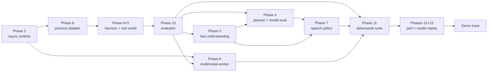

# Phase 2 Plan — From Deterministic Core to a Complete End-to-End Theme 05 Agent

| | |
|---|---|
| Date | 2026-09-30 |
| Baseline | commit `22613be` (Phase 1: deterministic runtime foundation, 73 tests) |
| Contract | [`ARCHITECTURE_REVIEW.md`](ARCHITECTURE_REVIEW.md) FINAL ARCHITECTURE + INV-01…23 (locked); interfaces from [`PHASE0_PREFLIGHT.md`](PHASE0_PREFLIGHT.md) §8 |
| Development model | This repository is **one of two independent end-to-end implementations**. It depends on nothing from the other and shares no code with it. The only thing designed to be shared is the **evaluation methodology** (§8), which is black-box by construction so both implementations can be scored identically. |

Phase numbers below follow the brief (Phase 2 = runtime … Phase 13 = replay). §3 gives the **execution order**, which differs from the numbering where dependencies demand it.

---

## 1. Objectives

Turn the Phase 1 deterministic core into a complete agent covering the full pipeline: input → protocol ingestion → fast understanding → session state → planning → asynchronous work → multimodal grounding → tool execution → interruption → supersession and cancellation → replanning → result admission → truthful response → structured snapshot → journal → replay and evaluation.

The optimisation targets are the Theme 05 scoring categories, **measured by our own black-box evaluator**:
- **task completion** (40);
- **interruption recovery** (35);
- **response latency** (15);
- **safety and protocol** (10);
- the multimodal and naturalness signals.

Visual complexity is not a target.

Non-negotiables carried from Phase 1:
- only the kernel mutates session state;
- workers return events and never call ids, snapshots or state;
- INV-01…23 are checked on every step of every test;
- replay stays deterministic.

## 2. Current vs required: the gap

| Capability | Phase 1 (done) | Required | Gap |
|---|---|---|---|
| Kernel, state, supersession, admission, operation ledger, journal, replay | Complete, tested (INV-01…23) | Same | None. Extend only where a phase needs a new input (e.g. an understanding context). |
| Runtime | Synchronous discrete-event simulator | Asynchronous runtime: concurrent workers, event re-entry, cancellation, timeouts, worker failure, late results, real timers | **Phase 2** |
| Clock | `FakeClock` + scheduler | Live clock source + manual clock for tests; the harness clock is still blocked (G3) | Phase 2 (live/manual); the real harness clock waits for the kit |
| Fast understanding | Scripted annotations | Deterministic, bounded, schema-derived: turn classes, slot values, corrections, goal switches, answers, status questions, backchannels | **Phase 3** |
| Planner | Scripted text → proposal map | Real reasoner behind the port; model-agnostic; validated proposals; replanning; provenance; replay capture; model comparison | **Phase 4** |
| Tools | Registry + scripted behaviours in the simulator | Realistic mock tool ecosystem (flight search, booking, tickets, manual lookup, …) with fault injection and a side-effect ledger | **Phase 5** |
| Multimodal | Scripted perception; frame-keyed evidence in the kernel | Perception worker **process** with ASR and vision backends; ambiguity (alternatives); stale-frame and conflict handling | **Phase 6** |
| Speech | Ack, clarify, FINAL templates | Response policy: meaningful acks, progress narration, filler budget, status answers, truthful wording, optional model realisation under grounding | **Phase 7** |
| Protocol | None (internal events) | One ingress + one egress adapter; a documented **local mock protocol** (explicitly not Samsung's) | **Phase 8** |
| Harness | Simulator with Python-defined scenarios | Declarative scenario files, sim + async modes, full fault model, per-scenario outputs | **Phase 9** |
| Evaluation | Tests only | Black-box internal metrics mirroring TC / IR / RL / SP, machine-readable results, reports | **Phase 10** |
| Adversarial | 22 tests + property tests | Large measured adversarial suite (≥ 24 families) | **Phase 11** |
| Performance | Kernel step latency measured once | Baselines for every latency class, memory and CPU; critical vs background | **Phase 12** |
| Replay of model-driven runs | Replay works because worker outputs are inbox events | Header records backend and model config; model inputs and outputs captured; live vs replay mode explicit | **Phase 13** |
| Demos | Scenario CLI timeline | Six demo scenarios + presentation timelines | Demo track |

## 3. Implementation phases and execution order

| Order | Phase | Why here |
|---|---|---|
| 1 | **Phase 2: Real runtime** | Everything asynchronous (workers, timers, adapters) plugs into it |
| 2 | **Phase 8: Protocol adapter** (local mock protocol) | The harness and evaluator must drive the agent through the *same* boundary the real harness will use. Building it early prevents wire assumptions leaking into the runtime. |
| 3 | **Phase 9 + Phase 5: Local harness and tool ecosystem** | Realistic tools with fault injection are part of the harness world; later intelligence has to be measured against them |
| 4 | **Phase 10: Evaluation engine** | "Do not optimise before measuring": the baseline score of the scripted system is recorded *before* adding understanding and models |
| 5 | **Phase 3: Fast understanding** | Deterministic and model-free; improves latency and interruption metrics on its own |
| 6 | **Phase 4: Planner + model evaluation layer** | Needs the evaluator to compare backends on identical scenarios |
| 7 | **Phase 6: Multimodal** | Needs the runtime (worker process), the evaluator, and backend downloads (approval needed, §6) |
| 8 | **Phase 7: Speech and response policy** | Needs real results and understanding to phrase from |
| 9 | **Phase 11: Adversarial suite** | Grows every phase; consolidated and measured here |
| 10 | **Phases 12 + 13: Performance and model replay** | Instrumented from Phase 2 onward; baselines finalised here |
| 11 | **Demo track** | Built from the evaluation scenarios; timelines from journals |

Each phase ends with the gate in §13 and a **PHASE STATUS** report, and the next phase starts only after that report.

### Phase 2: Real runtime (scope of the first implementation step)

- An `AsyncRuntime` composes the existing synchronous `Runtime`, so the step, journal and egress code stays shared and unchanged. It adds:
  - an asyncio drain loop, so kernel steps are sequential and in arrival order;
  - effect dispatch to asynchronous worker tasks (planner, perception);
  - advisory cancellation (`task.cancel()`; a worker that ignores it still returns, and the kernel's last-writer-wins handles the late result);
  - per-worker timeouts → `ProposalFailed` / `PerceptionFailed`;
  - worker exceptions → failure events;
  - thread-safe `submit` for executor threads and worker processes;
  - timers backed by a clock source: **live** (wall-mapped, `loop.call_later`) or **manual** (deterministic, advanced by tests).
- Worker interface: `async def planner(request) -> dict` and `async def perceiver(request) -> dict`, returning *content only*. The runtime attaches `req_id`/`based_on_seq`, so workers cannot forge identity.
- The synchronous simulator stays the deterministic test bed.

### Phase 8: Protocol adapter

- **Local mock protocol `PRISM-LOCAL/0`:** a documented JSON message schema for input events and output actions. It is labelled as ours in the code and docs, not Samsung's.
- `ingress.py` (wire → `Event`, media → file refs, manifest normalisation) and `egress.py` (`Action` → wire, schema validation). Tool mapping: result → outcome hint.
- Transports: in-process asyncio queues (live) and JSONL files (recorded streams).
- A contract test forbids core imports of wire modules.

### Phase 9 + 5: Local harness and tool ecosystem

- **Declarative scenarios** (`evaluation/scenarios/**/*.json`): manifest, tool world, a timestamped input stream (text, audio, frames, interrupts, harness-injected results), and expectations.
- **Mock tools with state:**
  - flight inventory and search;
  - bookings, with an idempotency-key ledger and a side-effect counter, so a duplicate booking is *observable in the world*, not just in our journal;
  - tickets;
  - device manual lookup by model and error code;
  - weather.

  Fault injection covers latency, errors (executed yes/no/unknown), malformed results, honouring or ignoring cancels, duplicates, and never answering.
- **Two run modes:**
  - **sim**, a discrete-event scheduler that is deterministic and byte-for-byte replayable;
  - **live**, `AsyncRuntime` plus real workers against a wall clock.
- **Per-scenario output:** journal, final state, emitted actions (wire form), latency measurements, the tool-world ledger, task and interruption outcomes, and protocol or invariant violations.

### Phase 10: Evaluation engine (black-box)

- `evaluation/metrics/` computes each score **only from**:
  - the input stream;
  - the emitted wire actions;
  - the mock tool world's ledger;
  - the scenario's expectations.

  The kernel journal is optional supporting evidence. This is what lets Developer B's implementation be scored identically if it speaks `PRISM-LOCAL/0`.
- **Internal metrics:**
  - **TC:** required tool effects happened with correct arguments; final snapshot matches expected intent and slots; the final response is grounded (it cites calls that happened and whose world results match).
  - **IR:** time from invalidating input to the cancel of each invalidated call; no stale reruns (no dispatch with invalidated arguments after the invalidation); no answer grounded on invalidated work; a snapshot updated after the interruption.
  - **RL:** time from each user turn end and each interruption to the first *substantive* spoken action (fillers excluded).
  - **SP:** duplicate side effects in the world ledger; schema violations; malformed snapshots; any action after a protocol error.
  - **Multimodal:** evidence-dependent expectations met; conflicts clarified.
  - **Naturalness proxies:** filler count, repeated utterances, speech during user turns.
- The 40/35/15/10 weighting yields an **internal score**, labelled as such, **never presented as a Samsung score**.
- Results: `evaluation/reports/<run-id>/results.json` + `report.md`.

### Phase 3: Fast understanding (deterministic T0)

- The interface is extended to `understand(text, payload, ctx)`, where `ctx` is a read-only view: registry, active-goal slots, open clarifications, and recent values. It stays pure and bounded.
- **Recognisers derived from the tool schemas:**
  - enums;
  - integers (digits and number words);
  - booleans;
  - dates and weekdays, and relative days *as tokens* (no calendar arithmetic without a harness date);
  - free strings through preposition cues learned from parameter names (to/from/for/on) and values already seen in the session.
- **Lexicons:** backchannels, correction markers, goal-switch markers, status-query markers, affirmation and confirmation.
- **Safety:** attribution happens only when unambiguous, otherwise T0 abstains. T0 never selects a tool for a new goal, and never confirms a slot except by the closed-turn rule already in the kernel.
- The annotated implementation stays for tests; an annotation overrides the recognisers.

### Phase 4: Planner and model evaluation layer

- A **reasoner port** with backends:
  - `scripted` (tests, fallback);
  - `ollama` (local HTTP; JSON-schema-constrained output);
  - `openai_compatible` (any hosted endpoint, used only if credentials and network are provided; none are configured today).
- **Proposal JSON Schema** covers intent, slot writes, a task graph whose nodes bind to slots, upstream outputs or constants, and a clarification. Validation and one repair attempt happen in the worker; the kernel admission rules stay authoritative.
- **Prompt:** the manifest, the goal slots with writer provenance, a ledger summary (done / in flight / superseded), evidence, and recent turns. Tool-result and frame text are quoted as data (anti-injection).
- **Replanning triggers** are unchanged: turn close. One addition is proposed: a `judgement` request when an upstream result needs a choice. It is marked as an **architecture-compatible extension** (F4 already allows proposals at judgement points) and is gated on evaluation evidence.
- **Model evaluation:** `evaluation/models/` runs the same scenario suite per backend and records:
  - p50/p95 latency;
  - valid-JSON rate and invalid-argument rate;
  - task completion and interruption behaviour;
  - clarification rate;
  - consistency (N repeated runs);
  - resource usage (RSS/CPU of the backend process).

  The selection is made from these numbers, and they must be re-measured in Docker on x86 before submission.

### Phase 6: Multimodal

- A **perception worker process** (`multiprocessing` spawn) behind `PerceptionPort`, returning events only. Crash → restart and fail pending requests. Heavy inference stays off the kernel's process (CF-12).
- **Backends:**
  - `scripted`;
  - **ASR** candidates: CTranslate2-based Whisper tiny/base, or whisper.cpp;
  - **vision** candidates: a small OCR model for codes and model numbers, plus an optional small vision-language model via the local server.

  All are selected by measurement, and **their downloads need approval** (§6, §12).
- **Evidence:** claims with alternatives (top-k with confidence); the newest-frame-per-key rule; stale frames (frames older than the user's later statement) are handled by last-writer-wins plus the conflict rule; evidence for suspended goals is kept but not applied (already in the kernel).
- **Video** is treated as a frame sequence (the Guide specifies PNG frames).

### Phase 7: Speech and response policy

- A policy module (pure, reads state only) produces speech *content*. The kernel still decides *whether* an act is allowed (INV-20).
- It adds:
  - a progress-narration timer (`τ_progress`, rate-limited);
  - a filler budget (≤ 1 contentless filler per turn after `τ_filler`);
  - status-question answers from state;
  - answer wording from admitted results (templates);
  - optional model realisation constrained to a fact list, with a template fallback.

### Phase 11: Adversarial suite

Declarative scenarios, measured by the evaluator. Each family covers: interrupt 1 ms before, at, and 1 ms after completion; repeated interruptions; correction during planner execution; correction during perception; a stale model result; a stale tool result; timeout + late result; a cancel ignored by the tool; a state-changing call completed despite cancel; duplicate requests; a malformed manifest; malformed arguments; conflicting evidence; a stale frame; rapid slot corrections; goal switching; partial plan completion; a planner result after several user updates; the same request repeated; same-time events; timer/input races; worker failure; and process failure. Each family also gets seeded timing variants.

### Phase 12: Performance

Instrumented from Phase 2 onward: kernel step, queue hop (submit → step), time to first substantive response, planner and perception latency, tool-dispatch latency, interruption-to-cancel latency, end-to-end scenario time, RSS (`resource`/`tracemalloc`) and CPU time. The critical path (ingress → step → egress) is reported separately from background work (workers, tools).

### Phase 13: Deterministic replay of model-driven runs

- The journal header records the backend, model id, prompt version, decoding parameters and schema version.
- Worker **inputs** (the request view) and raw **outputs** go into `fx_io` audit records. The admitted proposal is already an `in` event, so replay stays model-free.
- `mode: live | replay` is explicit in the header and the reports.

### Demo track

Six scenarios with presentation timelines (text + SVG swimlane generated from the journal):
1. change the request while a tool runs;
2. an old result arrives after cancel and is ignored;
3. background reasoning while the conversation stays responsive;
4. duplicate-safe booking;
5. asynchronous multimodal evidence landing on the right goal;
6. rapid corrections.

## 4. Dependencies

**External dependencies:**
- **G0:** submission window;
- **the evaluation kit:** real wire protocol and clock;
- **G11:** network/GPU in the evaluation container;
- **model downloads:** ASR/vision/LLM, which need approval and disk space (38 GB free).

## 5. Files and modules affected

| Area | Files |
|---|---|
| Phase 2 | new `agent/async_runtime.py`; `agent/clock.py` (+ `WallClock`); tests `tests/test_async_runtime.py` |
| Phase 8 | new `agent/adapter/ingress.py`, `agent/adapter/egress.py`, `agent/adapter/local_protocol.py` (schema + docs); `docs/LOCAL_PROTOCOL.md` |
| Phase 9 + 5 | new `evaluation/runner/`, `evaluation/tools/` (tool world), `evaluation/scenarios/`; `agent/scenario.py` kept for the Phase 1 tests |
| Phase 10 | new `evaluation/metrics/`, `evaluation/reports/` |
| Phase 3 | new `agent/understand_rules.py`; `agent/understand.py` (context type); one call site in `agent/kernel.py` |
| Phase 4 | new `agent/reasoner/` (port, backends, schema, prompts); `evaluation/models/` |
| Phase 6 | new `agent/perception/` (worker process, backends) |
| Phase 7 | new `agent/speech.py`; `agent/kernel.py` (`speak()` delegates content) |
| Phases 12–13 | `agent/runtime.py` (timing, `fx_io`), `agent/journal.py` (header fields, mode) |
| Docs | this plan (status per phase), `README.md`, `PHASE1_IMPLEMENTATION.md` (unchanged history), a new phase report per phase |

## 6. Model integration strategy

- **Model-agnostic ports.** The kernel never imports a backend. Backends are selected by configuration at warm-up and recorded in the journal header.
- **Available today** [observed]: `ollama` CLI with `qwen2.5:3b`, `qwen2.5:7b` and `llama3.1:8b` cached (all text-only). No API credentials. No ASR or vision models.
- **Candidates are evaluated, not assumed.** The first comparison runs the three cached text models plus `scripted` on the full scenario suite (§4 metrics).
- **CPU realism.** Dev-machine numbers (M4/Metal) are indicative only. The final choice requires the x86 CPU measurement inside Docker (Phase 12).
- **Downloads** (ASR, OCR/vision-language, any new LLM) are **proposed with sizes before download** and need the team's approval.

## 7. Multimodal strategy

Perception is asynchronous in a separate process, and it never touches state. Its outputs are evidence events with confidence and alternatives, keyed by frame and turn. The kernel rules already enforce:
- last-writer-wins against newer user input;
- conflict → clarification that blocks state-changing calls;
- no application to suspended goals.

The acknowledgement for a media arrival is immediate; perception latency is background. Audio interruption timing (G6) is a policy constant measured on audio scenarios.

## 8. Evaluation strategy

- **Black-box and implementation-agnostic.** Scores are computed from wire-level I/O plus the tool-world ledger, so the *same* scenarios and metrics can score Developer B's implementation.
- **Honest labels:** "internal score", "mirrors documented categories", "not a Samsung score".
- **Every run is reproducible:** scenario file hash, code commit, backend config and seed are recorded in `results.json`.
- **The baseline** (scripted understanding + scripted planner) is recorded first; every later phase reports its deltas against it.

## 9. Performance strategy

Measure first, and optimise only a measured hotspot on the critical path. Budgets:
- **kernel step:** p99 < 5 ms;
- **queue hop:** p99 < 5 ms;
- **first substantive response** after end of turn:
  - for an established goal: < 50 ms without a model;
  - for a new goal: bounded by planner latency, reported per backend;
- **interruption → cancel:** within the same step, < 10 ms end to end in live mode.

## 10. Test strategy

Every capability adds:
- **unit tests;**
- **contract tests:** the worker interface, no core → wire imports, workers cannot forge ids;
- **integration tests:** the runtime end to end;
- **adversarial tests** where relevant;
- **replay tests.**

`CheckedKernel` stays wrapped around every kernel in every test mode, including the asynchronous runtime. The complete Phase 1 suite runs after each integration step, and **no Phase 1 test is weakened**. Async tests use gated workers (asyncio events) and a manual clock rather than sleeps, so outcomes do not depend on timing luck. The few live-timer tests assert order and outcome, with generous margins, never exact durations.

## 11. Demo strategy

Demo scenarios are ordinary evaluation scenarios with a `demo` tag. Their timelines are generated from journals (text and SVG swimlanes: user, agent speech, calls with supersede/cancel marks, planner, perception). Each demo ships with the one-line architectural point it proves and the metric that shows it.

## 12. Risks

| Risk | Impact | Mitigation |
|---|---|---|
| G0: submission window closed | Fatal | External confirmation (team lead) |
| No evaluation kit, so the protocol and clock are guesses | High | `PRISM-LOCAL/0` is explicitly ours; adapter-only change later |
| CPU-only evaluation host makes LLM planning too slow | High | Fast understanding + deterministic continuation carry the latency; model comparison on x86 in Docker; scripted fallback |
| LLM JSON validity or argument errors | Medium | Schema-constrained decoding, one repair, kernel validation, measured invalid-argument rate |
| Model/ASR/vision downloads (disk: 38 GB free) | Medium | Size-reviewed proposals; one candidate at a time |
| The evaluator is biased toward this implementation | High (for the A/B choice) | Black-box metrics from wire I/O + world ledger only |
| F5 literal churn (Phase 1 limitation 3) | Low–Medium | Measured in Phase 11; any change goes through an architecture decision, not silently |
| Scope versus time | High | Phase gates; each phase delivers a working, measured system |

## 13. Exit criteria (every phase)

A phase is complete only when:
1. the implementation exists;
2. unit, contract, integration and relevant adversarial tests exist and pass;
3. the full earlier suite still passes, with INV-01…23 checked on every step;
4. replay is deterministic where applicable;
5. the relevant performance is measured and recorded;
6. docs and the README are updated;
7. no architectural contradiction is introduced (any needed change is written up as a decision, not slipped in).

---

## Phase status log

| Phase | Status | Report |
|---|---|---|
| 2: Real runtime | **complete** (86 tests, benchmarked) | [`PHASE2_RUNTIME.md`](PHASE2_RUNTIME.md) |
| 8 + 9/5 + 10 (first version): protocol adapter, black-box harness, tool world, evaluator | **complete** (204 tests; 34/34 scenarios; benchmarked) | [`PHASE3_PROTOCOL_ADAPTER.md`](PHASE3_PROTOCOL_ADAPTER.md) |
| 3: Fast understanding (the user's "Phase 4") | **complete** (257 tests; 47/47 scenarios; benchmarked) | [`PHASE4_FAST_UNDERSTANDING.md`](PHASE4_FAST_UNDERSTANDING.md) |
| 4: Planner + model evaluation (the user's "Phase 5") | **complete** (323 tests; 55/55 scenarios scripted; 3 local models A/B-tested) | [`PHASE5_PLANNER.md`](PHASE5_PLANNER.md), [`PHASE5_MODEL_EVALUATION.md`](PHASE5_MODEL_EVALUATION.md) |
| 6: Multimodal perception | next (awaiting go-ahead) | — |
