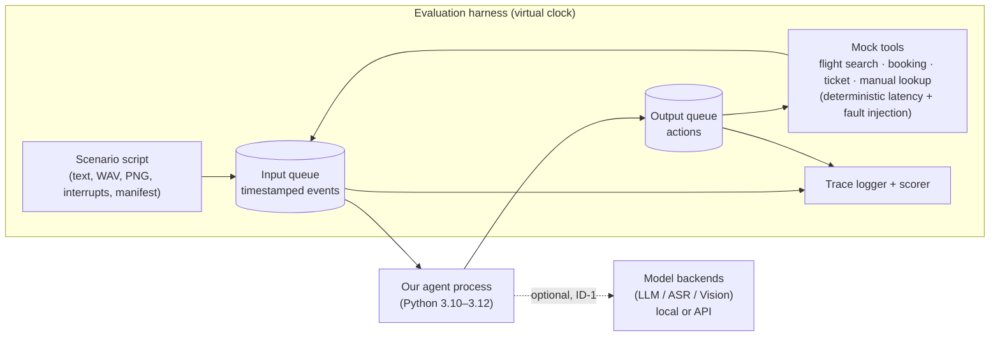
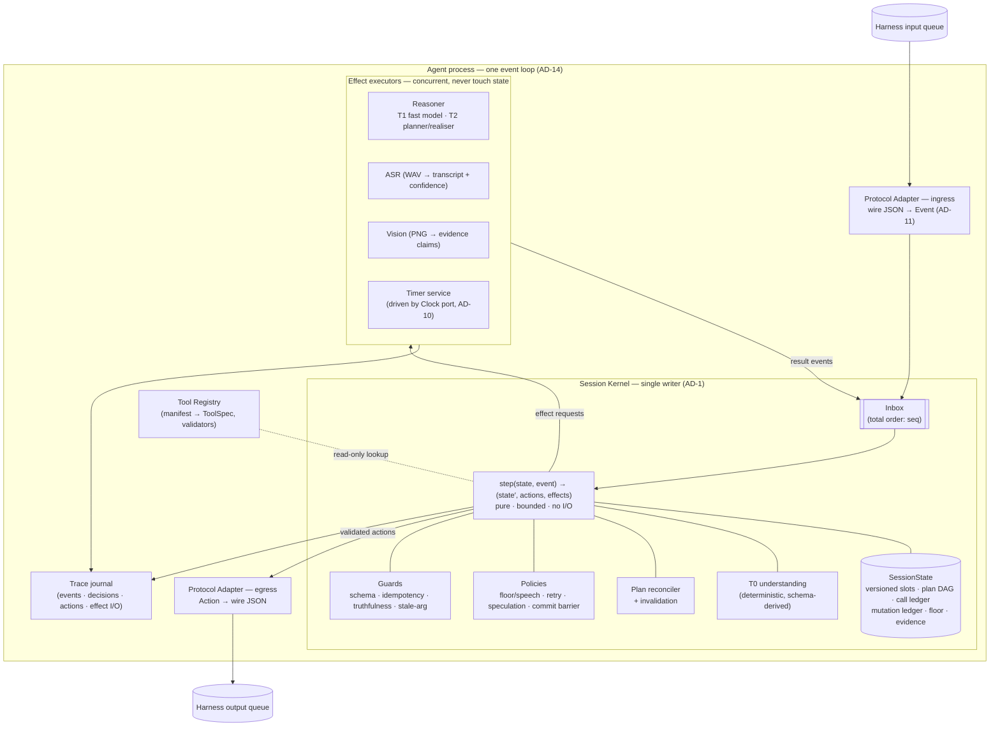
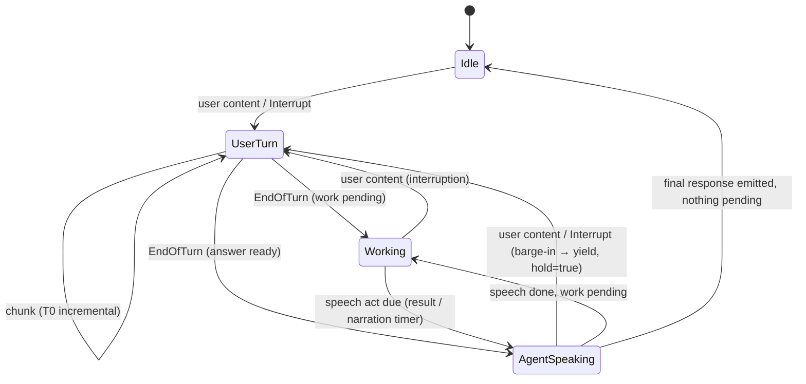
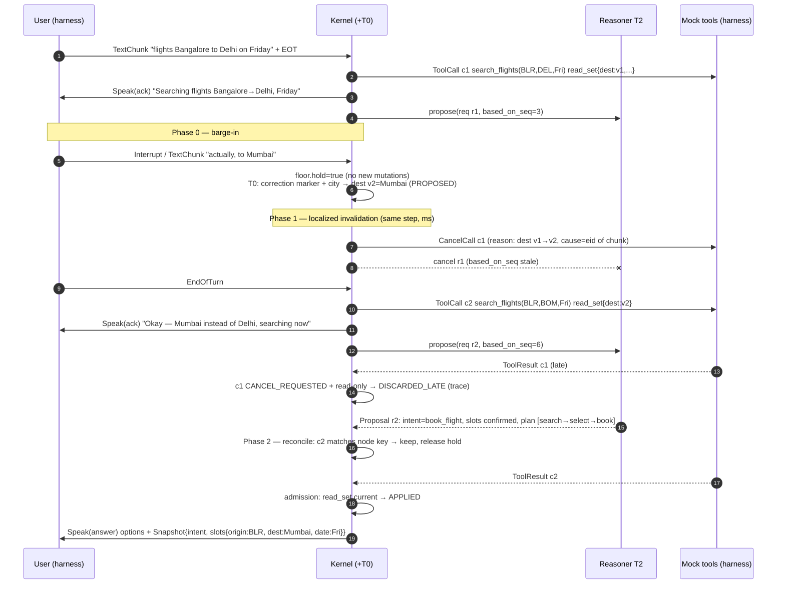
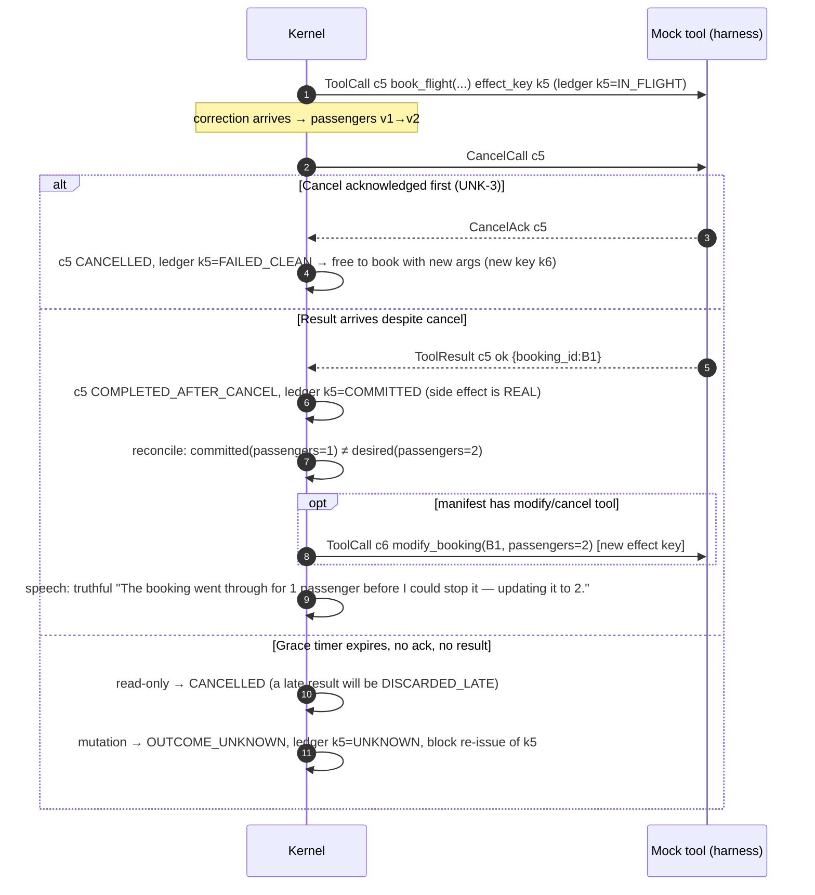
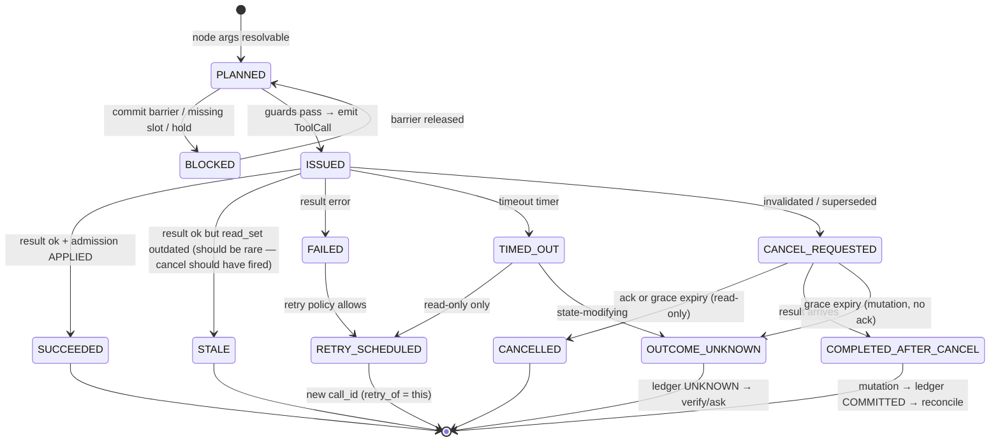
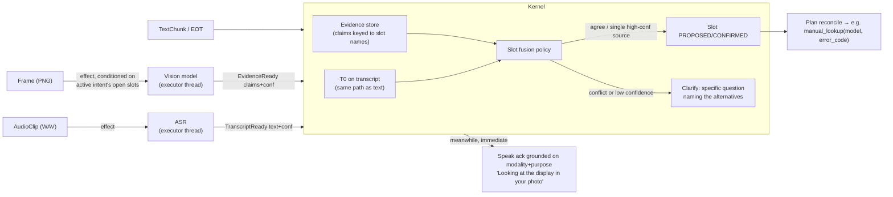

> **ARCHIVED — historical v0.1, superseded.** Preserved verbatim for decision history. It contains behaviour that the hostile review (`../ARCHITECTURE_REVIEW.md`) found unsafe (e.g. argument-keyed side-effect ledger, read-set invalidation, 100–400 ms interruption wait). Do not implement from this file. The normative architecture is the FINAL ARCHITECTURE section of `../ARCHITECTURE_REVIEW.md`.

# Theme 05 — Interruptible Real-Time Agent: Architecture Specification

| | |
|---|---|
| Project | Samsung PRISM Generative AI Hackathon 2026-27, Theme 05 "Interruptible Real-Time Agents" |
| Document status | **Superseded in part by `ARCHITECTURE_REVIEW.md` (2026-09-29).** Where they conflict, the review's "FINAL ARCHITECTURE — APPROVED FOR IMPLEMENTATION" section wins. The diagrams embedded below are v0.1 originals; the current diagram set is in `docs/diagrams/`. |
| Version | 0.1 (pre-implementation) |
| Date | 2026-09-29 |
| Authoritative sources | `Theme 5_Guide.pdf` (v1.0.0), `Samsung PRISM_Y2026_GenAI_Hackathon_3rd_Edition.V2(2).pdf` |

Decision labels used throughout:

- **AD-n — Architectural Decision (final once approved).** Changing one later means rework across modules.
- **ID-n — Implementation Decision (deliberately open).** These can be swapped behind a stable boundary, and most wait on the evaluation kit or on measurement.
- **UNK-n — Unknown.** These are facts we must get from the evaluation kit. The design isolates each one so it can't spread through the codebase.

---

## 0. Source analysis and repository audit

### 0.1 What the problem actually asks for (distilled from the Theme 05 guide)

| # | Requirement | Source (Guide §) | Architectural consequence |
|---|---|---|---|
| R1 | Agent communicates over **two asynchronous queues**: timestamped events in, actions out | §3 | The agent is an event processor, not a request/response chatbot. There is no "turn" API. |
| R2 | Inputs: text chunks + end-of-turn markers, WAV clips, PNG frames, interruption signals, **async tool results**, **tool manifests** | §3.1 | Tools are executed **by the harness**. We emit calls and receive results as events, so tool latency is never on our thread. |
| R3 | Outputs: spoken fillers, non-blocking tool calls with **explicit `call_id`**, cancellations, clarifications, final responses with **State Snapshots (intent + slots)** | §3.1 | The agent owns call identity. Snapshots are a first-class output, not a by-product of text generation. |
| R4 | Fast path in "a few hundred ms"; slow path for tools, multimodal, reasoning; coordination layer for non-blocking execution, cancellation, snapshots, idempotency | §1 | We need three separable concerns. The coordination layer is the heart of the system. |
| R5 | Floor management: meaningful responses quickly, **no false completion claims, no excessive fillers** | §3.2.1 | Speech must be derived from verified state, and fillers must be rate-limited. |
| R6 | Interruption recovery: cancel superseded in-flight calls **within a few ms grace period**, update snapshots, re-plan cleanly | §3.2.2 | Cancellation decisions cannot wait on an LLM. Part of understanding must be deterministic and in-process. |
| R7 | Session-scoped slots across turns; **localized slot corrections** | §3.2.3 | A correction must touch only the slot that changed and the work that depends on it. |
| R8 | Dynamic tool definitions from manifests (read-only vs state-modifying); **strictly no duplicate state-changing calls** | §3.2.4 | We need a manifest-driven registry and a mutation ledger, with no hard-coded tools. |
| R9 | Process audio and frames **behind conversational acknowledgements**; clarify ambiguous perception | §3.2.5 | Perception is asynchronous and produces evidence with confidence. |
| R10 | Well-formed JSON payloads with valid snapshots and identifiers | §3.2.6 | Every output passes schema validation before it leaves the agent. |
| R11 | Virtual-clock harness, deterministic replay, fault injection (latency, failure) for flight search, booking, ticket creation, frame-grounded manual lookup | §4 | Our own time source must be injectable, and our behaviour must be replayable. |
| R12 | 9 public / ~60 hidden scenarios, mix 50% text / 30% audio / 20% visual; interruptions, chained calls, retries, clarifications, **unseen tools**, **adversarial timing** | §4 | Tool handling must be generic. Timing robustness must come from structure, not tuning. |
| R13 | Score = Task Completion 40 + Interruption Recovery 35 + Latency 15 + Safety & Protocol 10, × quality multiplier 0.8–1.2 (naturalness, truthfulness, relevance); multimodal ×1.5 in hidden set | §5 | 75% of the score is correctness under interruption. Latency is 15% and measures only the **first substantive spoken action**. |
| R14 | Python 3.10–3.12, 120 s wall-clock cap per scenario, 300 s setup/warm-up hook, session-scoped memory only | §6 | We run as a single-process Python agent, load models during warm-up, and never cache across sessions. |
| R15 | Out of scope: wake word, voice synthesis tuning, UI design | §6 | We build no TTS and no UI product. A trace viewer is allowed as an engineering tool. |
| R16 | Focus areas: async event-loop orchestration, speculative execution, latency hiding, multimodal intent grounding | §6 | These are what the judges are primed to look for. |

Broader PRISM judging (main deck p.11): Working prototype 30%, Technical depth & feasibility 25%, Innovation 20%, Theme relevance 15%, Presentation & docs 10%. The final jury asks: *does it work, is it sound, would a user want it, can it become a worklet?* Submission needs a GitHub repo with README, Docker, a 5-minute video, a deck, and the release tag `PRISM_GENAI_HACKATHON_Y2026`.

### 0.2 Repository audit (as of 2026-09-29)

| Finding | Detail | Consequence |
|---|---|---|
| **No source code** | Only `fwdsamsungprismgenaihackathon3_0registrationli/` with PDFs, a pptx template and a docx | The design is greenfield. There is nothing to reuse or redesign. |
| **Not a git repository** | No `.git` | Submission requires a GitHub repo and a release tag. This must be fixed in Phase 0. |
| **Evaluation kit absent** | Guide §4: "released post the registrations" | The exact wire protocol, event field names, cancel semantics and clock semantics are all unknown. See §14.4 (UNK list). |
| Irrelevant material | `theme1_guidelines.pdf`, `Theme 2_...pdf`, `Theme 3 - Evaluation Criteria.pdf` (an Android APK rubric for Theme 3), `Theme 4 Guide_RAG.pdf` | Ignore these. Do not mix their criteria into ours. |
| **Inconsistency in main deck** | The Theme 05 slide lists "Corpus provided" and "begin retrieving before the utterance ends", which is copied from Theme 04 | The Guide v1.0.0 is authoritative. We will not build a RAG corpus pipeline; manual lookup is a harness-provided tool (Guide §4). |
| **Schedule risk** | The deck lists submission closing on 25 Sep 2026, and today is 29 Sep 2026 (dates are marked "tentative") | Confirm the live deadline with the organisers immediately (`prism@samsung.com`). This could make everything below moot. |
| Deliverable templates | `CollegeName_TeamName_Submission.pptx` (12 slides incl. architecture diagram slide), `LangAI3.0_AI_Disclosure.docx` | The AI-disclosure form requires feature-level provenance, so keep a log of AI-assisted work from day one. |

---

## 1. Executive architecture summary

The agent is a **deterministic, single-writer session kernel surrounded by asynchronous effect executors**. Every input (text chunk, audio clip, frame, interrupt, tool result, model output, timer) becomes an event in one ordered inbox. The kernel processes each event in a bounded, I/O-free step. The step updates a versioned session state and emits two kinds of output: **actions** (speech, tool calls, cancellations, clarifications, snapshots) and **effect requests** (run the LLM planner, run ASR, run vision, set a timer). Effects run concurrently and report back only by posting new events, so nothing but the kernel ever mutates state.

The mechanism that makes interruption recovery correct is **dependency-tracked, versioned slots**. Every slot value has a version number. Every tool call records the exact slot versions its arguments were derived from (its *read-set*). When a correction changes a slot, the kernel cancels, in the same step, exactly the in-flight calls whose read-set contains the old version. Calls unaffected by the correction keep running. Separately, every tool result and every model proposal goes through **admission control** when it arrives: it is applied only if its read-set is still current. Correctness therefore never depends on winning a race against a late result. Cancellation affects the promptness score; admission control guarantees correctness.

The LLM never acts directly. It **proposes** intent, slot updates and a desired plan. The kernel **disposes**: it validates proposals against the manifest schemas, derives `call_id`s, enforces the mutation ledger (no duplicate state-changing calls), and builds State Snapshots from canonical state. The plan is a **content-addressed dependency graph**, reconciled declaratively against the calls actually in flight. After an interruption, identical work is kept, obsolete work is cancelled, and only new work is issued.

Responsiveness comes from a **tiered understanding cascade**:

- **T0** is deterministic and runs in-kernel in milliseconds, using recognisers derived from the tool schemas.
- **T1** is a fast model effect.
- **T2** is the full planner.

Speech is generated only from **state deltas** ("searching flights to Mumbai for Friday" is spoken only once that call has actually been issued). A truthfulness guard blocks any completion claim that the ledger cannot back.

All time comes from an injectable clock. All effect outputs are journaled. A scenario can therefore be **replayed bit-for-bit without models or harness**, which makes concurrency bugs reproducible and makes every decision explainable from the trace.

---

## 2. Design principles

| # | Principle | Why (grounding) |
|---|---|---|
| P1 | **One writer, many workers.** Only the kernel mutates session state. Concurrency lives in effects, not in state. | R6, R7. Almost every interruption bug is a race on shared state. Removing shared mutable state removes the bug class. |
| P2 | **Correctness by validation, promptness by cancellation.** Late or stale results are rejected on arrival no matter what cancellation did. | R6, R13 (35% interruption). Cancellation can always lose a race with completion, but validation cannot. |
| P3 | **LLM proposes, kernel disposes.** Identifiers, snapshots, idempotency and cancellation are deterministic kernel functions. | R3, R8, R10. Safety & Protocol (10%) must not depend on sampling. |
| P4 | **Invalidate locally.** A correction invalidates only the work that read the corrected value. | R7 ("localized slot corrections"), and the Theme 05 slide: "most systems … throw everything away and start over". |
| P5 | **Speak facts, not hopes.** Every utterance is grounded in a state transition that has already happened. | R5 (no false completion claims), quality multiplier (truthfulness). |
| P6 | **Mutations are committed deliberately.** No speculative, duplicate or blind-retried state-changing call, ever. | R8, R13 ("zero duplicate state-changing calls"). |
| P7 | **Time is an input.** No sleeps and no wall-clock reads in logic. Timers are events. | R11 (virtual clock), and replayability. |
| P8 | **The harness protocol is a detail.** Exactly one module knows its wire format. | The eval kit is not yet available (UNK). Hidden scenarios may add fields. |
| P9 | **Level-triggered, not edge-triggered.** The kernel reconciles *desired* state against *actual* state instead of reacting to individual edges. | R12 (adversarial timing). A duplicate, missing or reordered event cannot desynchronise a level-triggered reconciler. |
| P10 | **Build the least system that proves the claims.** No broker, database, vector store, multi-agent framework or microservices. | Hackathon scope, 120 s scenarios, and single-session memory. Complexity that the 9 public and ~60 hidden scenarios cannot exercise is pure risk. |

---

## 3. System context



**Explicitly outside the agent core:** tool execution (the harness does it), speech synthesis, wake word, UI, cross-session memory, retrieval corpora, and scoring.

---

## 4. High-level architecture



### 4.1 Subsystem boundaries

| Subsystem | Owns | Must NOT do |
|---|---|---|
| **Protocol Adapter** | Wire format ↔ internal `Event`/`Action`; field mapping; ingest timestamps; loading media refs | Make decisions, hold state (beyond a dedupe window), or call models |
| **Session Kernel** | All session state; ordering; all decisions (cancel, issue, speak, clarify, snapshot); T0 understanding | Any I/O, model call, sleep or wall-clock read. It must not block for more than a few ms. |
| **Reasoner (T1/T2)** | Mapping language + evidence + state summary → structured *proposal* (intent, slot updates, desired plan, response content) | Emitting actions, choosing `call_id`s, writing state, or deciding idempotency |
| **Perception (ASR, Vision)** | Mapping raw media → typed *evidence* with confidence and provenance | Deciding slot values or talking to the user |
| **Timer service** | Turning "wake me at harness-time *t*" into a `TimerFired` event | Holding logic |
| **Tool Registry** | Parsing and validating manifests; argument validation and canonicalisation; side-effect class | Executing tools (the harness does) |
| **Trace journal** | Append-only record sufficient for deterministic replay and "why" queries | Being read by decision logic |

The boundaries follow the problem's own decomposition:

- **Perception** maps to ASR and Vision.
- **Reasoning** maps to the Reasoner.
- **Execution** maps to tool calls out through the Adapter.
- **Coordination** maps to the Kernel.
- **State** maps to SessionState.
- **Output** maps to the Adapter egress after the Guards.

---

## 5. Architectural alternatives considered

The problem is a concurrency and state-consistency problem (Guide §1), so the alternatives below differ in **where state lives and who serialises changes to it**. They are not deployment topologies.

| Approach | Description | Interruption correctness | State consistency | Latency | Determinism / testability | Hidden-set robustness | Build cost | Verdict |
|---|---|---|---|---|---|---|---|---|
| **A. Sequential agent loop + task cancellation** (ReAct-style, `task.cancel()` on interrupt) | One coroutine: listen → LLM → tool → LLM … | Poor. Cancel-and-restart discards valid work, and state is mutated mid-await, so races are likely | Weak | LLM on critical path | Low: behaviour depends on await interleavings | Weak on adversarial timing | Low | Rejected. It is the "half-duplex with a kill switch" the theme critiques. |
| **B. Multi-agent pipeline** (perception agent, planner agent, executor agent, speaker agent, each with own memory) | Actors message each other | Medium. Cancellation needs distributed agreement | Weak. Slots are replicated across agents and can drift | Good | Low to medium | Medium | High | Rejected. It adds consensus problems we would then have to solve. |
| **C. Blackboard** (shared state, knowledge sources fire opportunistically) | Classic AI architecture | Medium | Weak without locking, and locking re-creates A's races | Good | Low | Medium | Medium | Rejected. Its opportunism is the opposite of explainable traces. |
| **D. Reactive dataflow** (Rx-style streams; `switchMap` for supersession) | Streams of chunks → intents → calls | Coarse. `switchMap` cancels the *whole* upstream on any new input, which throws everything away | Implicit and scattered across operators | Good | Medium (virtual schedulers exist) | Medium | Medium | Rejected as the core. Its supersession granularity is wrong for localized corrections. |
| **E. End-to-end full-duplex speech model** (native duplex audio LLM) | One model does everything | Opaque | None explicit, so snapshots must be scraped | Excellent for speech | None | Weak on tools, IDs and schemas | High (GPU, weights) | Rejected. It fails Protocol and Snapshot requirements and is non-deterministic. |
| **F. Event-sourced single-writer kernel + effect executors + declarative plan reconciliation** (chosen) | Pure reducer over an ordered event log; effects asynchronous; versioned slots with read-sets | **Strong.** Localized invalidation plus admission control | **Strong.** One writer, versioned | Fast path ms; slow work never on the critical path | **Replayable bit-for-bit** | Strong. Level-triggered reconciliation tolerates reordering and duplicates | Medium | **Selected.** |

F borrows the right idea from each alternative:

- From **A**, the LLM-driven planning loop, demoted to a proposal source.
- From **D**, supersession, made fine-grained through read-sets.
- From database systems, optimistic concurrency control: validate the read-set at commit (admission control).
- From build systems and Kubernetes controllers, content-addressed nodes and level-triggered reconciliation.
- From statecharts, explicit floor and call lifecycles.

---

## 6. Detailed component architecture

### 6.1 Protocol Adapter (AD-11)

- **Ingress.** Maps wire messages to `Event`. It assigns `seq` (a monotonic arrival counter), records `t_harness` (the harness timestamp, authoritative) and `t_recv` (Clock.now). It loads WAV/PNG payloads by reference, so large blobs never enter the kernel state. It drops exact duplicates by harness event id if the protocol provides one. It performs no semantic interpretation.
- **Egress.** Maps `Action` to wire JSON and runs the **output schema validator** (a second line after kernel guards). If validation fails, it drops the action, emits an `ActionRejected` trace record, and posts an `EgressError` event so the kernel can compensate (e.g. re-emit a template response).
- It is the **only** module importing harness-specific names. When the kit arrives, only this module and its tests change.

### 6.2 Session Kernel (AD-1, AD-2)

Single coroutine consuming the inbox. For each event:

```
step(state, event):
  0  admit      — dedupe; ordering sanity; trace(event_in)
  1  working    — s := copy-on-write(state)
  2  interpret  — dispatch by event.kind (table-driven, §7):
                   content → T0 incremental understanding → provisional slot diffs
                   EndOfTurn → close turn; request T2 (cancel superseded reasoner reqs)
                   ReasonerProposal → admission (based_on_seq) → schema validation → apply
                   ToolResult → call admission control (§11.3) → apply / discard / reconcile
                   Evidence → attach; may resolve slots or open a clarification
                   TimerFired → timeout / progress narration / end-of-turn fallback / deadline governor
  3  invalidate — for each slot whose version changed in this step:
                   mark dependent calls/results/plan nodes invalid (§10.3)
  4  reconcile  — desired plan (latest admitted proposal + deterministic continuation)
                   vs actual calls → {cancel, issue, keep, reuse} (§12)
  5  guard      — commit barrier; mutation ledger; arg schema; stale-arg; truthfulness
  6  speak      — floor/speech policy: at most one speech act from the state delta
  7  snapshot   — emit snapshot if intent/slots changed and the policy requires it
  8  commit     — state := s; state.version++; emit actions (validated); start effects;
                   trace(decisions with reason codes + cause event ids)
```

Properties:

- **Bounded.** No I/O, no awaits, and p99 target < 5 ms (measured, §17).
- **Exception-safe.** Work happens on a copy. If the step raises, the old state stays intact, the event is traced as `poison`, and a safe fallback runs (§15).
- **Deterministic.** Given the same event sequence, including recorded effect outputs, it produces the same actions.

### 6.3 Tool Registry (AD-15)

Parses each manifest into:

```
ToolSpec {
  name, description,
  params: JSONSchema (validated; draft per kit),
  returns: JSONSchema | None,
  effect: READ_ONLY | STATE_MODIFYING      # from manifest; missing/unknown ⇒ STATE_MODIFYING (conservative)
  idempotent: bool | None                  # manifest hint, if any
  cancellable: bool | None
  timeout_s: float | None                  # manifest hint; else policy default
  compensation: {modify: tool?, cancel: tool?}   # detected by manifest hint or name/description; used only with policy
  source_event: eid, status: ACTIVE | QUARANTINED(reason)
}
```

It exposes `validate_args`, `canonicalize(args)` (key ordering, whitespace/case normalisation for strings where the schema permits, numeric normalisation, enum snapping with confidence) and `effect_key(tool, canonical_args)`.

A malformed tool is **quarantined**, not fatal. The rest of the manifest stays usable. Manifests can arrive mid-session; each new manifest produces a new registry version, and plan nodes referencing a removed tool are invalidated.

### 6.4 Understanding cascade (AD-8)

| Tier | Where | Latency budget | Input | Output | Used for |
|---|---|---|---|---|---|
| **T0** | In-kernel, synchronous | < 2 ms per chunk | Each text chunk + current state | Provisional slot diffs, correction markers, backchannel/hesitation flags, confidence | Immediate cancellation decisions; immediate substantive acks; the speculation trigger |
| **T1** | Effect (fast model) | ~100–400 ms target | Current open turn + slot table | Intent guess + slot diffs (structured) | Early substantive response when T0 is insufficient; pre-EOT understanding |
| **T2** | Effect (planner model) | ~0.5–3 s | Full context summary + manifest + evidence + ledger | **Proposal**: intent, slot updates with evidence spans, desired plan nodes, clarification need, response content | Authoritative understanding, plan, and final wording |

T0 is **generated from the manifest**, not hand-written per domain:

- Enum lexicons come from schema enums.
- Typed recognisers come from `format`/`type` (dates and relative days, times, integers, "two passengers" → 2).
- A correction-marker lexicon covers phrases such as "no", "actually", "instead", "wait", "make it", "change … to", "not X, Y".
- A backchannel/hesitation lexicon covers "uh-huh", "okay", "um", "hmm".
- A slot-attribution heuristic assigns a recognised value to the unique slot of compatible type. With several candidates (origin vs destination), prepositions ("to/from") and "most recently mentioned slot of this type" decide. **If it is still ambiguous, T0 abstains** and escalates to T1/T2.

T0 never commits a mutation. It can only make slots `PROPOSED`.

Unseen tools (R12) are handled by T2, which reads the manifest, and by T0's schema-derived recognisers, which rebuild whenever the manifest changes.

### 6.5 Reasoner (effect)

- It is a **port** with two operations: `propose(context) → Proposal` and `realise(response_spec) → text`. Backends (ID-1) are LLM(s) plus a **deterministic rule backend** used for tests and as a fallback on model failure.
- Every request carries `req_id`, `based_on_seq` (the last input event it saw) and `purpose`. Superseded requests are cancelled (task cancel) and their late results fail admission.
- Output is **schema-constrained** (ID-5). An invalid output gets one repair attempt, then falls back (§15).
- It sees the manifest, the slot table *with versions and history*, the ledger summary (what is done, in flight, or cancelled), evidence, and recent turns. It is instructed to express arguments **as slot references** where possible ("destination": `{"$slot":"destination"}`) so that the kernel can track read-sets precisely.

### 6.6 Perception executors (AD-13)

- **ASR:** WAV → `TranscriptReady{text, words?, confidence, source_eid}`. This is then fed into the *same* path as text chunks, so audio and text share one understanding pipeline.
- **Vision:** PNG + current question/intent → `EvidenceReady{claims:[{key, value, confidence, bbox?}], source_eid}`. It is question-conditioned when an intent is known, so it asks the model specific things ("model number on label", "error code on display").
- CPU/GPU-heavy inference runs in an executor thread/process, **never on the event loop** (a blocked loop = a dead fast path).

### 6.7 Policies

These are plain functions plus constants (ID-9). A policy is promoted to a pluggable strategy only if a second variant proves necessary.

- **Floor & speech** (§9.4)
- **Commit barrier** for mutations (§11.4)
- **Retry** (§11.5)
- **Speculation** for read-only calls (§9.3)
- **Interruption aggressiveness** (§10.2)
- **Deadline governor**: finalize before the 120 s cap

### 6.8 Guards (last line inside the kernel)

- **Arguments:** every tool call validates against its ToolSpec schema, and every slot-bound argument equals the *current* slot value (**stale-arg guard**).
- **Mutations:** every mutation passes the ledger (no duplicate effect key) and the commit barrier.
- **Truthfulness:** a speech act of type `answer`/`confirm` can only reference ledger facts in `SUCCEEDED`/`COMMITTED`. Phrases implying completion are generated only from such facts (§9.5).
- **Structure:** every action has `caused_by` (≥ 1 event id) and a valid schema.

---

## 7. Event model

### 7.1 Envelope

```python
@dataclass(frozen=True)
class Event:
    eid: str                 # harness id if provided, else f"in-{seq}" / f"fx-{seq}"
    seq: int                 # kernel arrival order — THE total order used for all decisions
    kind: EventKind
    t_harness: float | None  # timestamp from harness (virtual clock) — authoritative for latency
    t_recv: float            # Clock.now() at ingestion
    turn_id: int | None      # user turn this belongs to (assigned at ingestion for content)
    cause: tuple[str, ...]   # causal parents (effect results point to the request/event that caused them)
    corr: dict               # correlation: call_id, req_id, plan_rev, timer_id …
    payload: dict            # kind-specific, validated per kind
```

### 7.2 Event kinds

| Origin | Kind | Key payload | Notes |
|---|---|---|---|
| Harness | `SessionStart` / `SessionEnd` | scenario meta | Kernel instance per session. No state carried across. |
| Harness | `ToolManifest` | tool list | Can occur at start or mid-session |
| Harness | `TextChunk` | text, (is_partial?) | Opens a turn if none is open |
| Harness | `EndOfTurn` | — | Closes the open turn |
| Harness | `AudioClip` | wav ref, duration | Triggers the ASR effect. Also marks user activity on the floor. |
| Harness | `Frame` | png ref | Triggers the vision effect (question-conditioned) |
| Harness | `Interrupt` | (whatever kit provides) | Barge-in signal. May precede the content. |
| Harness | `ToolResult` | call_id, status, data/error | Also a possible `CancelAck` (UNK-3) |
| Effect | `TranscriptReady` | text, confidence, source_eid | Normalised into the text path |
| Effect | `EvidenceReady` | claims[], source_eid | |
| Effect | `ReasonerProposal` / `ReasonerFailed` | req_id, based_on_seq, proposal | |
| Effect | `TimerFired` | timer_id, purpose, due_t | Purposes: call_timeout, cancel_grace, progress_narration, eot_silence, deadline |
| Adapter | `EgressError` | action_id, reason | |

Actions are described in §14.

### 7.3 Identity, ordering, causality

- **Total order = `seq`** (inbox arrival). Harness timestamps are recorded and used for latency and timer maths, but decisions follow `seq`. This removes any ambiguity when timestamps tie or clocks jump. For events with equal `t_harness` delivered in one batch, we preserve harness delivery order.
- **Causality:** every effect result's `cause` points to its request's triggering event. Every action's `caused_by` points to the events that justified it. Combined, these form a DAG over the trace that lets us answer "why did call c7 happen?" mechanically (§16).
- **Correlation:** `call_id` (tool lifecycle), `req_id` (reasoner lifecycle), `plan_rev` (plan generation), `turn_id` (conversation), `intent_epoch` (goal identity).

### 7.4 Turn boundaries and interruption representation

- A **turn** opens on the first user content (text, audio or frame) when none is open, and closes on `EndOfTurn` or an EOT-silence timer (fallback for missing markers, UNK-6).
- An **interruption** is not a separate kind of turn. It is a user turn that opens while the agent holds the floor (speaking) **or** has un-finalised work for an earlier turn. The kernel records `turn.interrupts = (prior_turn_id, in_flight_call_ids, agent_speaking)`. An explicit `Interrupt` event opens that condition even before content arrives.
- **Backchannels and hesitations** ("uh-huh", "um") are detected by T0 and do not interrupt. They are traced as `backchannel` so they are visibly ignored.

### 7.5 How stale events are prevented from affecting the current task

Four fences apply, all checked in-kernel:

| Fence | Protects against | Mechanism |
|---|---|---|
| **Slot-version fence** | Tool results computed with superseded arguments | The call's `read_set {slot: version}` must equal the current versions at admission (§11.3) |
| **Input-sequence fence** | Reasoner/T1 proposals computed before newer user input | `proposal.based_on_seq ≥ state.last_user_input_seq`, otherwise discarded as `SUPERSEDED` |
| **Call-state fence** | Duplicate or late tool results | A result is admitted only if the call is `ISSUED` (or `CANCEL_REQUESTED`, which has separate handling) |
| **Intent-epoch fence** | Work belonging to an abandoned goal | Plan nodes and calls carry `intent_epoch`. After a goal switch, old-epoch read-only work is cancelled and old-epoch results are never used for the new goal's response. |

---

## 8. State model

### 8.1 Canonical state

```python
SessionState {
  version: int                                  # ++ per committed step
  registry: ToolRegistry                        # versioned
  floor: Floor { user_turn_open, agent_speaking, last_user_activity_t,
                 last_agent_speech_t, fillers_in_window, hold: bool }
  turns: list[Turn]                             # id, chunks, text, modality, status: OPEN|CLOSED, interrupts
  intent: IntentFrame | None                    # current goal
  intent_history: list[IntentFrame]             # COMPLETED | ABANDONED | SUSPENDED frames (context preserved)
  slots: dict[str, Slot]                        # session-scoped table
  evidence: dict[eid, Evidence]
  plan: Plan                                    # rev, nodes (§12)
  calls: dict[call_id, CallRecord]              # every call ever issued this session
  mutation_ledger: dict[effect_key, LedgerEntry]
  pending: list[PendingDecision]                # open clarifications / confirmations
  reasoner: dict[req_id, ReasonerReq]           # in-flight, with based_on_seq
  timers: dict[timer_id, Timer]
  last_user_input_seq: int
  last_snapshot: Snapshot | None
}

IntentFrame { name, epoch, status: HYPOTHESIZED|ACTIVE|COMPLETED|ABANDONED|SUSPENDED,
              confidence, required_slots, source_eids }

Slot { name, value, version, status: PROPOSED|CONFIRMED|INVALIDATED,
       confidence, tier: T0|T1|T2|USER_CONFIRMED|EVIDENCE,
       sources: [eid], history: [(version, value, status, eid, seq)] }

CallRecord { call_id, node_id, tool, args, canonical_args, effect_key, effect,
             read_set: {slot: version}, dep_calls: [call_id], intent_epoch,
             status (§11.2), attempt, retry_of, issued_seq, issued_t, deadline_t,
             result, admission: APPLIED|DISCARDED_LATE|DISCARDED_STALE|COMMITTED_AFTER_CANCEL|None,
             invalidated_by: eid|None }

LedgerEntry { effect_key, call_id, status: IN_FLIGHT|COMMITTED|FAILED_CLEAN|UNKNOWN, result }
```

### 8.2 Slot semantics

- **Session-scoped** (R7). Slot names are canonicalised to **tool parameter names from the manifest**, unless the kit defines a snapshot slot schema (UNK-5). The intent frame lists which slots it *uses*. Switching goals does not delete slots: a new intent inherits compatible slots as `PROPOSED`, and T2 confirms or overrides them.
- **Versioned.** Any value change → `version + 1`, and the old value moves to `history`. Re-asserting the same value does not bump the version, so it does not invalidate anything.
- **Status:**
  - `PROPOSED` comes from T0/T1 or inheritance. It may drive read-only calls and acks.
  - `CONFIRMED` comes from T2, explicit user confirmation, or high-confidence evidence. It is required for mutations.
  - `INVALIDATED` means explicitly retracted ("forget the date").
- **Confidence** is kept per slot. Low-confidence values from ASR or vision trigger clarification before any mutation uses them.

### 8.3 How an interruption modifies state without corrupting valid information

1. Only slots named in the correction diff change version. Every other slot, and every result derived only from unchanged slots, remains valid **by construction**.
2. Invalidation is computed from read-sets, not guessed. Anything whose read-set touches a bumped slot is marked invalid. Nothing else is.
3. A goal switch (new intent) **suspends** the old frame into `intent_history` instead of deleting it. The user can return ("ok, go back to the flight"), and completed facts (e.g. a booking already committed) remain in the ledger and remain truthful.
4. Committed mutations are **never** un-recorded. A correction that conflicts with a committed mutation produces a *reconciliation* decision (§10.5), not state rewriting.

### 8.4 State snapshot (derived, never authored)

```
snapshot(state) = {
  "intent": state.intent.name | null,
  "slots": { name: slot.value  for slots used by the active intent with status != INVALIDATED },
  # optional, if the kit permits extra fields (UNK-5):
  "snapshot_version": state.version, "intent_status": ..., "pending": [...]
}
```

It is produced by a pure function and validated against the snapshot schema before emission. The LLM never writes a snapshot. Emission points are:

- every final response (mandatory);
- after any interruption-induced change to intent or slots, once the change is confirmed;
- with clarification requests, if the kit expects it.

---

## 9. Fast vs slow execution model

### 9.1 Mechanics, not labels

There are no "fast path" or "slow path" threads. Instead:

- **The fast path is the synchronous kernel step plus T0.** Whatever can be decided from state already in memory is decided and emitted in the same step as the triggering event, in milliseconds. This covers:
  - cancellations;
  - acks grounded in newly recognised slot values;
  - issuing read-only calls whose arguments are complete;
  - clarifications for missing required slots;
  - progress narration when a timer fires.
- **The slow path is every effect:** T1, T2, ASR, vision, and the tools themselves (running in the harness). Effects never block the kernel. They re-enter as events, and the kernel's fast path then reacts to *their* results.

So "information flow between fast and slow" is simply this: **slow results become events, and events trigger fast reactions.** There is no second channel.

### 9.2 What qualifies for an immediate response

| Trigger | Immediate action (same step) | Why it's substantive, not filler |
|---|---|---|
| EOT with T0 slots covering a read-only tool's required params | Issue call + speak "Searching flights from Bangalore to Mumbai on Friday" | States the understood parameters and a real in-flight action |
| EOT with a required slot missing and no other ambiguity | Clarify "Which date would you like to fly?" | Moves the task forward |
| Correction chunk resolved by T0 | Cancel dependents + (at EOT) "Okay, Mumbai instead of Delhi" | Confirms the localized change |
| Frame/audio received with known intent | "Looking at the photo of your washer's display now" | Names the modality and the purpose |
| Slow call exceeds narration threshold | "Still waiting on the airline's fares for Friday" | Grounded progress. Rate-limited. |
| Nothing new to say | **Silence** | Silence beats a meaningless filler (R5) |

When T0 is insufficient, the first substantive action waits for T1 (a few hundred ms). A single contentless filler ("One moment") is allowed only if T1 misses its budget, and the filler budget caps it (§9.4).

### 9.3 Speculation (latency hiding)

- **Read-only calls** may be issued *before* EOT when a policy condition holds. The candidate condition is that T0/T1 slots cover all required params with confidence ≥ θ, and no correction marker has appeared in the open turn. A speculative call carries `speculative: true` in our trace. If the final understanding disagrees, it is cancelled by the normal read-set mechanism.
- **The reasoner** may start on a partial transcript, debounced by chunk arrival. Each new chunk supersedes the request through the input-sequence fence.
- **State-modifying calls are never speculative** (AD-7).
- **Default: speculation off for tool calls, on for T1** (ID-9). The scorer may count cancelled speculative calls as noise. We enable call speculation only after measuring on the public suite.

### 9.4 Floor and speech policy



Rules:

1. **Never speak while the user turn is open.** Barge-in means we yield (emit a stop/yield action if the protocol supports one, UNK-7).
2. **At most one speech act per kernel step.** Consecutive acts are merged by the realiser.
3. **Filler budget:** a contentless filler is allowed only if (a) the user has been waiting > `τ_filler`, (b) nothing substantive is available, and (c) fewer than `N` fillers have been spoken in the current turn. Defaults are `τ_filler` ≈ 700 ms, `N` = 1 (ID-9).
4. **Progress narration** occurs only for work in flight longer than `τ_progress` (≈ 2.5 s), must mention concrete parameters, and repeats at most every `τ_repeat`.
5. **Continuity:** while slow work continues, the agent may answer unrelated user questions from state. The plan keeps running, because conversation and execution share the state, not a thread.

### 9.5 Never claiming completion early

Every speech act carries `act ∈ {ack, narration, clarify, confirm, answer, filler, yield}` and `grounded_on: [call_id | slot@version | evidence eid]`.

- `confirm`/`answer` acts must reference at least one call in `SUCCEEDED` (read-only) or a ledger entry in `COMMITTED` (mutation).
- For `narration` about an in-flight call, the realiser uses progressive-aspect templates ("I'm booking…", never "I've booked…").
- LLM-realised text for `confirm`/`answer` is checked. Every entity it mentions must appear in the grounding facts; if one does not, the kernel falls back to the template.

---

## 10. Interruption and cancellation lifecycle

### 10.1 Lifecycle phases



| Phase | Trigger | Kernel actions | Budget |
|---|---|---|---|
| **0 Barge-in** | `Interrupt` or user content while agent speaks or work is pending | Yield floor; `hold=true` (freeze new mutations, not reads); open interrupting turn; start EOT-silence timer | same step |
| **1 Localized invalidation** | Each interrupting chunk | T0 diff → bump slot versions → cancel in-flight read-only calls whose read-set is now stale; cancel superseded reasoner requests; mark completed dependent results stale | same step (target < 5 ms from chunk arrival) |
| **2 Re-understanding** | EOT and/or T1/T2 proposal | Apply authoritative diff (may extend Phase 1's cancellations); determine intent change vs slot change; reconcile plan; issue new calls; substantive ack | T1: ~100s ms; T2: seconds (off the latency path) |
| **3 Convergence** | Results | Admission control; plan advances; mutation commit barrier opens; final response + snapshot | tool-bound |
| **4 Quiescence** | No pending work | `hold=false`; final snapshot; floor → Idle | — |

### 10.2 What is cancelled, and when — policy for unresolved interruptions

Only the content of an interruption can reveal what it invalidates. When T0 **resolves** the diff, cancellation is immediate and localized. When T0 **abstains**:

| Situation | Default action (ID-9, tune on public suite) | Rationale |
|---|---|---|
| Content looks like a backchannel/hesitation | Nothing is cancelled; hold is released at EOT | Avoids needless reruns |
| Explicit goal-switch markers ("forget that", "never mind", "instead, …" + different verb) | Cancel **all** in-flight read-only calls of the current intent epoch | Whole-goal supersession is known even if the new goal isn't |
| Content-bearing but unattributable | Keep calls running, but under **hold**. Their results are buffered and admitted only after T1/T2 re-understanding. Cancel on T1 verdict. | Correctness is guaranteed by admission control. Promptness is traded for avoiding wrong cancels. |

This is the one place where Interruption-score promptness trades against "stale rerun"/"no unnecessary work". The architecture makes the trade a **single policy knob**. Its default is set empirically (Approval Gate item G6).

### 10.3 Invalidation algorithm (localized)

```
on slot s: v → v+1   (in step, caused by event e):
  for call c in calls where c.status ∈ {ISSUED} and s ∈ c.read_set and c.read_set[s] == v:
      if c.effect == READ_ONLY:      emit CancelCall(c.call_id, reason=f"{s}@{v}→{v+1}", cause=e)
                                     c.status = CANCEL_REQUESTED; set timer cancel_grace
      else (STATE_MODIFYING):        if spec.cancellable is not False: emit CancelCall(...) ; c.status = CANCEL_REQUESTED
                                     c.at_risk = True   # outcome must be reconciled (§10.5)
  for call c in calls where c.status == SUCCEEDED and s ∈ c.read_set (stale version):
      c.result_valid = False          # never used for answers/grounding again
  transitively: calls whose dep_calls include an invalidated call are invalidated the same way
  plan nodes binding s: re-resolve args at reconcile (§12)
```

Cancellation is **idempotent**. Cancelling a call that is already `CANCEL_REQUESTED` is a no-op, so rapid interruptions never emit duplicate cancels.

### 10.4 Supersession semantics

| Change | Scope of supersession |
|---|---|
| Slot value correction | Calls/results/nodes whose read-set includes the old version (localized) |
| Slot retraction ("no date preference") | Same as above, and the slot becomes `INVALIDATED` |
| Intent refinement (same goal, extra constraint) | Only nodes whose args change (new content key); others kept |
| Goal switch | Old intent frame → `SUSPENDED`/`ABANDONED`; its in-flight read-only work is cancelled; **committed mutations stay** in the ledger and are mentioned truthfully if relevant |
| Newer user input vs in-flight reasoning | Any reasoner request with `based_on_seq < last_user_input_seq` |

### 10.5 Race reconciliation: cancel vs completion



Rules:

- **Read-only.** A late result after cancel is always discarded. Nothing needs rollback.
- **State-modifying.** The world is the source of truth. A result means the side effect happened, and we record it even though we asked for cancellation.
- **No automatic rollback.** Compensation (modify/cancel tools) is issued only when (a) the manifest offers it and (b) the policy allows it (ID-11), because compensation is itself a mutation.
- **Truthfulness.** The user is always told the true outcome.
- **The duplicate that must never happen:** re-issuing `book_flight` with k5's arguments. The ledger blocks it.

### 10.6 Partial completion

Plan nodes complete independently. After an interruption, `SUCCEEDED` nodes whose read-sets are still current are **reused, not re-run**. For example, "weather at destination" is invalidated by a destination change, but "user's loyalty tier" is kept.

---

## 11. Tool execution lifecycle

### 11.1 Call identity and arguments

- `call_id = f"{session_short}-c{n}"`, where `n` is a monotonically increasing per-session counter. It is deterministic, unique, and never reused, not even for retries.
- Arguments are resolved from plan-node bindings (slot refs → current values; node-output refs → admitted results; literals). They are then validated against the schema and canonicalised.
- `read_set` = slot versions used, plus `dep_calls`.
- `effect_key = hash(tool, canonical_args)`. It applies only to mutations and is also sent as an idempotency key if the protocol allows (UNK-4).

### 11.2 Call state machine



### 11.3 Result admission control (AD-5)

On `ToolResult(call_id)`:

1. Is `call_id` unknown? → trace `UNKNOWN_RESULT` and drop.
2. Is the call already terminal? → trace `DUPLICATE_RESULT` and drop.
3. Is the result malformed against the `returns` schema? → treat as `FAILED(malformed)`.
4. Is the call `CANCEL_REQUESTED`/`CANCELLED`?
   - Read-only → `DISCARDED_LATE`.
   - Mutation → `COMPLETED_AFTER_CANCEL`, ledger `COMMITTED`, reconcile (§10.5).
5. Is the read-set current, and are all dependency calls still valid?
   - No, read-only → `STALE`, discard.
   - No, mutation → commit to the ledger (side effect is real) and reconcile.
6. Otherwise `APPLIED`. The node output is set, dependents may now resolve, and the result may ground speech.

### 11.4 Mutation safety (AD-7)

A state-modifying call is issued only if **all** of the following hold:

- **Commit barrier:**
  - no user turn is open;
  - `hold == false`;
  - no reasoner request is in flight with `based_on_seq` older than the latest input;
  - every slot in the read-set is `CONFIRMED`;
  - no pending clarification touches those slots.
- **Ledger:** no entry for `effect_key` in {`IN_FLIGHT`, `COMMITTED`, `UNKNOWN`}.
- **Per-intent guard:** a mutation plan node that has `COMMITTED` is never re-run by re-planning. The new plan must use a different tool (modify/cancel) or ask.
- **Provenance guard:** the mutation's node must trace back to user-originated intent. Tool results and frame text cannot originate mutations (anti-injection, §20).

The barrier costs latency only on the mutation itself. That latency is not scored (R13 scores the *first spoken action*), and the barrier eliminates the most dangerous race: mutating while the user is still correcting.

### 11.5 Retries and timeouts

| Case | Read-only | State-modifying |
|---|---|---|
| Error result (explicit failure) | Retry up to `N_ro` (default 2) with a new `call_id` and backoff via timer; narrate if user-visible delay | Retry once, only if the error is explicitly *not-executed*/transient per manifest/error schema and the same idempotency key is sent (UNK-4). Otherwise report and ask. |
| Timeout (our deadline) | Emit cancel, retry | **Never blind-retry.** Mark `OUTCOME_UNKNOWN`. If the manifest has a read-only status/lookup tool, verify. Else tell the user truthfully and ask. |
| Malformed result | Treat as error | Treat as `OUTCOME_UNKNOWN` |

Deadlines are `spec.timeout_s` or a policy default, always in harness time.

---

## 12. Plan / task model

### 12.1 Choice: content-addressed dependency DAG, reconciled level-triggered (AD-6)

| Candidate | Partial progress | Dependencies | Parallelism | Cancellation / supersession | Unseen tools | Verdict |
|---|---|---|---|---|---|---|
| Linear step list | ✓ | implicit order only | ✗ | Coarse: all later steps discarded | ✓ | Too coarse |
| Per-domain finite-state machine | ✓ | ✓ | ✗ | ✓ | **✗ (hand-written per tool)** | Fails the hidden set |
| HTN / classical planner | ✓ | ✓ | ✓ | Heavy re-planning | Needs domain model | Overkill |
| Behavior tree | ✓ | Weak data flow | ✓ | ✓ | Moderate | Data dependencies are awkward |
| **DAG of content-addressed nodes + reconciliation** | ✓ | ✓ explicit | ✓ | **✓ fine-grained via keys + read-sets** | ✓ (LLM emits nodes from the manifest) | **Chosen** |

```
Node {
  node_id, kind: TOOL | ASK | CONFIRM | RESPOND,
  tool?, arg_bindings: {param: {"$slot": name} | {"$node": id, "path": jsonpath} | {"$lit": v}},
  depends_on: [node_id], intent_epoch,
  key: hash(kind, tool, resolved canonical args) — computable only when bindings resolve
}
Plan { rev, nodes, source: proposal req_id | deterministic_continuation }
```

### 12.2 Reconciliation (the replanning primitive)

The reasoner emits a **desired** plan (declarative). The kernel diffs it against the **actual** call ledger:

| Desired node key vs actual | Action |
|---|---|
| Same key in `ISSUED` | **Keep** (no rerun) |
| Same key `SUCCEEDED` and read-set current | **Reuse** result |
| Same key is a mutation already `COMMITTED` | **Reuse**. Never re-issue. |
| In-flight call whose key no longer appears in desired | **Cancel** |
| New key, bindings resolved, guards pass | **Issue** |
| Bindings unresolved (waiting on a dependency or slot) | Wait. A missing slot → `ASK` node. |

Because reconciliation compares states, not events, it is **idempotent**. Running it twice, or after a duplicate or reordered event, yields the same actions. This is P9 and is the main defence against the hidden set's adversarial timing.

### 12.3 Chained calls without an LLM round-trip each hop

When a node's bindings refer to another node's output with a deterministic selector (`$node:c_search.path:"$.flights[0].id"`, or a selector like "cheapest"), the kernel resolves and issues it itself, with no reasoner call. The reasoner is re-invoked only when a choice requires judgement or user input. This removes the most common unnecessary model call in chained-tool scenarios.

---

## 13. Multimodal grounding



- **Non-blocking.** Media arrival triggers an effect and (if the floor allows) an immediate purpose-grounded ack. The kernel continues processing text and tool events while perception runs.
- **Evidence, not facts.** Vision and ASR produce claims with confidence and provenance (`source_eid`). The **slot fusion policy** decides:
  - a single high-confidence source → `CONFIRMED` (vision) or `PROPOSED` (ASR, pending T2);
  - sources that agree → confidence rises;
  - **a conflict** (the user says "WW80", the frame reads "WW90") **or confidence < θ** → a **specific** clarification that names the alternatives. Mutations are blocked until it is resolved.
- **Late evidence.** Evidence that arrives after the user already supplied the slot confirms or conflicts; it never silently overwrites a user-stated value. Evidence tied to a frame from an abandoned intent epoch is retained but not used.
- **Audio vs text.** ASR output enters the *same* T0/T1/T2 path as text chunks, so interruption handling is identical across modalities (30% of scenarios). ASR confidence becomes slot confidence.
- **Hidden-set weighting.** Multimodal scenarios count 1.5×. Making the multimodal path share the text path's machinery means every interruption guarantee also holds for audio and visual scenarios.

---

## 14. Protocol contracts

### 14.1 Internal action model (the adapter maps this to the kit's wire format)

```python
Action {
  action_id: str           # f"a{n}", unique per session
  kind: SPEAK | TOOL_CALL | CANCEL | CLARIFY | FINAL | SNAPSHOT | YIELD
  t_emit: float            # harness clock time at emission
  turn_id: int | None
  plan_rev: int | None
  caused_by: [eid]         # ≥ 1; the events that justify this action
  payload: …
}
SPEAK    { text, act: ack|narration|filler|confirm|answer, grounded_on: [...] }
TOOL_CALL{ call_id, tool, args, idempotency_key?, speculative: bool }
CANCEL   { call_id, reason_code, invalidated_slots: [(slot, from_v, to_v)] }
CLARIFY  { text, slot?: str, options?: [..], reason: missing|ambiguous|conflict|low_confidence }
FINAL    { text, snapshot: Snapshot, grounded_on: [...] }
SNAPSHOT { snapshot: Snapshot }            # standalone update, if protocol allows
YIELD    { }                               # stop speaking, if protocol supports barge-in stop
```

Fields such as `caused_by`, `grounded_on` and `reason_code` go to the wire only if the kit allows extra fields. They **always** go to our own trace.

### 14.2 Malformed output prevention (defence in depth)

1. **By construction.** IDs, snapshots and cancellations come from deterministic kernel code, never from model text.
2. **Guard stage.** Each action is validated against the internal schema inside the step. An invalid action is never emitted, and the step records a guard violation.
3. **Adapter stage.** Wire JSON is validated against the kit schema (pinned from the kit). If it fails, the action is dropped, `EgressError` is raised, and the kernel falls back to a template.
4. **Model output.** Proposals are schema-constrained and validated. Values are checked against the ToolSpec schema, with enum snapping and type coercion only where it is lossless.

### 14.3 Snapshot contract

This is §8.4. It is pure, always valid, and emitted on every FINAL. Slot keys follow UNK-5.

### 14.4 Unknowns the adapter isolates (from the eval kit)

| ID | Unknown | Default assumption until known |
|---|---|---|
| UNK-1 | Exact event and action JSON schemas | Adapter maps §7 and §14.1 to them |
| UNK-2 | Clock semantics: does agent compute time advance virtual time? How is latency measured? | Clock port reads harness time. Measure both harness and wall time. |
| UNK-3 | Does the harness acknowledge cancellations? Does a cancelled mock tool still return? | Handle both (§10.5) |
| UNK-4 | Can we pass an idempotency key? | Send it if a field exists. The ledger guarantees safety regardless. |
| UNK-5 | Snapshot slot naming and schema | Tool parameter names |
| UNK-6 | Is every turn terminated with EOT? | EOT-silence timer fallback |
| UNK-7 | Is there a yield/stop-speaking action? Is speech duration simulated? | Emit YIELD if supported, else just stop further speech |
| UNK-8 | Network/GPU availability in the hidden evaluation environment | Decides ID-1…ID-4 (local vs API models) |
| UNK-9 | Does `Interrupt` precede, accompany or replace content? | Handle all three (Phase 0 is content-free) |

---

## 15. Error and failure handling

| Failure | Detection | Architectural response |
|---|---|---|
| Delayed tool | Elapsed > `τ_progress` | Grounded progress narration (rate-limited); keep waiting until the timeout |
| Tool timeout | `call_timeout` timer | Read-only: cancel + retry (new call_id). Mutation: `OUTCOME_UNKNOWN`, verify via a lookup tool if one exists, else tell the user. **Never blind-retry.** |
| Tool failure (error result) | Admission step | Retry policy (§11.5); after the retry budget, truthful failure message plus an alternative if the plan has one |
| Result after cancellation | Admission: status `CANCEL_REQUESTED` | Read-only: `DISCARDED_LATE`. Mutation: `COMPLETED_AFTER_CANCEL` → ledger commit → reconcile + truthful speech |
| Duplicate events | Adapter dedupe by eid; call-state fence | Dropped and traced. Reconciliation is idempotent anyway. |
| Duplicate tool request (planner re-emits same node) | Node key = existing key | Keep/reuse. Mutation ledger blocks it absolutely. |
| Interrupt during state-changing op | Read-set invalidation hits an `ISSUED` mutation | Cancel if cancellable; `at_risk`; reconcile on outcome (§10.5) |
| Interrupt right after tool completion | Result already `APPLIED`; slot then bumps | Read-only: result marked stale, the new plan re-issues with new args. Mutation: committed fact → reconcile (modify/cancel tool or ask). No duplicate. |
| Multiple rapid interruptions | Many slot bumps in successive steps | Cancels are idempotent. Hold stays until quiescence. Only the last-seq reasoner request survives. Mutations wait for the barrier, so they never fire mid-flurry. |
| Contradictory corrections ("Friday—no Saturday—actually Friday") | Slot history | Last-writer-wins by `seq`. Reverting to a prior value bumps the version again, and the call is re-issued with current args (legitimate, not stale). The debounce policy (ID-9) can avoid churn when all changes fall in one open turn. |
| Incomplete transcript (no EOT) | EOT-silence timer | Close the turn provisionally. Partial understanding may drive read-only work only. Mutations need a closed turn. |
| Ambiguous multimodal evidence | Fusion policy (conf < θ or conflict) | Specific clarification naming the alternatives. Mutations blocked on those slots. |
| Malformed tool manifest | Registry validation | Quarantine the offending tool (traced). If the scenario needs it, tell the user we can't do that action. Never crash. |
| Invalid tool arguments (from planner) | Schema validation | Lossless coercion → enum snap (≥ θ) → otherwise an ASK node for that slot. The invalid call is never emitted. |
| Planner failure (timeout / invalid JSON after repair) | `ReasonerFailed` | Fall back to the T0/T1 state. If the plan is deterministically derivable (single tool, all required slots), proceed. Else clarify. Retry once on the next input. |
| Model backend down | Effect error | Same as above, plus the rule backend. Degrade quality, never protocol. |
| Unexpected event ordering (result before call recorded; EOT before chunks) | Unknown call_id / empty turn | `UNKNOWN_RESULT` dropped (traced). Empty turn ignored. Level-triggered reconcile recovers. |
| Kernel exception | try/except around step | State is not committed (copy-on-write). Event traced as `poison`. Emit safe fallback (clarify/apologise, no mutation). Continue. |
| Process restart mid-scenario | Harness-level | Session memory is by design ephemeral (R14). The trace journal *could* rebuild state by replay, but auto-recovery is **not planned**: the harness restarts scenarios, and the 120 s cap leaves no room. |
| Virtual-clock edge cases (ties, jumps, zero-latency results) | — | Decisions ordered by `seq`, not time. Timers are harness-time based and fire as events, so a jump fires all due timers in `due_t` order. A result can arrive in the same instant as the call without any code path assuming a gap. |
| 120 s scenario cap | Deadline timer at `T_cap − margin` | **Deadline governor:** stop new slow work, cancel read-only calls, emit FINAL with the truthful current snapshot and status |

---

## 16. Observability and trace model (AD-12)

A JSONL journal, one record per line, is written asynchronously so it stays off the critical path.

| Record | Fields |
|---|---|
| `event_in` | eid, seq, kind, t_harness, t_recv, turn_id, cause, corr, payload digest (media by ref) |
| `decision` | seq_of_step, state_version before→after, decision type (e.g. `slot_bump`, `invalidate`, `cancel`, `issue`, `keep`, `reuse`, `discard_late`, `discard_stale`, `block_barrier`, `block_ledger`, `clarify`, `speak`, `snapshot`), **reason_code**, cause eids, affected ids |
| `action_out` | action_id, kind, payload, caused_by, t_emit, **latency_from_trigger** |
| `effect_start` / `effect_end` | req_id, kind (T1/T2/ASR/VIS), based_on_seq, duration, **full output** (for replay), cancelled? |
| `state_diff` | per-step structural diff (slots, calls, plan, ledger) |
| `metrics` | per-turn: time-to-first-substantive-speech, time-to-cancel after invalidating input, #fillers, #stale discards, #reruns |

With this journal, the following questions are answerable mechanically:

- **"Why did c7 happen?"** Follow `issue` → plan node → proposal req → input events.
- **"Why did c3's result not affect the answer?"** Look at `discard_late`/`discard_stale` with its reason code.
- **"Why was c3 cancelled?"** Look at `invalidate` → `slot destination v1→v2` → chunk eid.

A small offline tool renders the journal as a **swimlane timeline**: user, agent speech, calls (with cancel marks), reasoner, perception. This is an engineering and demo artefact, not a product UI.

---

## 17. Performance model

### 17.1 Where latency is scored

Only two latencies are scored directly:

- **L1:** first substantive spoken action after user input or interruption (15%).
- **L2:** cancellation promptness after invalidating input (inside the 35%).

Everything else only has to fit in 120 s.

### 17.2 Critical paths

| Path | Steps | Budget | Notes |
|---|---|---|---|
| L2 cancel (text) | ingest → step → T0 → invalidate → egress | **< 5 ms** | No model involved. This is why T0 exists. |
| L1 text, T0-sufficient | ingest(EOT) → step → issue call + templated ack → egress | < 10 ms | Most slot-filling turns with schema-typed values |
| L1 text, needs T1 | EOT → T1 effect → step → speak | ~150–400 ms | Start T1 on partial transcript (pre-EOT) to hide it |
| L1 audio | clip → ASR → T0/T1 → speak | ASR + above | **ASR is the bottleneck.** Warm the model in setup; pick for latency (ID-2). |
| L1 visual | frame → purpose ack (same step if intent known) | < 10 ms | Vision runs behind the ack |
| Planner (T2) | 0.5–3 s | off L1/L2 | Only gates mutations and final wording |

### 17.3 Blocking points and mitigations

- **Event-loop starvation from CPU-bound inference.** Run it in an executor. We treat this as an invariant and test for it: a synthetic loop-lag monitor fails the test if lag exceeds 20 ms.
- **Kernel step cost.** Copy-on-write only for touched sub-objects. Large tool results are stored by reference or digest, so they are never deep-copied.
- **Serial reasoner requests.** At most one in flight per purpose. A newer input cancels the older one, so no queue builds up behind stale work.

### 17.4 Latency hiding and avoided work

- **Pre-EOT work:** T1 runs on partial transcripts; read-only calls may speculate (policy).
- **Warm-up hook (300 s):** load and warm ASR, vision and LLM clients; compile T0 lexicons; open HTTP keep-alive. **No scenario data is cached** (R14).
- **Deterministic continuation** avoids a planner call per chained hop (§12.3).
- **Model-call triage.** No reasoner call for backchannels, duplicate chunks, or results that advance a fully-bound plan.
- **Prompt structure.** The static prefix (instructions + manifest) sits first, so provider-side prompt caching can apply within a session.
- **Parallel DAG nodes** are issued in the same step.

---

## 18. Testing strategy

Testing leans on the architecture: the kernel is a pure function over an event sequence, so **most concurrency bugs become ordinary unit tests over sequences**.

| Layer | What | How |
|---|---|---|
| Kernel unit | Each event handler, invalidation, admission, reconciliation | Construct state + event → assert actions/state. No asyncio. |
| **Invariant / property tests** | Safety guarantees under arbitrary interleavings | Generate random event sequences (chunks, EOTs, results, timers, duplicates, reorders), run the kernel, and assert the invariants below after every step |
| **Schedule fuzzing** | Adversarial timing | For a scripted scenario, permute delivery order within timing windows and vary tool latencies (seeded). Replay the failing seed exactly. |
| Virtual time | Timeouts, narration, grace, deadline | Fake Clock advanced by the test. No sleeps anywhere. |
| Record/replay | Model non-determinism | Effect outputs journaled. Replay a trace with no model or harness; identical actions are expected. Golden traces are kept for the 9 public scenarios. |
| Registry | Manifests incl. malformed/unseen | Table-driven parse/validate/canonicalise; quarantine behaviour |
| Integration | Real harness from the kit | Run the public suite per commit and record scores per category. We build our own mock harness **only** if the kit is late (Phase 0 decision). |
| Multimodal | ASR/vision adapters | Fixture media → evidence. Fusion/conflict policy tests use synthetic evidence. |

**Invariants (asserted by the property tests):**

| ID | Invariant |
|---|---|
| INV-1 | Only the kernel mutates `SessionState` (enforced structurally; effects receive immutable views) |
| INV-2 | `call_id`s are unique per session |
| INV-3 | At most one mutation call per `effect_key` that is not `FAILED_CLEAN` |
| INV-4 | A result is `APPLIED` only if its call was `ISSUED` and its read-set was current at admission |
| INV-5 | After any step that bumps slot *s*, no read-only call with a stale read-set on *s* remains `ISSUED` |
| INV-6 | No `confirm`/`answer` speech without a `SUCCEEDED`/`COMMITTED` grounding fact |
| INV-7 | Every emitted action and snapshot validates against the schema |
| INV-8 | Every action has non-empty `caused_by` |
| INV-9 | No mutation is issued while a user turn is open or `hold` is true |
| INV-10 | A reasoner proposal with `based_on_seq < last_user_input_seq` is never applied |
| INV-11 | Every session ends with a FINAL whose snapshot equals `snapshot(state)` |

---

## 19. Extensibility strategy

| New thing | Where it plugs in | Core change? |
|---|---|---|
| Tool / tool schema | Manifest → Registry; T0 recognisers regenerate; T2 sees the manifest | None |
| Modality | New ingress event kind + a perception effect emitting `EvidenceReady` claims | One dispatch-table entry |
| Scenario | Data, not code | None |
| Interruption pattern | T0 lexicon/recogniser additions; interruption policy constants | None (policy module) |
| Reasoning strategy / model | Reasoner port backend | None |
| Execution policy (retry, speculation, barrier, filler) | Policy functions and constants | None |
| Protocol revision | Adapter only | None |

The rule we follow: a new *kind of input* costs one table entry, and a new *instance* (tool, scenario) costs zero code.

---

## 20. Security and reliability considerations

- **Untrusted inputs.** User speech, frames (text in images), tool results and manifests are untrusted. The model only *proposes*. Tool calls must name registry tools with schema-valid arguments. Mutations need user-originated provenance (§11.4). Tool-result text and frame text are passed to the model as quoted data, never as instructions.
- **Session isolation.** One kernel instance per session. No module-level mutable state beyond warmed model handles. The warm-up hook loads weights only.
- **Resource bounds.** There are caps on concurrent calls, retries and reasoner concurrency, plus the deadline governor for the 120 s cap and timeouts on every effect.
- **Secrets.** Model API keys, if any (ID-1), come only from the environment and are never logged. The trace redacts headers.
- **Failure containment.** Effect errors become events, and a kernel exception rolls back the step. Protocol validity is maintained even when intelligence degrades.

---

## 21. Key architectural trade-offs

| Decision | We gain | We pay | Why it's right here |
|---|---|---|---|
| Single-writer kernel | No state races; replayability | All decisions serialised through one step | Steps are ms-scale, and throughput is one session |
| Deterministic T0 in-kernel | ms-level cancellation and acks | Heuristic coverage gaps; must abstain correctly | The "few ms grace" cannot be met by any model |
| Admission control *and* cancellation | Correct even when cancel loses the race | Two mechanisms to maintain | Interruption is 35% of the score, and races are the adversarial set's target |
| Commit barrier on mutations | No mutation during an active correction | Slightly later bookings | Mutation latency isn't scored; duplicates and wrong bookings are |
| LLM proposes, kernel disposes | Protocol safety independent of model | Model must emit a structured proposal format | Safety & Protocol plus the Task Completion snapshot accuracy |
| Speech from state deltas + templates | Truthful, fast | Risk of robotic phrasing (quality multiplier) | LLM realisation is used for final/answer wording under the grounding check |
| Conservative default for unlabeled tools (treat as mutating) | Never duplicates a mutation | Fewer speculative reads for such tools | The asymmetric penalty favours caution |
| No broker/DB/multi-agent | Buildable, testable | Not horizontally scalable | Not required: single session, 120 s |

---

## 22. Risks and mitigations

| Risk | Likelihood | Impact | Mitigation |
|---|---|---|---|
| **Deadline already passed** (deck: 25 Sep) | Unknown | Fatal | Confirm the timeline with the organisers **today** |
| Eval kit protocol differs from assumptions | High | Medium | AD-11: adapter-only change. Phase 0 is protocol lock. |
| Virtual clock counts our compute time differently than assumed (UNK-2) | Medium | High (latency score) | Measure on public suite in Phase 0. The Clock port supports both semantics. |
| No network in hidden env → API LLM unusable (UNK-8) | Medium | High | Reasoner port; local model option evaluated in Phase 0; rule backend fallback |
| T0 heuristics misattribute a correction (origin vs destination) | Medium | Medium | Abstain on ambiguity; admission control guarantees correctness; T2 overrides |
| Scorer penalises speculative/cancelled calls | Medium | Low–Med | Speculation off by default; enable only if measured beneficial |
| Snapshot slot naming mismatch (UNK-5) | Medium | High (Task Completion) | Pin from kit; mapping table in adapter |
| Model latency spikes | High | Medium | T0/T1 carry L1; T2 off critical path; timeouts + fallback |
| Over-engineering eats the schedule | Medium | High | Phased roadmap with a scoring-harness run gating each phase; P10 |
| Templated speech lowers quality multiplier | Medium | Low–Med | Grounded LLM realisation for answers; templates only for acks |

---

## 23. Recommended repository / module structure

```
Prism/                              # becomes the git repo
├── README.md                       # setup, run, reproduce scores
├── Dockerfile
├── pyproject.toml
├── docs/
│   ├── ARCHITECTURE.md             # this document
│   └── source/                     # PRISM PDFs (moved from the download folder)
├── agent/
│   ├── entry.py                    # harness hooks: setup/warm-up, run_session
│   ├── adapter.py                  # ONLY harness-aware module (AD-11)
│   ├── kernel/
│   │   ├── model.py                # Event, Action, SessionState, Slot, CallRecord, Plan dataclasses
│   │   ├── step.py                 # the reducer + dispatch table
│   │   ├── invalidate.py           # read-set invalidation + admission control
│   │   ├── reconcile.py            # plan DAG diff
│   │   ├── policies.py             # floor/speech, retry, speculation, barrier, deadline — constants here
│   │   ├── guards.py               # schema, ledger, stale-arg, truthfulness
│   │   └── t0.py                   # schema-derived recognisers, correction/backchannel lexicons
│   ├── tools.py                    # manifest → ToolSpec, validate, canonicalise, effect_key
│   ├── effects/
│   │   ├── reasoner.py             # port + backends (LLM, rules) + prompts/proposal schema
│   │   ├── asr.py
│   │   └── vision.py
│   ├── runtime.py                  # event loop, inbox, effect executor, Clock port, timers
│   └── trace.py                    # journal writer + replay loader
├── tools/
│   └── timeline.py                 # trace → swimlane HTML (demo/debug)
└── tests/
    ├── test_kernel.py              # handlers + invariants (property-based)
    ├── test_races.py               # schedule fuzzing, seeded
    ├── test_tools.py
    └── replays/                    # golden traces of public scenarios
```

We start with the fewest files that respect the boundaries, and split a file only when it grows past comfortable review size.

---

## 24. Implementation roadmap

Each phase ends with a public-suite run and recorded per-category scores.

| Phase | Goal | Exit criterion |
|---|---|---|
| **0 — Ground truth** | Confirm deadline; git init + GitHub; obtain eval kit; lock UNK-1…9; decide ID-1 (model hosting) given network/GPU facts; measure clock semantics with a stub agent | Stub agent passes protocol validation on all 9 public scenarios (even if it scores low) |
| **1 — Kernel spine** | Event/Action model, inbox, Clock, timers, adapter, registry, trace; rule-based reasoner; single-tool text scenarios | Text scenarios without interruption pass; INV-1,2,7,8,11 property tests green |
| **2 — Interruption core** | Versioned slots, read-sets, invalidation, admission control, mutation ledger, commit barrier, reconciliation, retries/timeouts | Interruption and retry public scenarios pass; INV-3,4,5,9,10 green under schedule fuzzing (≥ 10k seeds) |
| **3 — Understanding** | T0 generation from schemas; T1/T2 reasoner with proposal schema; unseen-tool handling; speech policy + truthfulness guard | Unseen-tool and clarification scenarios pass; L1/L2 latency measured per scenario |
| **4 — Multimodal** | ASR + vision effects, evidence fusion, clarification on conflict | Audio and visual public scenarios pass |
| **5 — Hardening** | Adversarial scenarios we write (rapid interrupts, cancel/complete races, malformed manifests, model outage, deadline); latency tuning; policy constants tuned | No invariant violations; no protocol errors; latency budgets met |
| **6 — Demo & submission** | Timeline viewer, demo scenarios, README/Docker, deck, AI-disclosure, tag `PRISM_GENAI_HACKATHON_Y2026` | Clean-machine Docker run reproduces scores |

---

## 25. Representative end-to-end traces

All times are harness-clock seconds. `→` means emitted action. The illustrative tool names match the Guide §4 mock domains.

### Trace A — Destination change mid-search (text, localized invalidation)

| t | seq | Event | Kernel decision | Action |
|---|---|---|---|---|
| 0.00 | 1 | Manifest {search_flights RO, book_flight SM, …} | Registry v1; T0 recognisers built | — |
| 0.10 | 2 | Chunk "flights from Bangalore to Delhi" | T0: origin=BLR v1, dest=DEL v1 (PROPOSED) | — (user turn open) |
| 0.50 | 3 | Chunk "on Friday" | date=Fri v1 | — |
| 0.55 | 4 | EOT | Required params covered → node N1 key k(BLR,DEL,Fri); T2 r1 requested | → CALL c1 search_flights read_set{o:1,d:1,dt:1}; → SPEAK ack "Searching flights Bangalore to Delhi on Friday" **(L1 ≈ 1 ms)** |
| 1.40 | 5 | Chunk "actually, to Mumbai" (agent not speaking; work pending ⇒ interruption) | hold; T0: marker "actually" + "to"+city → dest v2=Mumbai; invalidate c1; r1 superseded | → CANCEL c1 reason `dest@1→2` **(L2 ≈ 1 ms)** |
| 1.60 | 6 | EOT | N1′ key k(BLR,BOM,Fri); T2 r2 | → CALL c2; → SPEAK "Okay — Mumbai instead of Delhi, searching now" |
| 1.90 | 7 | Result c1 | CANCEL_REQUESTED + RO → DISCARDED_LATE | — |
| 2.70 | 8 | Proposal r2 (based_on 6) | Admitted; slots CONFIRMED; plan [N1′, ASK choose, N2 book]; c2 matches N1′ → keep; hold released | — |
| 3.20 | 9 | Result c2 | APPLIED | → SPEAK answer (grounded c2) "3 flights Friday to Mumbai; cheapest 7:05 IndiGo at ₹4,120. Want that one?" + SNAPSHOT {book_flight, origin BLR, dest Mumbai, date Fri} |

The old Delhi results never reach the user, the date and origin are never re-asked, and no Delhi rerun occurs.

### Trace B — Correction races a booking (no double booking)

| t | seq | Event | Decision | Action |
|---|---|---|---|---|
| 4.00 | 10 | Chunk "yes book the 7:05" + EOT | T2 → N2 book_flight(flight=6E201, pax={$slot:passengers}=1); barrier passes; ledger k5=IN_FLIGHT | → CALL c3 book_flight idem_key=k5; → SPEAK "Booking the 7:05 IndiGo for 1 passenger" (progressive, not "booked") |
| 4.05 | 11 | Chunk "wait, two of us" | hold; pax v2=2; c3 SM in flight → cancel + at_risk | → CANCEL c3 |
| 4.30 | 12 | Result c3 ok {booking B1, pax 1} | COMPLETED_AFTER_CANCEL; ledger k5=COMMITTED | — |
| 4.35 | 13 | EOT | Reconcile: committed pax=1 ≠ desired 2; manifest has modify_booking → N3 (new key k6); **book_flight(6E201, pax=1) never re-issued; book_flight(pax=2) not issued (would double-book)** | → SPEAK "That booking went through for one passenger before I could stop it — updating it to two." → CALL c4 modify_booking(B1, pax=2) |
| 5.10 | 14 | Result c4 ok | ledger k6 COMMITTED | → FINAL "Done — booking B1 now covers two passengers on the 7:05 to Mumbai." + SNAPSHOT{…, passengers: 2} |

Without a modify tool, the reconciler emits CLARIFY: "It's booked for one — should I cancel and rebook for two, or add a separate booking?" It never auto-books twice.

### Trace C — Visual troubleshooting with ambiguous evidence

| t | seq | Event | Decision | Action |
|---|---|---|---|---|
| 0.00 | 1 | Manifest {manual_lookup RO(model, error_code), create_ticket SM} | | |
| 0.20 | 2 | Chunk "my washer shows this error, what do I do" + Frame + EOT | intent≈troubleshoot (T0 lexicon "error"); vision effect conditioned on {model, error_code}; T2 r1 | → SPEAK "Taking a look at the display in your photo." |
| 1.90 | 3 | Evidence {model:"WW90T" .93, error_code:"4C" .52 / "4E" .41} | model CONFIRMED; error_code conflict → ASK; manual_lookup needs both → blocked | → CLARIFY "Your WW90T's display looks like 4C or 4E — which one do you see?" |
| 3.00 | 4 | Chunk "4C" + EOT | error_code=4C (USER_CONFIRMED) | → CALL c1 manual_lookup(WW90T,4C); → SPEAK "Checking the WW90T manual for 4C." |
| 3.80 | 5 | Result c1 {cause: water supply, steps…} | APPLIED | → FINAL grounded steps + SNAPSHOT{troubleshoot, model WW90T, error_code 4C} |

### Trace D — Rapid self-repairs + transient failure on a mutation

| t | seq | Event | Decision | Action |
|---|---|---|---|---|
| 0.30 | 2 | Chunk "raise a ticket for my cracked screen, priority high" | T0: issue="cracked screen", priority=high v1 | — (turn open ⇒ barrier) |
| 0.60 | 3 | Chunk "no, medium" | priority v2=medium | — (no call to cancel: barrier held the mutation) |
| 0.90 | 4 | Chunk "um actually high" | "um" hesitation ignored; priority v3=high | — |
| 1.00 | 5 | EOT | T2 r1 (based_on 5); barrier waits for CONFIRMED | → SPEAK "Got it — a high-priority ticket for your cracked screen." (ack, not a completion claim) |
| 1.80 | 6 | Proposal r1 | Slots CONFIRMED; create_ticket key k1 | → CALL c1 create_ticket(...) |
| 2.30 | 7 | Result c1 error {code:"UNAVAILABLE", executed:false} | Explicit not-executed → retry allowed with same idem key k1 | timer backoff |
| 2.80 | 8 | Timer | | → CALL c2 create_ticket(...) retry_of c1, idem k1 |
| 3.40 | 9 | Result c2 ok {ticket T-88} | ledger k1 COMMITTED | → FINAL "Ticket T-88 created at high priority." + SNAPSHOT |

The self-repair flurry costs **zero** cancels and zero stale calls, because the barrier kept the mutation from starting until the user finished.

---

## 26. Demonstrability (what the jury sees)

Every demo below is a normal scenario run, followed by the timeline view of its trace. None of them is a special demo mode.

1. **"Change your mind mid-search"** (Trace A). The swimlane shows c1 cancelled 1 ms after "to Mumbai", with its late result greyed out as discarded.
2. **"Correction races a booking"** (Trace B). The system shows the ledger preventing a double booking and tells the truth about the race.
3. **"Rapid self-repairs"** (Trace D). Three corrections produce exactly one ticket, with zero wasted calls.
4. **"Look at this"** (Trace C). The agent acks instantly, vision runs behind the ack, and a specific clarification resolves the ambiguous evidence.
5. **Fault injection live.** We raise the mock latency or inject timeouts and watch progress narration, retries and `OUTCOME_UNKNOWN` handling.
6. **Deterministic replay.** We re-run a recorded trace offline with models disconnected and get identical actions. This shows the jury that the concurrency behaviour is engineered, not lucky.

---

## 27. Decision register

### Architectural decisions (final once approved)

| ID | Decision |
|---|---|
| AD-1 | Single-writer session kernel; all state mutation serialised through `step` |
| AD-2 | Functional core / effectful shell: kernel does no I/O; models, perception and timers are effects returning events |
| AD-3 | LLM proposes, kernel disposes. `call_id`, snapshots, cancellations and idempotency are kernel-owned. |
| AD-4 | Versioned session-scoped slots with per-call read-sets; localized invalidation |
| AD-5 | Admission control on every tool result and model proposal (slot-version, input-seq, call-state and intent-epoch fences) |
| AD-6 | Plan = content-addressed dependency DAG, reconciled level-triggered against the call ledger |
| AD-7 | Mutation ledger keyed by effect key; commit barrier; no speculative or blind-retried mutations; committed side effects never un-recorded |
| AD-8 | Tiered understanding: T0 deterministic in-kernel (schema-derived), T1 fast effect, T2 planner effect |
| AD-9 | Speech derived from state deltas with a filler budget and truthfulness guard |
| AD-10 | Injectable Clock; harness time authoritative; all timers are events; total order by `seq` |
| AD-11 | One Protocol Adapter is the only harness-aware module; double schema validation on egress |
| AD-12 | Trace journal of events, decisions (reason codes + causes), actions and effect I/O, sufficient for deterministic replay |
| AD-13 | Perception produces evidence with confidence and provenance; slot fusion policy; conflicts → specific clarification |
| AD-14 | Single process, single event loop; CPU-heavy inference in executors; no broker/DB/vector store/multi-agent framework |
| AD-15 | Manifest-driven tool registry; unlabeled tools default to state-modifying; malformed tools quarantined |

### Implementation decisions (open)

| ID | Decision | Decided by |
|---|---|---|
| ID-1 | LLM(s) for T1/T2 and hosting (local vs API) | UNK-8, latency measurements |
| ID-2 | ASR engine | Latency on target hardware; WAV characteristics in kit |
| ID-3 | Vision model / OCR | Accuracy on kit frames; latency |
| ID-4 | T1 model (may equal T2 with smaller prompt) | Measured L1 |
| ID-5 | Structured-output enforcement (constrained decoding vs validate+repair) | Backend capabilities |
| ID-6 | Concurrency runtime (default `asyncio`, matching "asynchronous queues") | Kit interface |
| ID-7 | Schema validation library | Kit schema dialect |
| ID-8 | Wire mapping of §7 and §14.1 | UNK-1 |
| ID-9 | Policy constants: filler τ/N, progress τ, retry N, timeouts, speculation on/off, interruption aggressiveness, debounce | Public-suite tuning |
| ID-10 | Timeline viewer form | Demo needs |
| ID-11 | Confirmation-before-mutation and compensation policy | Kit scenario conventions |

---

## 28. Architecture Approval Gate

The following must be agreed **before implementation begins**:

| # | Decision / question | Proposed answer | Owner |
|---|---|---|---|
| **G0** | Is the submission window still open? (Deck: 25 Sep; today: 29 Sep) | Confirm with `prism@samsung.com` before any build work | Team lead |
| G1 | Adopt the single-writer event-sourced kernel + effect executors (AD-1, AD-2, AD-14) over agent-loop / multi-agent / reactive alternatives | **Yes** | All |
| G2 | Correctness-by-admission-control + promptness-by-cancellation (AD-5) as the interruption contract | **Yes** | All |
| G3 | Versioned slots with read-sets for localized invalidation (AD-4) | **Yes** | All |
| G4 | LLM restricted to proposals; kernel owns IDs, snapshots, cancels, idempotency (AD-3) | **Yes** | All |
| G5 | Mutation safety: ledger + commit barrier + no blind retries + truthful reconciliation (AD-7) | **Yes** | All |
| G6 | Default interruption aggressiveness when T0 abstains (§10.2): *keep under hold, cancel on T1 verdict*. Revisit after the Phase 0 measurement. | Provisional yes | Kernel owner |
| G7 | Deterministic T0 tier inside the kernel (AD-8), accepting heuristic coverage with abstention | **Yes** | NLU owner |
| G8 | Speculative *tool calls* off by default; T1 speculation on | Provisional yes | Kernel owner |
| G9 | Phase 0 must lock UNK-1…9 from the eval kit before Phase 2 starts; adapter is the only place they land (AD-11) | **Yes** | Adapter owner |
| G10 | Model hosting (ID-1) deferred until UNK-8 (network/GPU in eval env) is known; reasoner port + rule fallback built first | **Yes** | Reasoner owner |
| G11 | Invariants INV-1…11 are acceptance criteria; property tests + schedule fuzzing are part of the definition of done | **Yes** | All |
| G12 | Out of scope confirmed: TTS, wake word, UI product, RAG corpus, cross-session memory, process-restart recovery | **Yes** | All |
