# Theme 05 — Architecture diagram set

These diagrams draw the **reviewed** architecture in [`../ARCHITECTURE_REVIEW.md`](../ARCHITECTURE_REVIEW.md) (section *FINAL ARCHITECTURE — APPROVED FOR IMPLEMENTATION*). Where that document and [`../ARCHITECTURE.md`](../ARCHITECTURE.md) v0.1 disagree, the diagrams follow the review. The Mermaid `.mmd` files are the editable source; every `.svg` (for documents and slides) and `.png` (2× raster) is generated from them.

| # | Diagram | Shows | Source | Rendered |
|---|---|---|---|---|
| 1 | **Master architecture** | The whole system in one picture: harness → adapter → single-writer kernel → slow-path workers → outputs, journal | [`01_master_architecture.mmd`](01_master_architecture.mmd) | [svg](01_master_architecture.svg) · [png](01_master_architecture.png) |
| 2 | Runtime concurrency | What may overlap in time vs what is serialized in one kernel step; why there are no state races | [`02_runtime_concurrency.mmd`](02_runtime_concurrency.mmd) | [svg](02_runtime_concurrency.svg) · [png](02_runtime_concurrency.png) |
| 3 | Interruption recovery | Destination correction mid-search: supersession, advisory cancel, late result rejected, current result applied | [`03_interruption_recovery.mmd`](03_interruption_recovery.mmd) | [svg](03_interruption_recovery.svg) · [png](03_interruption_recovery.png) |
| 4 | State and execution identity | State revision before/after one correction: only the work that read the changed slot is superseded | [`04_state_execution_versions.mmd`](04_state_execution_versions.mmd) | [svg](04_state_execution_versions.svg) · [png](04_state_execution_versions.png) |
| 5 | Tool safety and idempotency | Proposal → validation → classification → operation ledger → dispatch → admission, and the "completed despite cancel" path | [`05_tool_safety_idempotency.mmd`](05_tool_safety_idempotency.mmd) | [svg](05_tool_safety_idempotency.svg) · [png](05_tool_safety_idempotency.png) |
| 5b | Booking race (supporting) | Review §10.6 as a sequence: a correction during a booking never produces a second booking | [`05b_booking_race.mmd`](05b_booking_race.mmd) | [svg](05b_booking_race.svg) · [png](05b_booking_race.png) |
| 6 | Multimodal pipeline | Text, audio and frames arriving in any order; evidence keyed by frame; conflicts surface as clarifications | [`06_multimodal_pipeline.mmd`](06_multimodal_pipeline.mmd) | [svg](06_multimodal_pipeline.svg) · [png](06_multimodal_pipeline.png) |
| 7 | Trace and deterministic replay | Journal records for one interruption, linked by sequence, rule and `caused_by`, and offline replay / permutation testing | [`07_trace_replay.mmd`](07_trace_replay.mmd) | [svg](07_trace_replay.svg) · [png](07_trace_replay.png) |



## Visual conventions

| Element | Meaning |
|---|---|
| Solid arrow | Synchronous: happens inside one kernel step |
| Dashed arrow | Asynchronous message (crosses the inbox or the harness queues) |
| Blue | Session kernel: serialized, single writer |
| Green, dashed group | Concurrent workers (slow path); never touch state |
| Orange | External evaluation harness |
| Purple | Protocol adapter (the only wire-format code) and derived artefacts such as the snapshot |
| Red | State-changing safety gates |
| Grey, dashed border | Superseded / stale work, never used |
| Amber | What a correction changed, or a situation needing reconciliation or clarification |
| Hexagon | Decision |

**Terms** (DESIRED / SUPERSEDED, outcome, operation FREE / LOCKED / COMMITTED, confirmed slot, content key `k(...)`, `call_id`, `rev`, `plan_rev`, seq, cancel) are defined once, in the *Terms* table of the final architecture in [`../ARCHITECTURE_REVIEW.md`](../ARCHITECTURE_REVIEW.md). The diagrams use them exactly that way. "Logical invalidation" in diagram 03 is a synonym of *supersede*.

## Re-rendering

```sh
cd docs/diagrams
./render.sh            # needs Node; uses @mermaid-js/mermaid-cli
# If the bundled Chromium is not downloaded, point Puppeteer at a local Chrome:
PUPPETEER_SKIP_DOWNLOAD=1 PUPPETEER_CFG=/path/to/puppeteer.json ./render.sh
#   puppeteer.json: {"executablePath": "/Applications/Google Chrome.app/Contents/MacOS/Google Chrome"}
```

Styling is shared through `mermaid.config.json`. Edit only the `.mmd` files, then re-render.

## Presenting the master diagram (about 75 seconds)

1. **Top.** The harness streams events at any time: text, audio, frames, interrupts, and tool results that may arrive late. One adapter translates them, so the core never depends on the wire format.
2. **Blue box.** Every event enters one ordered inbox, and a single kernel processes one event per step in milliseconds, without ever waiting. That kernel is the only thing that changes state, which is why there are no races.
3. **Inside the step, left to right.**
   - Fast deterministic understanding classifies the turn: a correction, an answer, a question or a backchannel.
   - Results are recorded as facts, but only used if still wanted.
   - The state holds goals, slot values and the calls we want.
   - Reconcile compares wanted to actual: new work is dispatched, and work that no longer matches is superseded with an advisory cancel.
   - State-changing tools pass a barrier and a one-attempt-per-operation lock.
   - Speech and snapshots are derived from state, so the agent never claims something is done before it is.
4. **Green.** Planning, perception and timers run concurrently and only return events, so slow work never blocks the conversation.
5. **Bottom.** Actions go out in order, and the journal records everything, so any run can be replayed exactly to explain every decision.

## Diagram consistency issues (resolved)

Three contradictions found while drawing, plus several found in the final consistency pass, were resolved in [`../ARCHITECTURE_REVIEW.md` §16](../ARCHITECTURE_REVIEW.md). The diagrams follow the resolutions.

| ID | Issue | Resolution | Diagram changes |
|---|---|---|---|
| DCI-1 | Reusing a completed result after a value is changed back | **D1:** a SUPERSEDED call is never used again; the reverted key is re-dispatched | 01 (reconcile wording, "reuse" removed), 04 (validity rule), 05 (R3 wording) |
| DCI-2 | New call while a superseded twin with the same key is still PENDING | **D2:** read-only dispatches immediately; state-changing waits on the operation lock. INV-R3 deleted. | 05 (read-only decision: "superseded twins don't matter") |
| DCI-3 | May the fast path cancel a state-changing call? | **D3:** supersession and cancel are deterministic kernel decisions for both classes; only *dispatch* of state-changing calls is gated | None: 05b already showed this |
| — | "committed" used for slots and for operations | **D8:** slots are *confirmed*; COMMITTED is reserved for operations | 05 ("slots confirmed") |
| — | `hold` could stay set forever after a content-free interrupt | **D4:** the end-of-turn silence timer or the deadline governor clears it | None |
| — | Dispatch timing never stated | **D5:** no tool call while a user turn is open | Already drawn (03, 04) |
| — | Compensation needs a superseded attempt's result | **D6:** reconciliation may reference the COMMITTED ledger record; forward use is forbidden | None: 05 and 05b already showed this |
| — | Cancel condition vs timeout | **D7:** cancel if the outcome is not yet known (PENDING or UNKNOWN) | 01 ("+ advisory cancel if outcome unknown") |
| — | Provenance guard lost from the final | **D9:** restored | 05 (barrier: "user-originated goal") |

These need no diagram changes:
- `ARCHITECTURE.md` no longer embeds v0.1 diagrams; they survive only in [`../archive/ARCHITECTURE_v0.1.md`](../archive/ARCHITECTURE_v0.1.md).
- The `weather(origin)` tool in diagram 04 is illustrative, taken from attack #24.
- Timers are labelled "harness time" because the clock source is a Phase 0 measurement (gate G3).

## Validation performed

| Check | Result |
|---|---|
| 1–3 Mermaid syntax valid; every diagram renders | All 8 sources render to SVG and PNG with `@mermaid-js/mermaid-cli` 11, with no errors |
| Labels readable | Each PNG was inspected. Diagrams 1, 2, 4, 5 and 7 were re-laid out after the first render: stacked subgraphs, crossing edges and oversized decision shapes were fixed. |
| 4 Every component exists in the reviewed architecture | Adapter (F8), inbox and kernel decide/apply (F2), fast understanding, reasoner and admission (F4), state items (F3), reconcile and gates (F6), speech/snapshot/deadline (F7), perception worker process (F1), journal and replay (F9) |
| 5 No obsolete v0.1 component | Sources scanned for read-sets, slot-version validity, copy-on-write, egress-error loop, cancel-grace state, speculative calls, hold buffering and argument-keyed ledger. None present. |
| 6 Cancellation matches the review | The advisory cancel is separate from logical supersession (diagrams 1, 3, 5, 5b). No cancel is sent for a call whose outcome is known. State-changing supersession keeps the operation LOCKED. |
| 7 Stale-result handling matches | The outcome is always recorded, and the result is used only if DESIRED (1, 3, 5, 7) |
| 8 State/version semantics match | Last-writer-wins slot values with writer seq, content-key validity, derived desired keys and snapshot, revisions used as trace identifiers only (3, 4). Goal-scoped slots and a suspended goal are kept (4, 6). |
| 9 Tool idempotency matches | The operation is (goal, tool, instance tag) with FREE / LOCKED / COMMITTED; never a second create; compensation only as a new operation (5, 5b). The first draft of diagram 5 skipped the operation update for results of DESIRED calls; fixed. Re-checked after the consistency phase (D1–D9); diagrams 01, 04 and 05 updated and re-rendered. |
| 10 Trace explains decisions | Diagram 7 links in → step (rule, slot write, desired keys at plan_rev) → out (`caused_by`, rule) for both "why this call" and "why was c1 ignored" |
| 11 Master readable on its own | It has a built-in legend and shows every mechanism asked for, including the interruption path (supersede + advisory cancel), stale rejection (admission), side-effect safety (gates) and replay (journal) |
